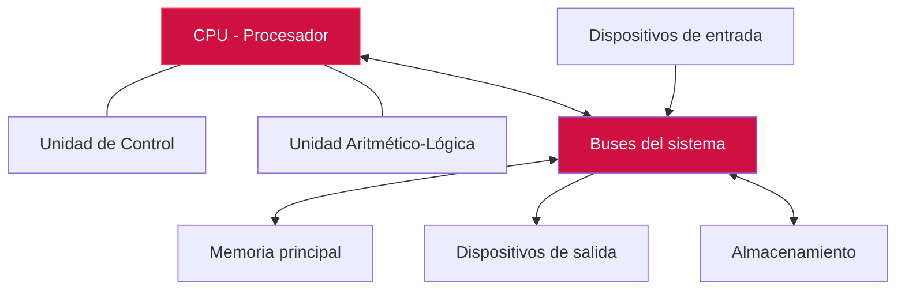
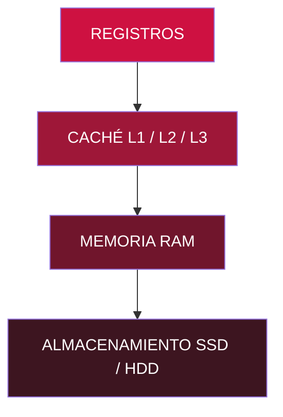
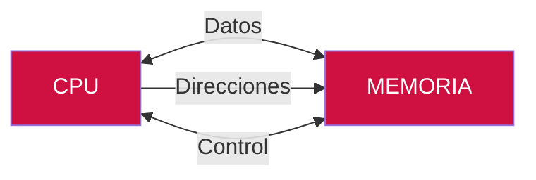
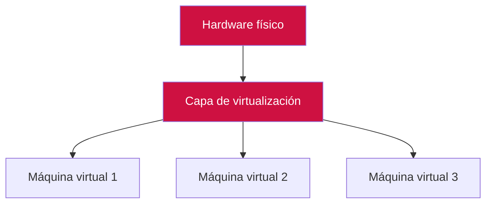

# Sistemas informáticos: estructura funcional

`Fundamentos de Hardware | ASIR`

---

[← Volver al temario](../README.md)

## Índice

1. [Arquitectura de Von Neumann](#1-arquitectura-de-von-neumann)
2. [Jerarquía de memoria y buses](#2-jerarquía-de-memoria-y-buses)
3. [Software y seguridad](#3-software-y-seguridad)
4. [Utilidades del sistema](#4-utilidades-del-sistema)
5. [Arquitecturas modernas y virtualización](#5-arquitecturas-modernas-y-virtualización)
6. [Conceptos clave](#6-conceptos-clave)
7. [Preguntas de repaso](#7-preguntas-de-repaso)
8. [Práctica](#8-práctica)

---

## 1. Arquitectura de Von Neumann

### 1.1. El sistema informático

Un sistema informático es un conjunto de elementos
que trabajan de forma coordinada para procesar información.

| Elemento | Definición |
|---|---|
| Hardware | Componentes físicos del ordenador. |
| Software | Programas e instrucciones. |
| Usuarios | Personas que utilizan el sistema. |

### Componentes funcionales

| Componente | Función |
|---|---|
| CPU | Procesa datos y ejecuta instrucciones. |
| Memoria principal | Almacena los datos y programas en ejecución. |
| Entrada y salida (E/S) | Permite introducir y obtener información. |
| Buses | Comunican los componentes del ordenador. |

### 1.2. Arquitectura de Von Neumann

Modelo de arquitectura informática propuesto en 1945.

Su característica principal es que los datos y las
instrucciones se almacenan en la misma memoria.

Esto se conoce como **programa almacenado**.

Gracias a ello, un mismo ordenador puede ejecutar
diferentes programas sin modificar físicamente el hardware.

### Componentes de la arquitectura

- **UC (Unidad de Control):** interpreta las instrucciones y dirige su ejecución.
- **ALU (Unidad Aritmético-Lógica):** realiza operaciones matemáticas y lógicas.
- **Memoria:** almacena datos e instrucciones.
- **Entrada y salida:** permite la comunicación con los dispositivos.

La Unidad de Control y la ALU son partes fundamentales
de la CPU.

### Von Neumann vs Harvard

| Característica | Von Neumann | Harvard |
|---|---|---|
| Memoria de datos | Compartida | Independiente |
| Memoria de instrucciones | Compartida | Independiente |
| Organización | Memoria común | Memorias separadas |
| Uso habitual | Ordenadores | Algunos microcontroladores |

> [!IMPORTANT]
> La diferencia fundamental es que Von Neumann utiliza
> una memoria común para datos e instrucciones,
> mientras que Harvard las separa.

### 1.3. Ciclo de instrucción

El procesador ejecuta los programas repitiendo
continuamente tres fases.

| Fase | Nombre | Función |
|---|---|---|
| 01 | Fetch | Buscar la siguiente instrucción en memoria. |
| 02 | Decode | Interpretar la instrucción y los datos necesarios. |
| 03 | Execute | Ejecutar la operación y guardar el resultado. |

El contador de programa indica cuál es la siguiente
instrucción que debe buscarse.

### Ejemplo sencillo

Para realizar una suma:

1. La CPU busca la instrucción.
2. La Unidad de Control interpreta que debe sumar.
3. La ALU realiza la suma.
4. Se guarda el resultado y continúa el ciclo.

### Frecuencia de reloj

Indica el número de ciclos de reloj por segundo.

| Unidad | Equivalencia |
|---|---:|
| Hz | 1 ciclo por segundo |
| MHz | 1 millón de ciclos por segundo |
| GHz | 1.000 millones de ciclos por segundo |

Una instrucción puede necesitar uno o varios ciclos
de reloj.

**Más GHz no significa necesariamente más rendimiento.**

También influyen la memoria, los buses, el almacenamiento
y las características del procesador.

---

## 2. Jerarquía de memoria y buses

### 2.1. Jerarquía de memoria

Los ordenadores utilizan diferentes tipos de memoria
para equilibrar velocidad, capacidad y coste.

| Memoria | Velocidad | Capacidad | Permanente |
|---|---|---|---|
| Registros | Máxima | Muy pequeña | No |
| Caché | Muy alta | Pequeña | No |
| RAM | Alta | Media | No |
| SSD/HDD | Menor | Muy grande | Sí |

### Registros

- Se encuentran dentro del procesador.
- Son las memorias más rápidas.
- Almacenan temporalmente información utilizada por la CPU.
- Tienen una capacidad muy reducida.

### Memoria caché

- Memoria muy rápida y cercana al procesador.
- Guarda los datos utilizados con mayor frecuencia.
- Reduce las esperas de acceso a la RAM.
- Se organiza en niveles L1, L2 y L3.

### Memoria RAM

- Almacena los programas y datos en ejecución.
- Es más lenta que la caché.
- Es volátil: pierde su contenido al apagar el equipo.

### Almacenamiento secundario

- Incluye los discos HDD y las unidades SSD.
- Conserva la información sin corriente eléctrica.
- Ofrece mucha capacidad.
- Es más lento que la memoria RAM.

### Regla fundamental

| Cerca de la CPU | Lejos de la CPU |
|---|---|
| Mayor velocidad | Menor velocidad |
| Menor capacidad | Mayor capacidad |
| Mayor coste por bit | Menor coste por bit |

### Principio de localidad

Los programas suelen reutilizar datos e instrucciones
o acceder a posiciones de memoria cercanas.

La caché aprovecha este comportamiento para evitar
accesos constantes a memorias más lentas.

### Cuello de botella

Se produce cuando un componente limita el rendimiento
del conjunto del sistema.

Ejemplos:

- Poca RAM: el equipo necesita utilizar más el disco.
- HDD lento: los programas tardan en abrirse.
- CPU saturada: las operaciones tardan más en completarse.

Cambiar un HDD por un SSD o ampliar la RAM puede
mejorar el rendimiento sin cambiar el procesador.

---

### 2.2. Buses, canales e interfaces

Los buses son las vías de comunicación por las que
circula la información entre los componentes.

| Tipo de bus | Qué transporta |
|---|---|
| Bus de datos | La información que se transfiere. |
| Bus de direcciones | La ubicación de memoria donde leer o escribir. |
| Bus de control | Las señales que coordinan las operaciones. |

### Características de los buses

- **Anchura:** cantidad de bits que pueden transferirse de golpe.
- **Velocidad:** influye en la rapidez de las transferencias.

Un bus lento puede limitar el rendimiento de una CPU rápida.

### Interfaces especializadas

| Interfaz | Uso habitual |
|---|---|
| PCIe | Tarjetas de expansión y almacenamiento rápido. |
| SATA | Unidades de almacenamiento. |
| USB | Periféricos y dispositivos externos. |

---

## 3. Software y seguridad

### 3.1. Clasificación del software por función

| Tipo | Función | Ejemplos |
|---|---|---|
| Software de sistema | Gestionar el ordenador. | Windows, Linux, drivers. |
| Software de programación | Crear otros programas. | Editores, compiladores, IDE. |
| Software de aplicación | Realizar tareas del usuario. | Navegadores, ofimática, diseño. |

El software de propósito general permite realizar
tareas habituales como navegar, editar documentos
o comprimir archivos.

### 3.2. Clasificación por licencia

| Licencia | Características | Ejemplos |
|---|---|---|
| Propietario | Código cerrado y uso restringido. | Windows, Microsoft Office. |
| Libre / código abierto | Permite estudiar, modificar y distribuir según su licencia. | Linux, LibreOffice. |
| Freeware | Uso gratuito, normalmente con restricciones sobre el código. | Aplicaciones gratuitas. |
| Shareware | Versión de prueba o con funciones limitadas. | Programas de evaluación. |

> [!IMPORTANT]
> Software libre no significa necesariamente software gratuito.
> Que un programa sea gratuito tampoco significa que pueda
> utilizarse libremente en una empresa.

Las organizaciones deben controlar el número de licencias,
sus condiciones y el software instalado.

### 3.3. Instalación segura de aplicaciones

- [ ] Descargar desde fuentes oficiales.
- [ ] Comprobar la licencia de uso.
- [ ] Verificar la firma digital o el hash.
- [ ] Revisar las opciones del instalador.
- [ ] Rechazar aplicaciones adicionales no deseadas.
- [ ] Mantener el software actualizado.
- [ ] Utilizar cuentas sin privilegios para el uso diario.

### Conceptos de seguridad

| Concepto | Definición |
|---|---|
| Malware | Software malicioso. |
| Adware | Software que muestra publicidad, a veces no deseada. |
| Hash | Huella que permite comprobar la integridad de un archivo. |
| Firma digital | Permite verificar autenticidad e integridad. |
| Vulnerabilidad | Debilidad que puede comprometer la seguridad. |

Ejemplo: un instalador descargado de una página no oficial
puede incluir adware o malware oculto.

---

## 4. Utilidades del sistema

### 4.1. Compresores y gestión de archivos

Los compresores permiten reducir el tamaño de los archivos
y agruparlos en un único contenedor.

La compresión de archivos estudiada en esta unidad
es sin pérdida: al descomprimir se recupera el original.

| Formato | Características |
|---|---|
| ZIP | Universal y ampliamente compatible. |
| 7z | Alta compresión mediante LZMA y LZMA2. |
| TAR | Agrupa archivos, habitual en Linux. |
| TAR.GZ | Agrupación TAR y compresión GZIP. |
| TAR.XZ | Agrupación TAR y compresión XZ. |

### 7-Zip

Herramienta de compresión cuya mayor parte del código
se distribuye bajo licencia GNU LGPL.

Admite formatos como:

- 7z.
- ZIP.
- XZ.
- BZIP2.
- GZIP.
- TAR.
- WIM.

### Utilidades de gestión de archivos

- Búsqueda avanzada.
- Comparación de archivos y carpetas.
- Renombrado por lotes.
- Cálculo de hashes.
- Comprobación de integridad.

Comprimir archivos facilita el almacenamiento,
la organización y las transferencias por red.

### 4.2. Utilidades de seguridad

| Herramienta | Función |
|---|---|
| Antivirus | Detecta y combate software malicioso. |
| Antiespías | Detecta programas de espionaje. |
| Cortafuegos | Controla el tráfico de red. |

### Antivirus

Puede detectar amenazas mediante:

- Firmas de malware conocido.
- Comportamientos sospechosos.
- Protección en tiempo real.
- Análisis bajo demanda o programados.

Ejemplo en Linux: ClamAV, antivirus libre bajo GPLv2,
habitual en servidores de correo y archivos.

### Cortafuegos (Firewall)

Filtra las conexiones entrantes y salientes mediante reglas.

Las reglas pueden aplicarse según:

- Dirección de red.
- Puerto.
- Protocolo.
- Aplicación.

### Perfiles del cortafuegos de Windows

| Perfil | Entorno |
|---|---|
| Dominio | Redes de dominio de una organización. |
| Privado | Redes de confianza. |
| Público | Redes no consideradas de confianza. |

Por defecto, el cortafuegos de Windows bloquea el tráfico
entrante no solicitado o no autorizado y permite el saliente
salvo que exista una regla que lo impida.

En Linux existen herramientas como ufw y firewalld.

> [!WARNING]
> No es recomendable mantener dos antivirus con protección
> en tiempo real funcionando simultáneamente.
> Pueden interferir y reducir el rendimiento.

Las herramientas de seguridad deben permanecer actualizadas.

### 4.3. Aplicaciones portables y no portables

| Característica | Portable | Instalable |
|---|---|---|
| Instalación | No necesita | Sí necesita |
| Privilegios | Normalmente no requiere administrador | Suele requerir administrador |
| Configuración | Junto al programa | En el sistema |
| Registro en el sistema | Normalmente no | Sí |
| Inventario centralizado | Más complicado | Más sencillo |
| Asociaciones y servicios | Normalmente no crea | Puede crear |
| Actualizaciones centralizadas | Más difíciles | Más fáciles |

### Aplicaciones portables

Ventajas:

- Pueden ejecutarse desde una memoria USB.
- No necesitan una instalación tradicional.
- Son útiles para tareas de diagnóstico.
- Aportan flexibilidad.

Desventajas:

- Dificultan el inventario de software.
- Complican las actualizaciones centralizadas.
- Pueden eludir políticas de seguridad.

En Linux, AppImage es un ejemplo de distribución
de aplicaciones sin instalación tradicional.

Hay que comprobar la licencia tanto de las aplicaciones
portables como de las instalables.

---

## 5. Arquitecturas modernas y virtualización

### Arquitecturas de procesadores

| Arquitectura | Características |
|---|---|
| x86 | Habitual en ordenadores Intel y AMD. |
| ARM | Eficiente energéticamente; presente en móviles, portátiles y servidores. |
| RISC-V | Arquitectura de instrucciones abierta. |

La arquitectura del procesador influye en la
compatibilidad del software.

### Sistemas heterogéneos

Combinan diferentes unidades especializadas.

| Unidad | Función |
|---|---|
| CPU | Procesamiento general. |
| GPU | Procesamiento gráfico y tareas paralelas. |
| NPU | Operaciones relacionadas con inteligencia artificial. |

### SaaS (Software as a Service)

Software que se utiliza como servicio en la nube,
normalmente desde el navegador.

Ejemplos:

- Correo electrónico web.
- Aplicaciones ofimáticas online.
- Aplicaciones de gestión en la nube.

Ventaja: reduce la necesidad de instalaciones locales.

Desventaja: dependencia de la conexión y del proveedor.

### Virtualización

Permite ejecutar varios sistemas operativos sobre
un mismo equipo físico mediante máquinas virtuales.

### Contenedores

Empaquetan una aplicación junto con sus dependencias
para facilitar su despliegue y ejecución en
diferentes entornos compatibles.

---

## 6. Conceptos clave

| Concepto | Lo que debo recordar |
|---|---|
| Hardware | Parte física. |
| Software | Programas e instrucciones. |
| CPU | Ejecuta instrucciones. |
| UC | Interpreta y coordina. |
| ALU | Calcula y realiza operaciones lógicas. |
| Von Neumann | Datos e instrucciones en la misma memoria. |
| Harvard | Memorias separadas. |
| Fetch | Buscar la instrucción. |
| Decode | Interpretar la instrucción. |
| Execute | Ejecutar la instrucción. |
| GHz | Ciclos de reloj por segundo, en miles de millones. |
| Registros | Memoria más rápida. |
| Caché | Reduce accesos a la RAM. |
| RAM | Memoria principal volátil. |
| SSD/HDD | Almacenamiento permanente. |
| Bus de datos | Transporta información. |
| Bus de direcciones | Indica ubicaciones. |
| Bus de control | Coordina operaciones. |
| Hash | Comprueba la integridad. |
| Firewall | Filtra el tráfico de red. |
| Portable | Aplicación sin instalación tradicional. |
| SaaS | Software como servicio. |
| Virtualización | Varios sistemas sobre un mismo hardware. |

---

## 7. Preguntas de repaso

Intenta responder antes de desplegar la solución.

01. ¿Qué elementos forman un sistema informático?

Hardware, software y usuarios.

02. ¿Cuál es la característica principal de Von Neumann?

Los datos y las instrucciones comparten la misma memoria.

03. ¿Qué diferencia existe entre Von Neumann y Harvard?

Harvard utiliza memorias separadas para datos e instrucciones.

04. ¿Qué función tiene la ALU?

Realizar operaciones aritméticas y lógicas.

05. ¿Qué función tiene la Unidad de Control?

Interpretar instrucciones y coordinar su ejecución.

06. ¿Cuáles son las fases del ciclo de instrucción?

Fetch, Decode y Execute.

07. ¿Qué mide la frecuencia de reloj?

El número de ciclos de reloj por segundo.

08. Ordena las memorias de mayor a menor velocidad.

Registros, caché, RAM y almacenamiento secundario.

09. ¿Qué significa que la RAM sea volátil?

Que pierde su contenido cuando deja de recibir corriente.

10. ¿Para qué sirve la caché?

Para almacenar información de uso frecuente y reducir
los accesos a memorias más lentas.

11. ¿Cuáles son los tres tipos principales de buses?

Bus de datos, bus de direcciones y bus de control.

12. ¿Qué es un cuello de botella?

Un componente que limita el rendimiento del conjunto.

13. ¿Cómo se clasifica el software por función?

De sistema, de programación y de aplicación.

14. ¿Software libre y gratuito significan lo mismo?

No. El software libre se define por las libertades
que concede su licencia, no por su precio.

15. ¿Cuál es la diferencia entre freeware y shareware?

Freeware es de uso gratuito y shareware suele ofrecer
una versión de prueba o con limitaciones.

16. ¿Para qué sirve un hash?

Para comprobar que un archivo no ha sido alterado,
comparándolo con una suma de referencia fiable.

17. ¿Cuál es la diferencia entre antivirus y firewall?

El antivirus detecta software malicioso.
El firewall controla el tráfico de red.

18. ¿Qué caracteriza a una aplicación portable?

Puede ejecutarse sin una instalación tradicional.

19. ¿Qué es SaaS?

Software que se utiliza como servicio a través de la nube.

20. ¿Qué permite la virtualización?

Ejecutar varios sistemas operativos sobre un mismo
hardware mediante máquinas virtuales.

21. ¿Qué diferencia hay entre CPU, GPU y NPU?

La CPU realiza procesamiento general, la GPU se
especializa en gráficos y tareas paralelas, y la NPU
en operaciones de inteligencia artificial.

---

## 8. Práctica

### Análisis de un sistema informático

- [ ] Identificar los componentes de mi ordenador.
- [ ] Representar la arquitectura de Von Neumann.
- [ ] Identificar el procesador.
- [ ] Comprobar la cantidad de memoria RAM.
- [ ] Identificar el almacenamiento.
- [ ] Clasificar programas por función y licencia.
- [ ] Elaborar un procedimiento de instalación segura.
- [ ] Comprobar la integridad de una descarga.

---

## Resumen final

El ordenador funciona mediante la colaboración entre
el procesador, la memoria, los buses y los periféricos.

La arquitectura de Von Neumann almacena datos e
instrucciones en una memoria común.

La CPU ejecuta instrucciones mediante el ciclo
Fetch - Decode - Execute.

La jerarquía de memoria equilibra velocidad,
capacidad y coste.

El software permite utilizar el hardware y debe
instalarse respetando las licencias y las medidas
de seguridad.

---

Fuente: Fundamentos de Hardware, Unidad 1.
Prometeo - thePower. Apuntes personales.

---

`UNIDAD 01 | FUNDAMENTOS DE HARDWARE`

[Volver al temario](../README.md)

