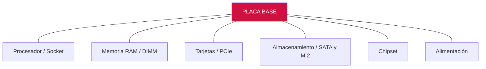
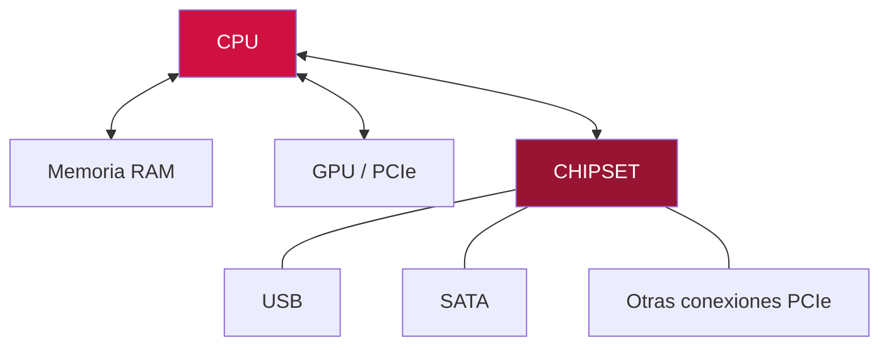
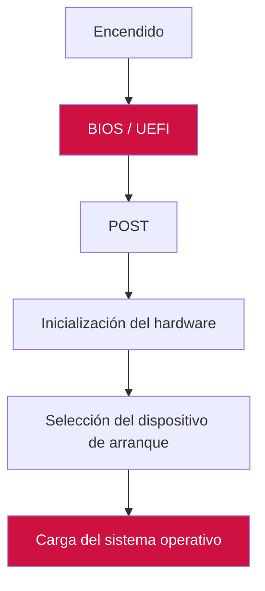
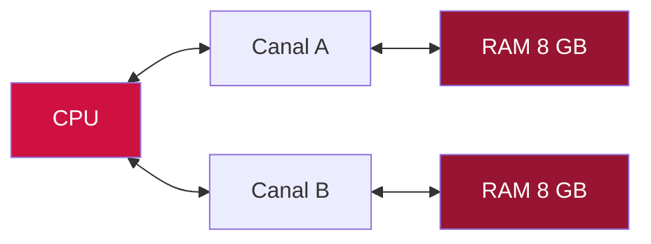
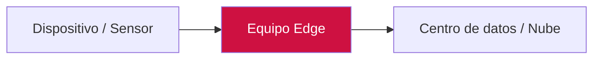

# Estructura física: la placa base

`Fundamentos de Hardware | ASIR`

---

[← Volver al temario](../README.md)

## Índice

1. [Componentes físicos del sistema](#1-componentes-físicos-del-sistema)
2. [Chipset, ranuras y conectores](#2-chipset-ranuras-y-conectores)
3. [Memoria RAM](#3-memoria-ram)
4. [Plataformas modernas](#4-plataformas-modernas)
5. [Conceptos clave](#5-conceptos-clave)
6. [Preguntas de repaso](#6-preguntas-de-repaso)
7. [Práctica](#7-práctica)

---

## 1. Componentes físicos del sistema

### 1.1. Componentes de un ordenador

| Componente | Función |
|---|---|
| Placa base | Conecta y comunica los componentes. |
| CPU | Ejecuta instrucciones y procesa información. |
| RAM | Almacena temporalmente datos y programas. |
| GPU | Procesa gráficos y tareas paralelas. |
| SSD/HDD | Almacena información de forma permanente. |
| Fuente de alimentación | Suministra energía eléctrica. |
| Refrigeración | Evacua el calor de los componentes. |
| Tarjetas de expansión | Añaden funcionalidades al equipo. |

### 1.2. La placa base

La placa base (motherboard) es el circuito impreso
principal sobre el que se conectan los componentes
de un ordenador.

Determina gran parte de la compatibilidad y las
posibilidades de ampliación del equipo.

### Factores de forma

El factor de forma es un estándar que determina:

- Las dimensiones de la placa base.
- La posición de sus anclajes.
- La distribución de sus componentes.
- La caja compatible.
- Las posibilidades de expansión.

| Formato | Tamaño relativo | Expansión | Uso habitual |
|---|---|---|---|
| ATX | Estándar | Alta | Sobremesa y estaciones de trabajo |
| Micro-ATX | Reducido | Media | Equipos de oficina |
| Mini-ITX | Muy compacto | Limitada | Mini-PC |
| E-ATX | Grande | Alta | Estaciones de trabajo y determinadas plataformas de servidor |

Existen también formatos específicos y propietarios
para servidores instalados en armarios rack.

Las dimensiones exactas deben comprobarse en las
especificaciones del fabricante.

> [!IMPORTANT]
> Antes de comprar una placa base, comprueba que
> su factor de forma sea compatible con la caja.

### 1.3. El socket

El socket es el zócalo de la placa base donde se
instala el procesador.

Determina:

- Los procesadores que se pueden instalar.
- La disposición y el número de contactos.
- El sistema de anclaje del procesador.
- La compatibilidad de la refrigeración.

Ejemplos de sockets mencionados en el temario:

| Fabricante | Socket |
|---|---|
| Intel | LGA 1851 |
| AMD | AM5 |

Los sockets cambian entre generaciones.

Aunque dos procesadores utilicen el mismo socket,
también hay que comprobar la lista de CPU admitidas
y la versión de BIOS/UEFI necesaria.

### Comprobaciones de compatibilidad

- Socket de la placa y del procesador.
- Chipset compatible.
- Lista oficial de procesadores admitidos.
- Versión de BIOS/UEFI.
- Anclaje del disipador.
- Factor de forma de la caja.

La QVL (Qualified Vendor List) permite consultar
componentes, especialmente memorias, que el fabricante
ha validado para la placa.

> [!WARNING]
> Nunca se debe forzar un procesador en un socket.
> Una incompatibilidad puede provocar daños físicos.

---

## 2. Chipset, ranuras y conectores

### 2.1. El chipset

El chipset es el conjunto de circuitos que gestiona
parte de la comunicación entre los componentes.

Determina las funciones y límites de la plataforma:

- Cantidad de puertos USB.
- Conectividad SATA.
- Líneas PCI Express.
- Posibilidades de expansión.
- Compatibilidad con determinadas funciones.
- Posibilidad de realizar overclocking.

En los procesadores modernos, algunas funciones
tradicionales del chipset se han integrado dentro
de la propia CPU.

Esquema simplificado de una plataforma moderna.

### Diferencia entre socket y chipset

| Socket | Chipset |
|---|---|
| Zócalo físico del procesador. | Conjunto de circuitos de comunicación. |
| Condiciona qué CPU se puede instalar. | Determina conexiones y funcionalidades. |

Ambos son fundamentales al elegir una placa base.

### 2.2. Ranuras y conectores

| Conexión | Función |
|---|---|
| PCI Express | Tarjetas gráficas, de red y otras expansiones. |
| DIMM | Instalación de memoria RAM. |
| SATA | Conexión de discos HDD y SSD SATA. |
| M.2 | Conexión de dispositivos compactos, como SSD NVMe. |
| USB | Conexión de periféricos. |

### PCI Express (PCIe)

Interfaz de comunicación de alta velocidad utilizada
para conectar tarjetas y unidades de almacenamiento.

| Configuración | Número de líneas |
|---|---:|
| PCIe x1 | 1 |
| PCIe x4 | 4 |
| PCIe x8 | 8 |
| PCIe x16 | 16 |

Un mayor número de líneas permite un mayor ancho
de banda dentro de la misma generación.

Las tarjetas gráficas utilizan habitualmente
ranuras PCIe x16.

El tamaño físico de una ranura no garantiza que
disponga de todas las líneas eléctricas posibles.

### SATA, M.2 y NVMe

| Concepto | Definición |
|---|---|
| SATA | Interfaz de conexión de almacenamiento. |
| M.2 | Formato físico y conector para dispositivos compactos. |
| NVMe | Protocolo de almacenamiento utilizado por SSD sobre PCIe. |

Un SSD M.2 NVMe suele ofrecer un rendimiento superior
al de un SSD SATA.

> [!NOTE]
> M.2 no significa necesariamente NVMe.
> Existen unidades M.2 SATA y M.2 NVMe.
> Hay que comprobar qué admite la placa.

### 2.3. BIOS y UEFI

La BIOS y la UEFI son firmware que prepara el
ordenador antes de iniciar el sistema operativo.

El firmware es software integrado en un dispositivo.

### Proceso de arranque

### POST

Power-On Self-Test.

Es la comprobación inicial del hardware que realiza
el equipo durante el arranque.

Permite detectar determinados problemas de CPU,
memoria y otros componentes.

### Diferencias entre BIOS y UEFI

| Característica | BIOS clásica | UEFI |
|---|---|---|
| Tecnología | Tradicional | Moderna |
| Interfaz | Generalmente de texto | Puede ser gráfica |
| Arranque habitual | MBR | GPT |
| Discos grandes | Limitación habitual de unos 2 TB con MBR | Admite discos superiores con GPT |
| Secure Boot | No | Disponible |
| Funciones | Más limitadas | Más avanzadas |

### Configuración de la UEFI

Desde la UEFI podemos:

- Comprobar el procesador y la memoria detectados.
- Consultar los discos conectados.
- Configurar el orden de arranque.
- Modificar fecha y hora.
- Configurar determinadas opciones del hardware.
- Activar o configurar Secure Boot.
- Modificar parámetros de rendimiento compatibles.

### Secure Boot

Función de seguridad que verifica la confianza
del software de arranque antes de permitir su ejecución.

Ayuda a proteger el sistema frente a determinados
programas maliciosos que intentan ejecutarse al arrancar.

### 2.4. Overclocking

Consiste en aumentar la frecuencia de funcionamiento
de un componente por encima de su configuración de fábrica.

Puede aplicarse al procesador o a la memoria
si la plataforma lo permite.

| Ventajas | Inconvenientes |
|---|---|
| Mayor rendimiento potencial. | Mayor temperatura. |
| Aprovechamiento adicional del hardware. | Mayor consumo eléctrico. |
| | Posible inestabilidad. |
| | Reducción de la vida útil. |
| | Posibles limitaciones de garantía. |

Requiere componentes compatibles, refrigeración
adecuada y una fuente de calidad.

> [!IMPORTANT]
> En servidores y equipos de producción se prioriza
> la estabilidad y la fiabilidad frente al overclocking.

---

## 3. Memoria RAM

### 3.1. Funcionamiento general

RAM significa Random Access Memory.

Es la memoria principal de trabajo del ordenador.

Características:

- Almacena los programas y datos en ejecución.
- Es rápida.
- Permite el acceso directo a sus posiciones.
- Es volátil: pierde su contenido sin alimentación.

Cuando la RAM es insuficiente, el sistema puede
utilizar parte del almacenamiento como memoria
virtual o espacio de intercambio (swap).

El almacenamiento es más lento que la RAM,
por lo que puede reducirse considerablemente
el rendimiento.

### 3.2. Generaciones DDR

DDR significa Double Data Rate.

Las generaciones DDR han evolucionado aumentando
la velocidad y la capacidad, y mejorando la eficiencia.

| Generación | Características generales |
|---|---|
| DDR3 | Generación anterior. |
| DDR4 | Mayor velocidad y eficiencia que DDR3. |
| DDR5 | Mayor velocidad y capacidad potencial que DDR4. |

Las generaciones DDR3, DDR4 y DDR5 no son
intercambiables.

Sus muescas y características eléctricas son distintas.

Las velocidades y voltajes concretos deben consultarse
en las especificaciones JEDEC y del fabricante.

### Formatos de memoria

| Formato | Uso |
|---|---|
| DIMM | Ordenadores de sobremesa y servidores. |
| SO-DIMM | Portátiles y equipos compactos. |

### Compatibilidad de la RAM

Antes de comprar memoria hay que comprobar:

- Generación DDR admitida.
- Formato físico.
- Capacidad máxima admitida.
- Velocidades compatibles.
- Número de ranuras disponibles.
- Compatibilidad con CPU y placa base.
- Configuración recomendada por el fabricante.

### 3.3. Configuración multicanal

El modo multicanal aumenta el ancho de banda
entre el procesador y la memoria.

| Configuración | Canales |
|---|---:|
| Single channel | 1 |
| Dual channel | 2 |
| Quad channel | 4 |

Para aprovechar el dual channel se recomienda
instalar módulos compatibles, preferiblemente
idénticos, en las ranuras indicadas por el fabricante.

### Ejemplo práctico

| Configuración | Capacidad total | Canales |
|---|---:|---:|
| 1 módulo de 16 GB | 16 GB | 1 |
| 2 módulos de 8 GB | 16 GB | 2 |

Ambas configuraciones tienen la misma capacidad.

Sin embargo, la segunda puede proporcionar
aproximadamente el doble de ancho de banda teórico,
si la plataforma funciona en dual channel.

Esto no significa que todos los programas
vayan a funcionar el doble de rápido.

> [!IMPORTANT]
> Consulta el manual de la placa para saber
> en qué ranuras debes instalar los módulos.
> En muchas placas de cuatro ranuras se recomienda
> utilizar A2 y B2, pero no es una regla universal.

---

## 4. Plataformas modernas

### PCI Express y DDR5

El temario destaca la evolución de PCIe y la RAM.

| Tecnología | Evolución |
|---|---|
| PCIe | 3.0, 4.0, 5.0 y 6.0 |
| RAM DDR | DDR3, DDR4 y DDR5 |

Las generaciones sucesivas de PCIe aumentan
el ancho de banda disponible por línea.

PCIe 5.0 duplica el ancho de banda nominal
por línea de PCIe 4.0.

Esto beneficia especialmente a:

- Tarjetas gráficas.
- SSD NVMe de alto rendimiento.
- Tarjetas de expansión de alta velocidad.

### Placas de consumo y servidor

| Característica | Consumo | Servidor |
|---|---|---|
| Uso | Personal y oficina | Servicios y centros de datos |
| Procesadores | Habitualmente uno | Uno o varios |
| Memoria RAM | Capacidad convencional | Mayor capacidad |
| ECC | Depende de la plataforma | Habitual |
| Expansión PCIe | Según modelo | Habitualmente elevada |
| Gestión remota | Limitada | IPMI/BMC y otras funciones |
| Prioridad | Precio y rendimiento | Fiabilidad y escalabilidad |

La memoria ECC permite detectar y corregir
determinados errores de memoria.

IPMI y BMC están relacionados con la supervisión
y administración remota de servidores.

Las plataformas de servidor también pueden
incorporar componentes redundantes.

### Edge computing

Consiste en realizar procesamiento cerca del lugar
donde se generan los datos.

Ejemplos de entornos:

- Fábricas.
- Tiendas.
- Instalaciones industriales.
- Antenas de comunicaciones.

Sus equipos suelen ser compactos, robustos
y de bajo consumo.

Pueden utilizar procesadores ARM y diseños
adaptados a condiciones exigentes.

---

## 5. Conceptos clave

| Concepto | Definición rápida |
|---|---|
| Placa base | Circuito principal del ordenador. |
| Factor de forma | Estándar físico de la placa. |
| ATX | Formato habitual de sobremesa. |
| Socket | Zócalo del procesador. |
| Chipset | Gestiona comunicaciones y funciones. |
| PCIe | Interfaz de alta velocidad. |
| DIMM | Formato habitual de RAM de sobremesa. |
| SO-DIMM | Formato compacto de RAM. |
| SATA | Interfaz de almacenamiento. |
| M.2 | Formato físico y conector. |
| NVMe | Protocolo de almacenamiento sobre PCIe. |
| BIOS | Firmware de arranque tradicional. |
| UEFI | Firmware de arranque moderno. |
| POST | Comprobación inicial del hardware. |
| Secure Boot | Verificación del software de arranque. |
| Overclocking | Aumento de frecuencia sobre la de fábrica. |
| DDR | Tecnología de memoria RAM. |
| Dual channel | Uso de dos canales de memoria. |
| ECC | Detección y corrección de errores de memoria. |
| Edge | Procesamiento próximo al origen de los datos. |

---

## 6. Preguntas de repaso

01. ¿Qué función tiene la placa base?

Conectar y comunicar los componentes del ordenador.

02. ¿Qué determina el factor de forma?

Las dimensiones, los anclajes, la caja compatible
y las posibilidades de expansión.

03. ¿Qué formato es más compacto: ATX o Mini-ITX?

Mini-ITX.

04. ¿Qué es el socket?

El zócalo de la placa base donde se instala la CPU.

05. ¿Qué función tiene el chipset?

Gestionar parte de las comunicaciones y determinar
las conexiones y funcionalidades de la plataforma.

06. ¿Es suficiente comprobar el socket para elegir una CPU?

No. También hay que comprobar el chipset, la lista
de procesadores admitidos y la versión de firmware.

07. ¿Para qué sirve PCI Express?

Para comunicar tarjetas de expansión y dispositivos
de alta velocidad, como GPU y SSD NVMe.

08. ¿Cuántas líneas tiene PCIe x16?

Dieciséis líneas en una conexión x16 completa.

09. ¿Qué diferencia hay entre M.2 y NVMe?

M.2 es un formato físico y conector.
NVMe es un protocolo de almacenamiento sobre PCIe.

10. ¿Qué es la BIOS?

El firmware tradicional que inicializa el hardware
y prepara el arranque del sistema.

11. ¿Qué ventajas tiene UEFI?

Admite funciones modernas de arranque, discos grandes
mediante GPT y opciones de seguridad como Secure Boot.

12. ¿Qué significa POST?

Power-On Self-Test: comprobación inicial del hardware.

13. ¿Para qué sirve Secure Boot?

Para verificar la confianza del software de arranque.

14. ¿Qué es el overclocking?

Aumentar la frecuencia de funcionamiento de un
componente por encima de su configuración de fábrica.

15. ¿Qué riesgos tiene el overclocking?

Mayor temperatura, consumo, inestabilidad
y posible reducción de la vida útil.

16. ¿Se puede instalar DDR4 en una placa DDR5?

No. Las generaciones DDR son incompatibles entre sí.

17. ¿Qué diferencia existe entre DIMM y SO-DIMM?

SO-DIMM es más compacto y se utiliza habitualmente
en portátiles.

18. ¿Qué ventaja ofrece el dual channel?

Aumenta el ancho de banda entre CPU y RAM.

19. ¿Qué ocurre cuando la RAM es insuficiente?

El sistema puede utilizar el almacenamiento como
memoria virtual, reduciendo el rendimiento.

20. ¿Qué caracteriza a una placa de servidor?

Mayor capacidad de memoria, fiabilidad, expansión,
gestión remota y soporte habitual de ECC.

21. ¿Qué es edge computing?

Procesar información cerca del lugar donde se genera.

---

## 7. Práctica

### Identificación de una placa base

- [ ] Identificar fabricante y modelo.
- [ ] Identificar el socket.
- [ ] Identificar el chipset.
- [ ] Comprobar el factor de forma.
- [ ] Localizar las ranuras DIMM.
- [ ] Localizar las ranuras PCIe.
- [ ] Identificar los conectores SATA y M.2.
- [ ] Comprobar la generación de RAM compatible.
- [ ] Consultar el manual y la lista de compatibilidad.
- [ ] Planificar una ampliación en dual channel.

### Configuración de la plataforma

- [ ] Elegir una placa compatible con una CPU concreta.
- [ ] Comparar una placa de consumo y una de servidor.
- [ ] Consultar el hardware reconocido desde la UEFI.
- [ ] Identificar el orden de arranque.
- [ ] Consultar el estado de Secure Boot.
- [ ] Documentar la configuración.

No modificar opciones de arranque o seguridad
sin conocer sus consecuencias.

---

## Resumen final

La placa base conecta y comunica los componentes.

El factor de forma determina sus dimensiones
y compatibilidad con la caja.

El socket y el chipset condicionan la compatibilidad
y las funciones disponibles.

La UEFI inicializa el hardware y prepara el arranque.

La RAM debe ser compatible con la plataforma.

El dual channel aumenta el ancho de banda.

Las plataformas de servidor priorizan fiabilidad,
capacidad y administración remota.

---

Fuente: Fundamentos de Hardware, Unidad 2.
Prometeo - thePower. Apuntes personales.

---

`UNIDAD 02 | FUNDAMENTOS DE HARDWARE`

[Volver al temario](../README.md)

