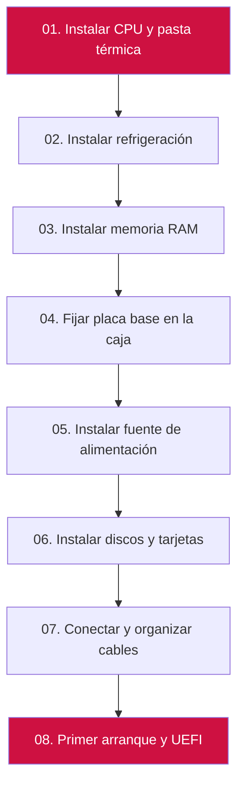
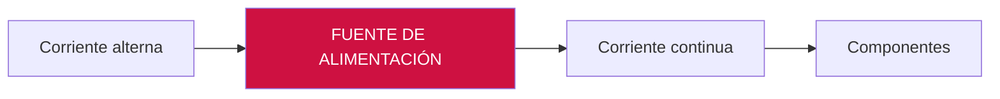
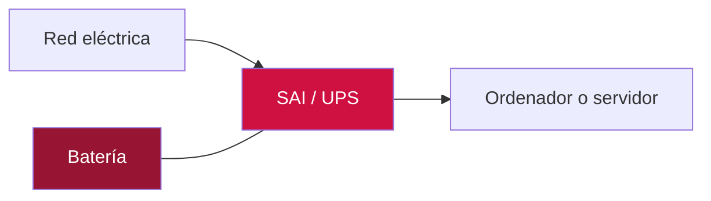
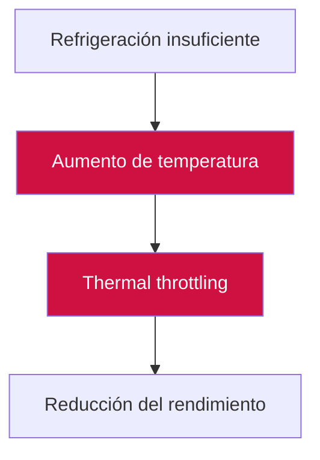
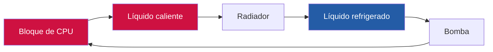
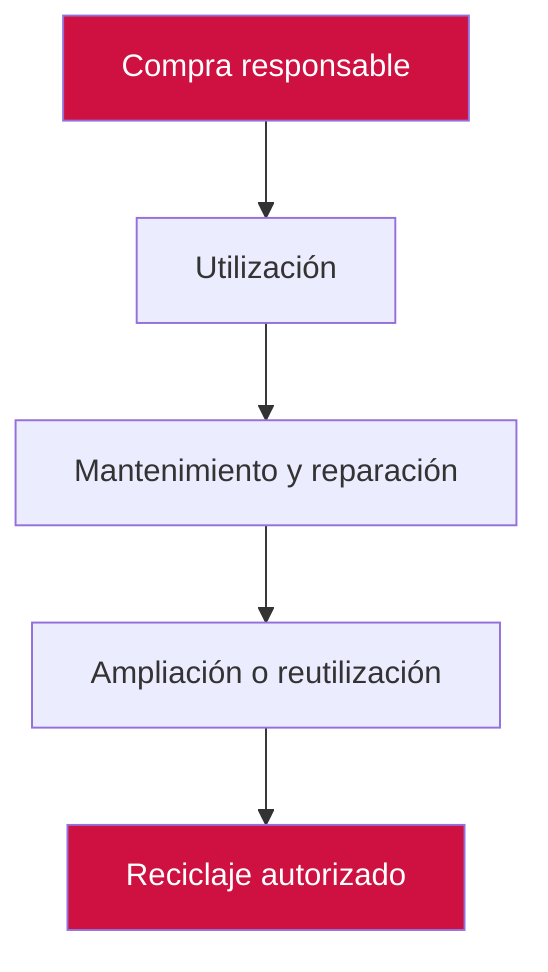

# Soporte, conexionado, cajas, alimentación y BIOS

`Fundamentos de Hardware | ASIR`

---

[← Volver al temario](../README.md)

## Índice

1. [Seguridad y secuencia de montaje](#1-seguridad-y-secuencia-de-montaje)
2. [Cajas y fuentes de alimentación](#2-cajas-y-fuentes-de-alimentación)
3. [Sistema de Alimentación Ininterrumpida](#3-sistema-de-alimentación-ininterrumpida)
4. [Refrigeración y TDP](#4-refrigeración-y-tdp)
5. [Eficiencia energética y sostenibilidad](#5-eficiencia-energética-y-sostenibilidad)
6. [Conceptos clave](#6-conceptos-clave)
7. [Preguntas de repaso](#7-preguntas-de-repaso)
8. [Práctica](#8-práctica)

---

## 1. Seguridad y secuencia de montaje

### 1.1. Electricidad estática (ESD)

ESD significa Electrostatic Discharge,
o descarga electrostática.

Se produce cuando la electricidad estática
acumulada se transfiere entre dos elementos.

Una descarga imperceptible para una persona
puede dañar o destruir un componente electrónico.

### Componentes sensibles

- Procesadores.
- Memorias RAM.
- Placas base.
- Tarjetas gráficas.
- Otros circuitos electrónicos.

### Medidas de protección

| Medida | Función |
|---|---|
| Pulsera antiestática | Evita acumular diferencias de potencial peligrosas. |
| Alfombrilla antiestática | Proporciona una superficie de trabajo adecuada. |
| Bolsas antiestáticas | Protegen los componentes durante su almacenamiento. |
| Contacto con metal sin pintar del chasis | Ayuda a igualar el potencial eléctrico con el equipo. |

La pulsera y la alfombrilla deben utilizarse
con una conexión a tierra antiestática adecuada.

### Seguridad eléctrica y personal

- Desconectar el equipo de la corriente.
- No trabajar con las manos húmedas.
- Utilizar herramientas adecuadas.
- Mantener una iluminación correcta.
- Trabajar con una postura adecuada.
- No forzar conectores ni componentes.
- Mantener limpio y ordenado el banco de montaje.

> [!WARNING]
> Las medidas de seguridad protegen tanto al técnico
> como a los componentes.
> Nunca se debe desmontar el interior de una fuente
> de alimentación: puede conservar carga peligrosa.

### 1.2. Herramientas de montaje

| Herramienta | Utilidad |
|---|---|
| Destornillador Phillips | Montar y desmontar tornillos de estrella. |
| Destornillador imantado | Facilitar el manejo de tornillos. |
| Bridas | Organizar el cableado. |
| Pasta térmica | Mejorar la transmisión del calor. |
| Pulsera antiestática | Proteger frente a ESD. |
| Linterna | Iluminar zonas de difícil acceso. |
| Alicates de precisión | Facilitar tareas de manipulación. |
| Multímetro | Realizar mediciones eléctricas. |
| Comprobador de fuentes | Diagnosticar fuentes de alimentación. |

Preparar las herramientas antes del montaje
reduce errores y evita daños.

### 1.3. Secuencia de montaje ATX

El orden de montaje permite trabajar de forma
más cómoda, segura y organizada.

### Paso 1. Procesador

- Identificar la orientación correcta.
- Colocarlo en el socket sin forzar.
- Cerrar el sistema de anclaje.
- Aplicar la pasta térmica cuando corresponda.

### Paso 2. Refrigeración

- Instalar el disipador o sistema de refrigeración.
- Utilizar un anclaje compatible.
- Conectar el ventilador de CPU cuando corresponda.

### Paso 3. Memoria RAM

- Comprobar generación y formato.
- Identificar las ranuras recomendadas.
- Colocar los módulos para aprovechar el multicanal.

### Paso 4. Placa base

- Instalar los separadores de la caja.
- Colocar la placa sobre los separadores.
- Fijarla con sus tornillos correspondientes.

Los separadores evitan el contacto directo
entre la placa y el metal de la caja.

### Paso 5. Fuente de alimentación

- Instalar la fuente.
- Conectar la alimentación principal de la placa.
- Conectar la alimentación del procesador.

### Paso 6. Almacenamiento y expansión

- Instalar unidades SSD o HDD.
- Instalar las tarjetas de expansión.
- Fijar correctamente la tarjeta gráfica.

### Paso 7. Cableado

| Conector | Función |
|---|---|
| ATX 24 pines | Alimentación principal de la placa. |
| EPS/CPU 8 pines | Alimentación del procesador. |
| SATA de datos | Comunicación con unidades SATA. |
| SATA de alimentación | Suministro eléctrico a unidades SATA. |
| PCIe de alimentación | Alimentación de tarjetas compatibles. |
| Front panel | Botones e indicadores de la caja. |
| CPU_FAN | Conexión del ventilador del procesador. |
| SYS_FAN | Conexión de ventiladores de la caja. |

Los conectores concretos dependen de los componentes.

Organizar los cables mejora el flujo de aire
y facilita el mantenimiento.

### Paso 8. Primer arranque

- Comprobar que el equipo realiza el POST.
- Entrar en la UEFI.
- Revisar el procesador reconocido.
- Comprobar la memoria RAM.
- Comprobar las unidades de almacenamiento.
- Revisar las temperaturas y ventiladores.
- Consultar el orden de arranque.

> [!IMPORTANT]
> Resulta más cómodo instalar CPU, RAM y refrigeración
> antes de introducir la placa base en la caja,
> siempre que el diseño del equipo lo permita.

---

## 2. Cajas y fuentes de alimentación

### 2.1. La caja o chasis

La caja aloja y protege los componentes físicos
del ordenador.

Su elección depende de:

- Factor de forma de la placa base.
- Dimensiones de la tarjeta gráfica.
- Altura del disipador.
- Espacio para almacenamiento.
- Compatibilidad con la fuente.
- Posibilidades de refrigeración.
- Facilidad de montaje y mantenimiento.

### Tipos de cajas

| Tipo | Características |
|---|---|
| Full Tower | Torre grande con elevada capacidad de expansión. |
| Mid Tower | Torre de tamaño intermedio. |
| Mini Tower | Torre compacta. |
| SFF | Small Form Factor, formato reducido. |
| Rack | Formato para servidores y armarios de CPD. |

En servidores, la altura de los equipos de rack
se expresa mediante unidades como 1U o 2U.

### Flujo de aire (Airflow)

El objetivo es introducir aire frío
y expulsar el aire caliente.

Una configuración habitual introduce aire por
la parte frontal y lo expulsa por detrás y arriba.

Para mejorar la refrigeración:

- Orientar correctamente los ventiladores.
- Evitar que los cables obstruyan el aire.
- Mantener limpias las entradas de ventilación.
- Elegir una caja con suficiente espacio.

### 2.2. Fuente de alimentación

PSU significa Power Supply Unit.

Convierte la corriente alterna (CA) de la red
eléctrica en corriente continua (CC), utilizada
por los componentes del ordenador.

Una fuente insuficiente o de mala calidad
puede provocar:

- Reinicios.
- Apagados.
- Inestabilidad.
- Daños en los componentes.

### Características de una fuente

| Característica | Qué debemos comprobar |
|---|---|
| Potencia | Vatios disponibles para el equipo. |
| Eficiencia | Energía aprovechada frente a la consumida. |
| Conectores | Compatibilidad con placa, GPU y discos. |
| Protecciones | Seguridad frente a sobretensiones y cortocircuitos. |
| Calidad | Fiabilidad y estabilidad. |

La CPU y la GPU suelen ser los componentes
con mayor consumo eléctrico.

### Certificación 80 PLUS

Indica la eficiencia energética de la fuente.

Una fuente más eficiente pierde menos energía
en forma de calor al suministrar la misma potencia.

Niveles habituales:

| Nivel | Orden de eficiencia |
|---|---|
| 80 PLUS Standard | Básico |
| Bronze | Superior al básico |
| Silver | Superior a Bronze |
| Gold | Superior a Silver |
| Platinum | Superior a Gold |
| Titanium | Superior a Platinum |

Los porcentajes exactos dependen de la categoría,
la tensión de ensayo y el nivel de carga.

> [!NOTE]
> 80 PLUS mide eficiencia, no garantiza por sí sola
> la calidad general de una fuente.

### Ejemplo complementario de eficiencia

Si los componentes necesitan 450 W y la fuente
trabaja con una eficiencia del 90 %:

- Potencia entregada: 450 W.
- Potencia tomada de la red: 500 W.
- Pérdidas: 50 W, principalmente en forma de calor.

Una fuente de 650 W no consume 650 W constantemente.
El consumo depende de la carga y de su eficiencia.

### Cálculo de potencia necesaria

El temario recomienda sumar los consumos y añadir
aproximadamente un 20-30 % de margen.

Ejemplo orientativo:

| Componente | Consumo estimado |
|---|---:|
| Procesador | 125 W |
| Tarjeta gráfica | 250 W |
| Placa base | 40 W |
| RAM | 10 W |
| Almacenamiento | 15 W |
| Ventiladores | 10 W |
| Total | 450 W |

Margen del 25 %:

    450 x 1,25 = 562,5 W

Una fuente de 650 W de calidad podría resultar
adecuada para esta configuración de ejemplo.

Hay que comprobar también los picos de consumo,
los conectores y las recomendaciones del fabricante.

---

## 3. Sistema de Alimentación Ininterrumpida

### 3.1. El SAI

SAI significa Sistema de Alimentación Ininterrumpida.

En inglés se denomina UPS:
Uninterruptible Power Supply.

Es un dispositivo con baterías que permite
mantener temporalmente la alimentación eléctrica
cuando falla la corriente.

### Funciones

- Mantener temporalmente el funcionamiento del equipo.
- Permitir guardar el trabajo.
- Facilitar un apagado ordenado.
- Ayudar a evitar la corrupción de datos.
- Proteger frente a determinadas anomalías eléctricas.
- Mantener servicios hasta que arranque un generador.

Es especialmente importante en servidores
y centros de procesamiento de datos (CPD).

### 3.2. Dimensionamiento del SAI

| Parámetro | Significado |
|---|---|
| W | Potencia activa que puede suministrar. |
| VA | Potencia aparente que admite. |
| Autonomía | Tiempo de funcionamiento con batería. |
| Carga | Consumo de los equipos conectados. |
| Capacidad de batería | Energía disponible para mantener el servicio. |

Es necesario comprobar tanto el límite de vatios
como el de voltamperios del SAI.

### Ejemplo complementario de autonomía

Supongamos una batería de:

- Tensión: 12 V.
- Capacidad: 9 Ah.
- Carga conectada: 100 W.

Energía nominal:

    12 V x 9 Ah = 108 Wh

Autonomía ideal:

    108 Wh / 100 W = 1,08 horas

Este resultado equivale a 64,8 minutos ideales.

La autonomía real será diferente debido a:

- Pérdidas de conversión.
- Estado y antigüedad de la batería.
- Intensidad de descarga.
- Límites de funcionamiento del SAI.

> [!IMPORTANT]
> Para dimensionar un SAI real debe consultarse
> la tabla de autonomía del fabricante para la carga
> prevista. La fórmula anterior es una aproximación
> teórica, no una garantía de duración.

---

## 4. Refrigeración y TDP

### 4.1. TDP

TDP significa Thermal Design Power,
o potencia de diseño térmico.

Se expresa en vatios y sirve como referencia
para dimensionar la refrigeración necesaria
de un componente.

| TDP | Necesidades habituales |
|---|---|
| Bajo | Refrigeración sencilla. |
| Medio | Disipador adecuado y ventilación. |
| Alto | Refrigeración de mayor capacidad. |

La refrigeración debe estar dimensionada para
la carga térmica del componente, con margen adecuado.

El TDP no equivale necesariamente al consumo
eléctrico máximo real.

### Consecuencias del sobrecalentamiento

- Disminución del rendimiento.
- Inestabilidad.
- Apagados de protección.
- Posible degradación de componentes.

### Thermal throttling

Es la reducción automática del rendimiento
y de la frecuencia para limitar la temperatura
del componente.

### 4.2. Refrigeración pasiva

Disipa el calor sin ventiladores ni partes móviles.

Utiliza disipadores, normalmente de aluminio
o cobre, que aumentan la superficie de contacto
con el aire.

El calor se evacua mediante convección natural.

| Ventajas | Desventajas |
|---|---|
| Silenciosa. | Capacidad de disipación limitada. |
| Sin desgaste de ventiladores. | No suele ser adecuada para componentes potentes. |
| Poco mantenimiento. | Depende de las condiciones ambientales. |

Usos habituales:

- Chipsets.
- Algunos SSD.
- Mini-PC.
- Equipos de bajo consumo.
- Sistemas fanless.

### 4.3. Refrigeración activa

Utiliza elementos activos para mover el calor.

### Refrigeración por aire

Está formada por:

- Disipador.
- Uno o varios ventiladores.
- Pasta térmica.

Es la solución más habitual, económica
y suficiente para muchos equipos.

### Refrigeración líquida

Utiliza un circuito que transporta el calor
mediante líquido refrigerante.

Componentes principales:

- Bloque de refrigeración.
- Bomba.
- Líquido refrigerante.
- Tubos.
- Radiador.
- Ventiladores.

Tipos:

| Tipo | Características |
|---|---|
| AIO | Sistema integrado y normalmente cerrado. |
| Custom | Circuito personalizado por componentes. |

### Comparativa de refrigeración

| Tipo | Ruido | Capacidad térmica | Uso habitual |
|---|---|---|---|
| Pasiva | Muy bajo | Limitada | Bajo consumo |
| Aire | Variable | Media o alta | Mayoría de equipos |
| Líquida | Variable | Puede ser elevada | Alto rendimiento |

La refrigeración líquida no siempre es mejor
ni más silenciosa que un buen disipador por aire.

La elección depende de:

- TDP.
- Presupuesto.
- Espacio disponible.
- Nivel de ruido.
- Rendimiento necesario.

### Pasta térmica

Material que mejora la transmisión de calor
entre el componente y el disipador.

Rellena pequeñas irregularidades de las superficies
y reduce la resistencia térmica del contacto.

Debe aplicarse correctamente siguiendo
las recomendaciones del fabricante.

Un mal contacto térmico puede provocar
temperaturas elevadas incluso con un buen disipador.

---

## 5. Eficiencia energética y sostenibilidad

### Eficiencia energética

Busca reducir el consumo y las pérdidas de energía
sin perjudicar las necesidades del sistema.

Medidas:

- Utilizar fuentes eficientes.
- Elegir componentes de consumo adecuado.
- Dimensionar correctamente la refrigeración.
- Evitar el funcionamiento innecesario a máxima potencia.
- Mantener los sistemas limpios y bien ventilados.

### Refrigeración avanzada

En centros de datos se utilizan sistemas
de refrigeración líquida para evacuar grandes
cantidades de calor.

### Refrigeración por inmersión

Consiste en introducir hardware compatible
en un líquido eléctricamente no conductor
para facilitar la disipación térmica.

Se utiliza en determinadas instalaciones
de alto rendimiento y centros de datos.

### PUE

Power Usage Effectiveness.

Indicador relacionado con la eficiencia energética
de un centro de datos.

Se estudiará con mayor profundidad en la Unidad 7.

### RAEE

Residuos de Aparatos Eléctricos y Electrónicos.

Los equipos electrónicos contienen:

- Materiales aprovechables, como cobre y oro.
- Materiales que pueden resultar contaminantes.

No deben desecharse con la basura común.

Deben entregarse a puntos limpios, sistemas
de recogida o gestores autorizados.

### Ciclo de vida del hardware

La sostenibilidad busca prolongar la vida útil
del hardware antes de sustituirlo.

---

## 6. Conceptos clave

| Concepto | Definición rápida |
|---|---|
| ESD | Descarga electrostática. |
| Pulsera antiestática | Protección frente a electricidad estática. |
| Separadores | Evitan el contacto de la placa con el chasis. |
| ATX 24 pines | Alimentación principal de la placa. |
| EPS/CPU | Alimentación del procesador. |
| Chasis | Caja que aloja el hardware. |
| Airflow | Flujo de aire. |
| PSU | Fuente de alimentación. |
| 80 PLUS | Certificación de eficiencia energética. |
| SAI/UPS | Alimentación temporal mediante baterías. |
| W | Potencia activa. |
| VA | Potencia aparente. |
| Wh | Energía. |
| TDP | Potencia de diseño térmico. |
| Throttling | Reducción de rendimiento por protección térmica. |
| Refrigeración pasiva | Disipación sin elementos móviles. |
| Refrigeración activa | Disipación mediante ventiladores o líquido. |
| AIO | Refrigeración líquida integrada. |
| Pasta térmica | Mejora el contacto térmico. |
| RAEE | Residuos eléctricos y electrónicos. |

---

## 7. Preguntas de repaso

01. ¿Qué significa ESD?

Electrostatic Discharge o descarga electrostática.

02. ¿Por qué es peligrosa la electricidad estática?

Puede dañar componentes electrónicos incluso
cuando la persona no percibe la descarga.

03. ¿Qué medidas evitan daños por ESD?

Pulsera antiestática, alfombrilla, manipulación
adecuada y bolsas antiestáticas.

04. ¿Debe montarse un equipo conectado a la corriente?

No. Debe desconectarse antes de manipularlo.

05. ¿Qué componentes conviene montar primero?

CPU, refrigeración y RAM, normalmente con la placa
fuera de la caja.

06. ¿Para qué sirven los separadores?

Para evitar que la placa base toque directamente
la superficie metálica de la caja.

07. ¿Qué alimenta el conector ATX de 24 pines?

La placa base.

08. ¿Qué alimenta el conector EPS/CPU?

El procesador.

09. ¿Qué se comprueba durante el primer arranque?

POST, reconocimiento del hardware, temperaturas,
ventiladores y configuración de arranque.

10. ¿Cómo debe circular habitualmente el aire?

Entrada de aire frío por delante y salida de aire
caliente por detrás y arriba.

11. ¿Qué función tiene la fuente de alimentación?

Convertir la corriente alterna en corriente continua
para suministrar energía al hardware.

12. ¿Qué indica 80 PLUS?

La eficiencia energética de la fuente.

13. ¿Qué margen recomienda el temario para la fuente?

Aproximadamente entre un 20 y un 30 %.

14. Si un equipo consume 400 W, ¿cuánto necesita con un margen del 25 %?

500 W: 400 x 1,25.

15. ¿Qué es un SAI?

Un dispositivo con batería que mantiene
temporalmente la alimentación cuando falla la red.

16. ¿Qué determina la autonomía de un SAI?

La carga conectada, las características de la batería
y la eficiencia del sistema.

17. ¿Qué significa TDP?

Thermal Design Power o potencia de diseño térmico.

18. ¿Qué es el thermal throttling?

La reducción automática del rendimiento para
limitar la temperatura.

19. ¿Qué diferencia hay entre refrigeración activa y pasiva?

La pasiva no utiliza partes móviles.
La activa utiliza elementos como ventiladores
o bombas para transportar el calor.

20. ¿Para qué sirve la pasta térmica?

Para mejorar el contacto y la transmisión de calor
entre el componente y el disipador.

21. ¿Es siempre mejor la refrigeración líquida?

No. Depende de la carga térmica, la calidad,
el presupuesto, el espacio y el ruido.

22. ¿Qué es la refrigeración por inmersión?

Disipar calor sumergiendo hardware compatible
en un líquido eléctricamente no conductor.

23. ¿Qué significa RAEE?

Residuos de Aparatos Eléctricos y Electrónicos.

24. ¿Dónde deben desecharse los RAEE?

En puntos limpios, sistemas de recogida
o gestores autorizados.

---

## 8. Práctica

### Preparación y montaje

- [ ] Preparar el banco de montaje.
- [ ] Aplicar medidas de seguridad.
- [ ] Preparar las herramientas.
- [ ] Comprobar compatibilidades.
- [ ] Instalar los componentes siguiendo el orden ATX.
- [ ] Organizar el cableado.
- [ ] Comprobar el primer arranque.

### Dimensionamiento de la alimentación

- [ ] Estimar el consumo de los componentes.
- [ ] Añadir un margen del 20-30 %.
- [ ] Elegir una fuente compatible.
- [ ] Comprobar eficiencia y protecciones.
- [ ] Seleccionar un SAI según potencia y autonomía.

### Dimensionamiento de la refrigeración

- [ ] Consultar el TDP del procesador.
- [ ] Comparar refrigeración por aire y líquida.
- [ ] Comprobar dimensiones y compatibilidad.
- [ ] Comparar pastas térmicas.
- [ ] Planificar el flujo de aire de la caja.

---

## Resumen final

La seguridad eléctrica y antiestática es fundamental
durante el montaje de cualquier ordenador.

Seguir un orden de montaje reduce los errores.

La fuente debe cubrir el consumo del equipo
con un margen de seguridad adecuado.

El SAI protege la continuidad del servicio
ante problemas de alimentación eléctrica.

El TDP permite orientar la elección de refrigeración.

La gestión responsable de los RAEE reduce
el impacto ambiental del hardware.

---

Fuente: Fundamentos de Hardware, Unidad 3.
Prometeo - thePower. Apuntes personales.

Los ejemplos numéricos son complementarios
al contenido del temario.

---

`UNIDAD 03 | FUNDAMENTOS DE HARDWARE`

[Volver al temario](../README.md)

