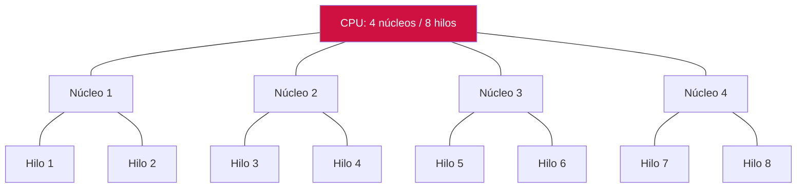
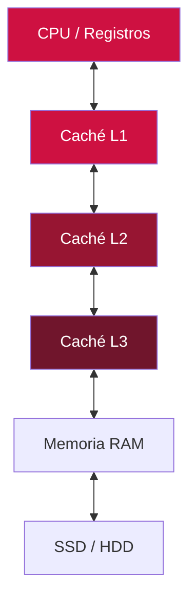
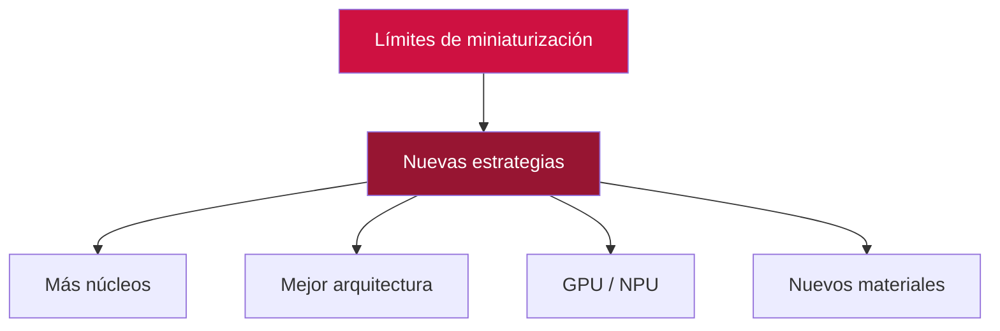
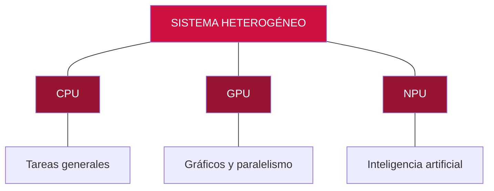

# Microprocesadores y memoria

`Fundamentos de Hardware | ASIR`

---

[← Volver al temario](../README.md)

## Índice

1. [El microprocesador](#1-el-microprocesador)
2. [Características del procesador](#2-características-del-procesador)
3. [Arquitecturas CISC y RISC](#3-arquitecturas-cisc-y-risc)
4. [Ley de Moore](#4-ley-de-moore)
5. [Procesadores de consumo y servidor](#5-procesadores-de-consumo-y-servidor)
6. [Memoria RAM en profundidad](#6-memoria-ram-en-profundidad)
7. [Tecnologías modernas](#7-tecnologías-modernas)
8. [Conceptos clave](#8-conceptos-clave)
9. [Preguntas de repaso](#9-preguntas-de-repaso)
10. [Práctica](#10-práctica)

---

## 1. El microprocesador

### 1.1. Definición

El microprocesador es un circuito integrado
que contiene la unidad central de procesamiento (CPU).

Es el encargado de ejecutar instrucciones
y procesar información.

Sus funciones principales son:

- Realizar cálculos.
- Ejecutar instrucciones.
- Procesar datos.
- Coordinar operaciones.
- Ejecutar los programas del ordenador.

### 1.2. Evolución histórica

El Intel 4004, presentado en 1971, se considera
el primer microprocesador comercial.

Desde entonces, los procesadores han evolucionado
considerablemente.

| Primeros procesadores | Procesadores modernos |
|---|---|
| Un solo núcleo. | Múltiples núcleos. |
| Miles de transistores. | Miles de millones de transistores. |
| Frecuencias reducidas. | Frecuencias mucho mayores. |
| Capacidad limitada. | Alto rendimiento y especialización. |

La evolución no consiste únicamente en aumentar
la frecuencia, sino también en mejorar la eficiencia,
el paralelismo y la arquitectura.

### Fabricantes y arquitecturas

| Fabricante o plataforma | Arquitectura habitual |
|---|---|
| Intel | x86 / x86-64 |
| AMD | x86 / x86-64 |
| Apple Silicon | ARM |
| Otros diseñadores de chips ARM | ARM |

---

## 2. Características del procesador

### 2.1. Frecuencia de reloj

Indica cuántos ciclos de reloj se producen
cada segundo.

Se expresa normalmente en GHz.

| Unidad | Equivalencia |
|---|---:|
| Hz | 1 ciclo por segundo |
| MHz | 1 millón de ciclos por segundo |
| GHz | 1.000 millones de ciclos por segundo |

Ejemplo:

Un procesador a 3 GHz realiza aproximadamente
3.000 millones de ciclos de reloj por segundo.

Esto no significa que ejecute necesariamente
3.000 millones de instrucciones por segundo.

### 2.2. Núcleos (Cores)

Los núcleos son unidades físicas de procesamiento
que forman parte del procesador.

Permiten ejecutar tareas en paralelo.

Un procesador multinúcleo puede repartir
el trabajo entre diferentes núcleos.

Especialmente útil para:

- Virtualización.
- Edición de vídeo.
- Servidores.
- Multitarea.
- Aplicaciones que aprovechan el paralelismo.

### 2.3. Hilos (Threads)

Un hilo es un flujo de ejecución.

Tecnologías como Hyper-Threading y SMT permiten
que un núcleo físico gestione más de un hilo
de hardware.

Ejemplo simplificado:

### Diferencia entre núcleos e hilos

| Núcleos | Hilos |
|---|---|
| Unidades físicas de procesamiento. | Flujos de ejecución. |
| Ejecutan operaciones. | Permiten organizar y aprovechar la ejecución. |
| Forman parte del hardware. | Pueden aprovechar los recursos de un mismo núcleo. |

Tener 8 hilos no equivale necesariamente
a tener 8 núcleos físicos.

### 2.4. Memoria caché

Memoria muy rápida situada dentro o muy cerca
de las unidades de procesamiento.

Almacena datos e instrucciones para reducir
el tiempo de acceso a la RAM.

| Nivel | Velocidad habitual | Capacidad relativa |
|---|---|---|
| L1 | La más rápida | Muy pequeña |
| L2 | Muy rápida | Mayor que L1 |
| L3 | Rápida | Habitualmente mayor |

Una mayor cantidad de caché puede mejorar
el rendimiento, dependiendo del programa.

### 2.5. Consumo y TDP

El consumo eléctrico indica la energía que
necesita el procesador durante su funcionamiento.

El TDP es una referencia de diseño térmico
utilizada para seleccionar la refrigeración.

No son exactamente el mismo concepto.

Un procesador de mayor rendimiento puede
necesitar una refrigeración y alimentación
más exigentes.

### 2.6. Arquitectura y litografía

La arquitectura determina cómo está diseñado
el procesador y cómo ejecuta las instrucciones.

La litografía está relacionada con el proceso
de fabricación del chip.

Se identifica habitualmente mediante
denominaciones expresadas en nanómetros (nm).

Las generaciones de fabricación más avanzadas
pueden mejorar la densidad de transistores
y la eficiencia energética.

Las denominaciones en nanómetros no son
directamente comparables entre todos
los fabricantes ni garantizan por sí solas
un mayor rendimiento.

### Resumen de características

| Característica | Qué indica |
|---|---|
| GHz | Ciclos de reloj por segundo. |
| Núcleos | Unidades físicas de procesamiento. |
| Hilos | Capacidad de gestionar flujos de ejecución. |
| Caché | Memoria rápida para datos e instrucciones. |
| TDP | Referencia para dimensionar la refrigeración. |
| Arquitectura | Diseño y funcionamiento del procesador. |
| Litografía | Tecnología de fabricación. |

> [!IMPORTANT]
> No se puede elegir el mejor procesador
> comparando únicamente los GHz.
> Hay que valorar el conjunto de características
> y el uso que tendrá el equipo.

---

## 3. Arquitecturas CISC y RISC

Son dos filosofías de diseño de conjuntos
de instrucciones.

### 3.1. CISC

Complex Instruction Set Computer.

Se caracteriza por disponer de un conjunto
amplio de instrucciones, algunas complejas.

Está asociada a la arquitectura x86.

Ejemplos:

- Procesadores Intel.
- Procesadores AMD.
- Ordenadores de sobremesa tradicionales.
- Servidores x86.

### 3.2. RISC

Reduced Instruction Set Computer.

Se caracteriza por utilizar instrucciones
generalmente más simples y regulares.

Ejemplos:

- ARM.
- RISC-V.

Es habitual en dispositivos móviles
y tiene presencia creciente en portátiles
y servidores.

### Comparativa CISC y RISC

| Característica | CISC | RISC |
|---|---|---|
| Significado | Complex Instruction Set Computer | Reduced Instruction Set Computer |
| Instrucciones | Amplias y algunas complejas | Generalmente más simples |
| Ejemplos | x86 | ARM y RISC-V |
| Uso tradicional | PC y servidores | Móviles y sistemas integrados |

### Arquitecturas modernas

La diferencia entre ambas filosofías
no es tan marcada como antiguamente.

Los procesadores x86 modernos pueden utilizar
internamente técnicas similares a RISC.

Los procesadores ARM también se utilizan
en ordenadores y servidores de alto rendimiento.

La eficiencia real depende del diseño concreto,
no exclusivamente de ser CISC o RISC.

### Compatibilidad del software

Un programa compilado para x86 no puede
ejecutarse directamente en ARM de forma nativa.

Puede necesitar:

- Una versión compatible.
- Recompilación.
- Emulación.
- Traducción de instrucciones.

> [!IMPORTANT]
> La arquitectura del procesador condiciona
> la compatibilidad del software.

---

## 4. Ley de Moore

### 4.1. Definición

Gordon Moore formuló en 1965 una observación
sobre la evolución del número de componentes
integrados en los chips.

La versión habitual estudiada en el temario
establece que el número de transistores se
duplica aproximadamente cada dos años.

Esta observación explica buena parte de la
evolución histórica de la informática.

### Ejemplo teórico

| Año | Número relativo de transistores |
|---|---:|
| 0 | 1 |
| 2 | 2 |
| 4 | 4 |
| 6 | 8 |
| 8 | 16 |
| 10 | 32 |

Es un ejemplo matemático simplificado,
no una previsión garantizada.

### 4.2. Ralentización de la Ley de Moore

La miniaturización de los transistores
se enfrenta a límites físicos y tecnológicos.

También existen dificultades relacionadas
con la temperatura, la fabricación y el coste.

Por ello, el rendimiento moderno aumenta
mediante diferentes estrategias:

- Más núcleos.
- Mayor paralelismo.
- Arquitecturas mejoradas.
- Unidades especializadas.
- Nuevos materiales y diseños.

> [!NOTE]
> La Ley de Moore se refiere al número de
> transistores, no a que todos los ordenadores
> sean automáticamente el doble de rápidos
> cada dos años.

---

## 5. Procesadores de consumo y servidor

### 5.1. Procesadores de consumo

Están destinados a equipos personales,
portátiles y puestos de trabajo.

Priorizan:

- Relación entre precio y rendimiento.
- Buen rendimiento en tareas cotidianas.
- Frecuencias elevadas.
- Consumo adecuado al tipo de equipo.

Ejemplos de familias:

- Intel Core.
- AMD Ryzen.

### 5.2. Procesadores de servidor

Están diseñados para ejecutar grandes cargas
de trabajo y mantener servicios continuos.

Ejemplos:

- Intel Xeon.
- AMD EPYC.

Características habituales:

- Elevado número de núcleos.
- Soporte de grandes cantidades de RAM.
- Compatibilidad con memoria ECC.
- Mayor cantidad de líneas PCIe.
- Posibilidad de múltiples sockets según modelo.
- Fiabilidad y escalabilidad.

### Comparativa

| Característica | Consumo | Servidor |
|---|---|---|
| Uso | Personal y oficina | CPD y servicios |
| Núcleos | Según gama | Habitualmente numerosos |
| RAM máxima | Generalmente inferior | Generalmente superior |
| ECC | Depende de la plataforma | Habitual |
| Multisocket | Poco habitual | Disponible en ciertas plataformas |
| PCIe | Expansión convencional | Gran capacidad de expansión |
| Prioridad | Rendimiento por euro | Fiabilidad y escalabilidad |

### Selección según el uso

| Uso | Características prioritarias |
|---|---|
| Ofimática | Eficiencia y coste reducido. |
| Videojuegos | Rendimiento por núcleo y equilibrio con GPU. |
| Edición de vídeo | Núcleos y rendimiento paralelo. |
| Virtualización | Núcleos, hilos y capacidad de RAM. |
| Servidor crítico | Fiabilidad, ECC y escalabilidad. |

No siempre es necesario elegir
el procesador más potente o más caro.

El objetivo es seleccionar el hardware
que mejor se adapte a la carga de trabajo.

---

## 6. Memoria RAM en profundidad

### 6.1. Funcionamiento de la RAM

RAM significa Random Access Memory.

Almacena temporalmente los datos e instrucciones
que está utilizando el sistema.

Características:

- Acceso aleatorio o directo a sus posiciones.
- Memoria volátil.
- Alta velocidad frente al almacenamiento.
- Permite trabajar con varios programas.

### DRAM

Dynamic Random Access Memory.

Es la tecnología utilizada habitualmente
en la memoria principal del ordenador.

Sus celdas almacenan bits mediante
condensadores y transistores.

Un condensador puede almacenar carga eléctrica,
que permite representar información binaria.

La carga se pierde progresivamente,
por lo que la DRAM necesita refrescarse
periódicamente para conservar la información.

La RAM actúa como una memoria de trabajo rápida
entre el almacenamiento y el procesador.

### 6.2. Parámetros de la RAM

| Parámetro | Significado |
|---|---|
| Capacidad | Cantidad de información que puede almacenar. |
| Velocidad de transferencia | Cantidad de transferencias por segundo. |
| Latencia | Retardo asociado al acceso. |
| Generación | DDR3, DDR4, DDR5, etc. |
| Formato | DIMM o SO-DIMM. |
| Canales | Vías de comunicación con la memoria. |

### Capacidad

Se expresa normalmente en GB.

Una mayor capacidad permite mantener
más programas y datos en memoria.

Cuando la capacidad es insuficiente,
el sistema puede recurrir al almacenamiento,
que es considerablemente más lento.

### Frecuencia y velocidad de transferencia

En las memorias DDR es importante distinguir:

- MHz: millones de ciclos de reloj por segundo.
- MT/s: millones de transferencias por segundo.

DDR significa Double Data Rate.

Permite realizar dos transferencias por ciclo
del reloj de datos correspondiente.

Ejemplo complementario:

Una memoria DDR4-3200 ofrece 3.200 MT/s
con un reloj de datos de aproximadamente 1.600 MHz.

Habitualmente se anuncia como 3.200 MHz,
aunque técnicamente corresponde a 3.200 MT/s.

### Latencia CAS (CL)

CAS Latency es el número de ciclos de reloj
asociados al retardo entre una orden de lectura
y la disponibilidad inicial de los datos,
en las condiciones correspondientes.

Se expresa mediante valores como:

- CL16.
- CL18.
- CL30.
- CL36.

A igual velocidad de transferencia,
un CL menor implica una menor latencia CAS.

No se deben comparar los valores CL
de memorias con velocidades diferentes
sin tener en cuenta su frecuencia.

### Ejemplo complementario de latencia

Fórmula para estimar la latencia CAS:

    Latencia (ns) = CL x 2000 / velocidad (MT/s)

| Memoria | CL | Latencia CAS aproximada |
|---|---:|---:|
| DDR4-3200 | 16 | 10 ns |
| DDR4-3600 | 18 | 10 ns |
| DDR5-6000 | 30 | 10 ns |
| DDR5-6000 | 36 | 12 ns |

Esto permite entender por qué un número CL
más elevado no implica necesariamente
una latencia real mayor.

La latencia CAS no representa por sí sola
todo el tiempo de acceso a la memoria.

### Ancho de banda

Es la cantidad de información que puede
transferirse por unidad de tiempo.

Depende de:

- Velocidad de transferencia.
- Anchura de los canales.
- Número de canales utilizados.

### Cálculo del ancho de banda

Ejemplo complementario para canales
de datos de 64 bits:

    Ancho de banda (MB/s) =
    MT/s x (64 / 8) x número de canales

Un canal de 64 bits equivale a 8 bytes.

Ejemplo con DDR4-3200:

Single channel:

    3200 x 8 x 1 = 25.600 MB/s
    25,6 GB/s

Dual channel:

    3200 x 8 x 2 = 51.200 MB/s
    51,2 GB/s

| Configuración | Ancho de banda teórico |
|---|---:|
| DDR4-3200 Single channel | 25,6 GB/s |
| DDR4-3200 Dual channel | 51,2 GB/s |
| DDR5-6000 Single channel | 48 GB/s |
| DDR5-6000 Dual channel | 96 GB/s |

Se supone un ancho agregado de 64 bits por canal
de memoria de la plataforma.

Estos valores son máximos teóricos.
El rendimiento real depende del hardware,
la aplicación y otras limitaciones.

> [!IMPORTANT]
> Para elegir RAM, primero hay que garantizar
> suficiente capacidad.
> Después se valoran velocidad, latencia
> y configuración multicanal.

### 6.3. Memoria ECC

ECC significa Error-Correcting Code.

Es una tecnología que permite detectar
y corregir determinados errores en memoria.

Los errores pueden producirse por interferencias
o defectos que alteren los bits almacenados.

La memoria ECC incorpora mecanismos adicionales
de comprobación y corrección.

Los esquemas ECC habituales pueden corregir
errores de un bit y detectar determinados errores
de varios bits.

No todos los errores son corregibles.

### Ventajas

- Mayor integridad de los datos.
- Mayor fiabilidad.
- Reducción del riesgo de corrupción causada
  por determinados errores de memoria.

### Usos habituales

- Servidores.
- Bases de datos críticas.
- Virtualización.
- Cálculos científicos.
- Estaciones de trabajo profesionales.

### ECC frente a no ECC

| Característica | ECC | No ECC |
|---|---|---|
| Corrección de errores | Disponible | Sin ECC de sistema equivalente |
| Fiabilidad de memoria | Mayor frente a errores corregibles | Convencional |
| Uso | Servidores y sistemas críticos | Consumo y oficina |
| Compatibilidad | Requiere soporte específico | Habitualmente más extendida |

Es necesario que el procesador, la placa
y la memoria sean compatibles con ECC.

---

## 7. Tecnologías modernas

### 7.1. Computación heterogénea

Consiste en utilizar diferentes unidades
de procesamiento especializadas.

Cada unidad realiza las tareas para
las que resulta más adecuada.

### CPU

Central Processing Unit.

Diseñada para procesamiento general
y tareas variadas.

### GPU

Graphics Processing Unit.

Diseñada para procesamiento gráfico
y operaciones masivamente paralelas.

También se utiliza para:

- Inteligencia artificial.
- Cálculo científico.
- Renderizado.
- Procesamiento paralelo.

### NPU

Neural Processing Unit.

Unidad especializada en determinadas
operaciones de inteligencia artificial.

Busca ejecutar esas operaciones de forma
eficiente y con un consumo adecuado.

### Comparativa

| Unidad | Especialización |
|---|---|
| CPU | Procesamiento general. |
| GPU | Gráficos y cálculo paralelo. |
| NPU | Operaciones de inteligencia artificial. |

### 7.2. Memoria HBM

HBM significa High Bandwidth Memory.

Es una memoria de alto ancho de banda
que utiliza chips apilados en tres dimensiones.

Se sitúa muy cerca del procesador
o de la unidad gráfica.

Características:

- Ancho de banda muy elevado.
- Diseño mediante apilamiento 3D.
- Gran capacidad de transferencia paralela.
- Adecuada para cargas muy exigentes.

Usos habituales:

- GPU de alto rendimiento.
- Aceleradores de inteligencia artificial.
- Supercomputación.
- Cálculo científico.

| Memoria DDR convencional | HBM |
|---|---|
| Habitualmente en módulos de memoria. | Chips apilados cerca del procesador. |
| Uso general. | Cargas de alto rendimiento. |
| Ancho de banda convencional. | Ancho de banda muy elevado. |

La HBM ayuda a reducir el cuello de botella
que aparece cuando una unidad de procesamiento
muy rápida no recibe suficientes datos.

---

## 8. Conceptos clave

| Concepto | Definición rápida |
|---|---|
| Microprocesador | Chip que integra la CPU. |
| Intel 4004 | Primer microprocesador comercial, 1971. |
| GHz | Miles de millones de ciclos por segundo. |
| Núcleo | Unidad física de procesamiento. |
| Hilo | Flujo de ejecución. |
| SMT | Ejecución simultánea de varios hilos de hardware por núcleo. |
| Caché | Memoria interna de alta velocidad. |
| Litografía | Tecnología de fabricación del chip. |
| CISC | Conjunto amplio de instrucciones. |
| RISC | Instrucciones generalmente más simples. |
| x86 | Arquitectura habitual de Intel y AMD. |
| ARM | Arquitectura basada en RISC. |
| Ley de Moore | Duplicación aproximada de transistores cada dos años. |
| DRAM | Memoria dinámica que necesita refresco. |
| DDR | Double Data Rate. |
| MT/s | Millones de transferencias por segundo. |
| CL | Latencia CAS expresada en ciclos. |
| Ancho de banda | Información transferida por unidad de tiempo. |
| ECC | Detección y corrección de determinados errores. |
| GPU | Procesamiento gráfico y paralelo. |
| NPU | Procesamiento especializado en IA. |
| HBM | Memoria de alto ancho de banda. |

---

## 9. Preguntas de repaso

01. ¿Qué es un microprocesador?

Un circuito integrado que contiene la CPU
y ejecuta instrucciones.

02. ¿Cuál fue el primer microprocesador comercial?

Intel 4004, presentado en 1971.

03. ¿Qué mide la frecuencia en GHz?

Los miles de millones de ciclos de reloj por segundo.

04. ¿Qué es un núcleo?

Una unidad física de procesamiento del procesador.

05. ¿Qué diferencia hay entre núcleos e hilos?

Los núcleos son unidades físicas.
Los hilos son flujos de ejecución.

06. ¿Para qué sirve la memoria caché?

Para reducir el tiempo de acceso a datos
e instrucciones utilizados por la CPU.

07. ¿Qué nivel de caché suele ser el más rápido?

L1.

08. ¿Más GHz significa siempre más rendimiento?

No. También influyen la arquitectura, los núcleos,
los hilos, la caché y la carga de trabajo.

09. ¿Qué significa CISC?

Complex Instruction Set Computer.

10. ¿Qué significa RISC?

Reduced Instruction Set Computer.

11. ¿Qué arquitectura utilizan habitualmente Intel y AMD?

x86 y su extensión de 64 bits.

12. ¿Qué arquitecturas se asocian a RISC?

ARM y RISC-V.

13. ¿Un programa x86 funciona de forma nativa en ARM?

No. Necesita una versión compatible o algún
mecanismo de adaptación, traducción o emulación.

14. ¿Qué establece la Ley de Moore?

Que el número de transistores por chip
se duplica aproximadamente cada dos años,
según su formulación habitual.

15. ¿Por qué se ralentiza la Ley de Moore?

Por los límites físicos, tecnológicos
y económicos de la miniaturización.

16. ¿Cómo se mejora actualmente el rendimiento?

Mediante más núcleos, mejores arquitecturas,
paralelismo y unidades especializadas.

17. ¿Qué procesadores son habituales en servidores?

Intel Xeon y AMD EPYC.

18. ¿Qué diferencia a un procesador de servidor?

Prioriza la fiabilidad, la escalabilidad,
la capacidad de memoria y el procesamiento paralelo.

19. ¿Por qué la DRAM necesita refrescarse?

Porque sus condensadores pierden carga
y necesitan recuperarla para conservar los datos.

20. ¿Qué significa que la RAM sea volátil?

Que pierde la información cuando deja
de recibir alimentación.

21. ¿Qué diferencia hay entre MHz y MT/s?

MHz mide ciclos por segundo.
MT/s mide transferencias por segundo.

22. ¿Qué es la latencia CAS?

El retardo expresado en ciclos asociado
a una operación de lectura de la memoria.

23. ¿Qué es el ancho de banda de la RAM?

La cantidad de información que puede transferirse
por unidad de tiempo.

24. ¿Cuál es el ancho de banda teórico de DDR4-3200 en dual channel de 64 bits por canal?

51.200 MB/s, equivalentes a 51,2 GB/s.

3200 x 8 x 2.

25. ¿Qué latencia CAS aproximada tiene DDR4-3200 CL16?

10 nanosegundos.

16 x 2000 / 3200.

26. ¿Qué significa ECC?

Error-Correcting Code.

27. ¿Qué función tiene ECC?

Detectar y corregir determinados errores
de memoria para proteger la integridad de los datos.

28. ¿Puede utilizarse ECC en cualquier ordenador?

No. Requiere compatibilidad entre la memoria,
el procesador y la placa.

29. ¿Qué diferencia hay entre CPU, GPU y NPU?

CPU: procesamiento general.

GPU: procesamiento gráfico y paralelo.

NPU: operaciones especializadas de IA.

30. ¿Qué es la memoria HBM?

Memoria de alto ancho de banda con chips
apilados en 3D, situada cerca de las unidades
de procesamiento.

---

## 10. Práctica

### Identificación de un procesador

- [ ] Identificar fabricante y modelo.
- [ ] Comprobar la frecuencia.
- [ ] Comprobar núcleos e hilos.
- [ ] Consultar los niveles de caché.
- [ ] Identificar la arquitectura.
- [ ] Consultar el TDP.
- [ ] Identificar el socket.

### Identificación de la memoria RAM

- [ ] Comprobar la capacidad instalada.
- [ ] Identificar la generación DDR.
- [ ] Comprobar la velocidad de transferencia.
- [ ] Consultar la latencia CL.
- [ ] Identificar el número de módulos.
- [ ] Comprobar la configuración multicanal.
- [ ] Identificar si utiliza ECC.
- [ ] Calcular el ancho de banda teórico.

### Selección de hardware

- [ ] Comparar procesadores para diferentes usos.
- [ ] Justificar la elección de consumo o servidor.
- [ ] Seleccionar la capacidad de RAM necesaria.
- [ ] Elegir la velocidad y latencia adecuadas.
- [ ] Justificar si se necesita memoria ECC.

---

## Resumen final

El procesador ejecuta las instrucciones
y procesa la información.

Su rendimiento depende de la frecuencia,
los núcleos, los hilos, la caché y su arquitectura.

CISC y RISC representan distintas filosofías
de diseño de conjuntos de instrucciones.

La Ley de Moore explica la evolución histórica
del número de transistores.

Los procesadores de servidor priorizan
fiabilidad, capacidad y escalabilidad.

La RAM es una memoria de trabajo volátil.

Su capacidad, velocidad, latencia y canales
determinan sus posibilidades de rendimiento.

La memoria ECC mejora la fiabilidad
frente a determinados errores.

Las GPU, NPU y memorias HBM representan
la especialización del hardware moderno.

---

Fuente: Fundamentos de Hardware, Unidad 4.
Prometeo - thePower. Apuntes personales.

Las fórmulas y ejemplos numéricos son ampliaciones
complementarias para facilitar el aprendizaje.

---

`UNIDAD 04 | FUNDAMENTOS DE HARDWARE`

[Volver al temario](../README.md)

