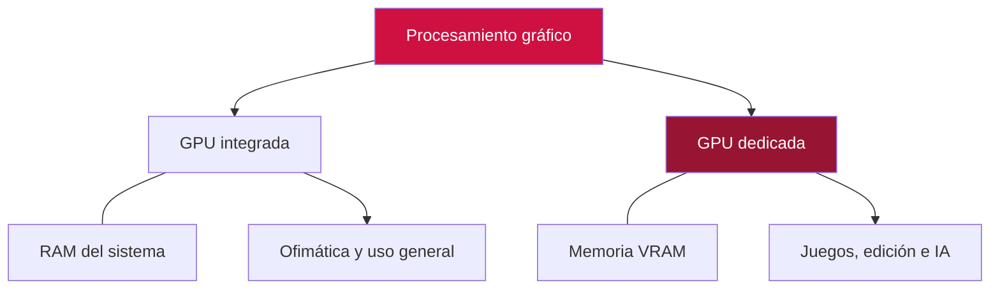
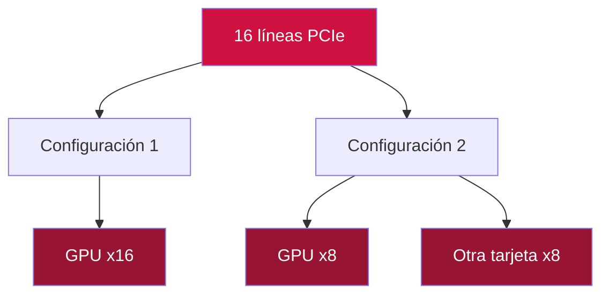
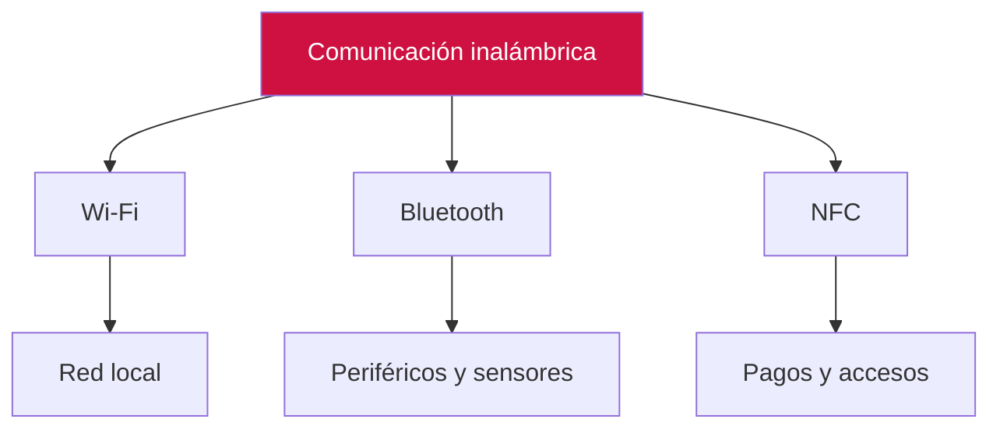

# Tarjetas de expansión

`Fundamentos de Hardware | ASIR`

---

[← Volver al temario](../README.md)

## Índice

1. [Tarjetas de expansión](#1-tarjetas-de-expansión)
2. [Buses y protocolos de comunicación](#2-buses-y-protocolos-de-comunicación)
3. [Protocolos de comunicación inalámbrica](#3-protocolos-de-comunicación-inalámbrica)
4. [Ampliación y actualización](#4-ampliación-y-actualización)
5. [Conceptos clave](#5-conceptos-clave)
6. [Preguntas de repaso](#6-preguntas-de-repaso)
7. [Práctica](#7-práctica)

---

## 1. Tarjetas de expansión

Referencia: PDF, páginas 4-6.

Las tarjetas de expansión permiten añadir funciones
o mejorar las prestaciones de un ordenador sin
sustituir toda la placa base.

Se conectan mediante interfaces como PCI Express.

Muchas funciones básicas ya vienen integradas
en la placa base o en el procesador.

### 1.1. Tarjeta gráfica (GPU)

GPU significa Graphics Processing Unit.

Es la unidad encargada de generar las imágenes
que se muestran en la pantalla y realizar
operaciones de cálculo paralelo.

### Gráfica integrada y dedicada

| Característica | Integrada (iGPU) | Dedicada |
|---|---|---|
| Ubicación | Dentro del procesador | Tarjeta independiente |
| Conexión | Integrada | Habitualmente PCIe x16 |
| Memoria | Comparte la RAM | VRAM propia normalmente |
| Rendimiento | Uso general | Alto rendimiento |
| Consumo | Habitualmente bajo | Puede ser elevado |
| Uso | Ofimática y navegación | Juegos, diseño, edición e IA |
| Refrigeración | Compartida con la CPU | Refrigeración propia |

### VRAM

Video Random Access Memory.

Es la memoria utilizada por el procesador gráfico
para almacenar texturas, imágenes y otros datos.

Una mayor cantidad de VRAM permite manejar
cargas gráficas más grandes, aunque no garantiza
por sí sola un mayor rendimiento.

### Aplicaciones de una GPU dedicada

- Videojuegos.
- Diseño gráfico.
- Modelado y renderizado 3D.
- Edición de vídeo.
- Inteligencia artificial.
- Computación científica.

> [!IMPORTANT]
> Una GPU dedicada puede tener un consumo elevado.
> Hay que dimensionar correctamente la fuente
> de alimentación y la refrigeración.

### 1.2. Tarjetas de sonido, red y periféricos

| Componente | Función |
|---|---|
| Tarjeta de sonido | Procesar entradas y salidas de audio. |
| Tarjeta de red | Conectar el equipo a una red. |
| Tarjeta de captura | Capturar señales de vídeo. |
| Tarjeta de expansión USB | Añadir puertos USB. |
| Controladora de almacenamiento | Añadir conexiones para unidades de almacenamiento. |

### Tarjeta de red (NIC)

NIC significa Network Interface Card.

Permite conectar el ordenador a una red.

Puede estar integrada en la placa base o ser
una tarjeta de expansión independiente.

Una tarjeta dedicada permite añadir:

- Mayor velocidad de conexión.
- Conectividad mediante fibra óptica.
- Puertos adicionales.
- Funcionalidades profesionales para servidores.

### Ejemplo práctico

Un servidor dispone de una conexión de 1 GbE.

Si necesita mayor ancho de banda, puede instalarse
una tarjeta de red de 10 GbE.

Para aprovecharla, el resto de la infraestructura
de red también debe admitir esa velocidad.

### Periféricos

| Tipo | Función | Ejemplos |
|---|---|---|
| Entrada | Introducir información | Teclado, ratón, escáner |
| Salida | Mostrar información | Monitor, impresora |
| Entrada y salida | Recibir y emitir información | Pantalla táctil |

---

## 2. Buses y protocolos de comunicación

Referencia: PDF, páginas 7-10.

### 2.1. PCI Express (PCIe)

Es un bus serie de alta velocidad que comunica
la placa base con tarjetas de expansión y
dispositivos de almacenamiento.

Utiliza líneas de comunicación llamadas lanes.

### Número de líneas

| Conexión | Líneas | Uso habitual |
|---|---:|---|
| PCIe x1 | 1 | Sonido, USB y tarjetas pequeñas |
| PCIe x4 | 4 | SSD NVMe |
| PCIe x8 | 8 | Tarjetas profesionales |
| PCIe x16 | 16 | Tarjetas gráficas |

El ancho de banda depende de:

- Generación PCIe.
- Número de líneas activas.

### Generaciones PCIe

Cada generación aumenta la velocidad disponible
por línea.

Tabla complementaria de velocidades teóricas
aproximadas por dirección:

| Generación | x1 | x4 | x8 | x16 |
|---|---:|---:|---:|---:|
| PCIe 3.0 | 0,985 GB/s | 3,94 GB/s | 7,88 GB/s | 15,75 GB/s |
| PCIe 4.0 | 1,969 GB/s | 7,88 GB/s | 15,75 GB/s | 31,51 GB/s |
| PCIe 5.0 | 3,938 GB/s | 15,75 GB/s | 31,51 GB/s | 63,02 GB/s |

PCIe 4.0 x8 proporciona aproximadamente
el mismo ancho de banda que PCIe 3.0 x16.

### Reparto de líneas PCIe

En determinadas placas base, instalar varias tarjetas
puede provocar que se compartan las líneas disponibles.

El esquema representa dos configuraciones alternativas.

Una tarjeta gráfica que pasa de x16 a x8 dispone
de la mitad del ancho de banda de su enlace,
pero no necesariamente pierde la mitad del rendimiento.

> [!IMPORTANT]
> Una ranura físicamente x16 puede disponer de menos
> líneas eléctricas. Consulta el manual de la placa base.

### Cálculo complementario del ancho de banda

Para PCIe 3.0, 4.0 y 5.0:

    GB/s = GT/s x (128 / 130) x líneas / 8

| Generación | Transferencias por línea |
|---|---:|
| PCIe 3.0 | 8 GT/s |
| PCIe 4.0 | 16 GT/s |
| PCIe 5.0 | 32 GT/s |

Ejemplo: PCIe 4.0 x8.

    16 x (128 / 130) x 8 / 8
    = 15,75 GB/s aproximadamente

Estos valores son teóricos por dirección.

### 2.2. USB

USB significa Universal Serial Bus.

Permite conectar periféricos externos y suministrar
alimentación eléctrica a dispositivos compatibles.

Características:

- Conexión de periféricos.
- Transferencia de datos.
- Alimentación eléctrica.
- Plug and Play.
- Compatibilidad con numerosos dispositivos.

### Generaciones USB

Velocidades nominales complementarias:

| Versión | Velocidad nominal |
|---|---:|
| USB 2.0 | 480 Mb/s |
| USB 3.x | 5, 10 o 20 Gb/s |
| USB4 | 20 o 40 Gb/s en variantes habituales |
| USB4 versión 2 | Hasta 80 Gb/s bidireccionales en modos compatibles |

### Tipos de conectores

| Conector | Características |
|---|---|
| USB-A | Conector rectangular tradicional. |
| USB-B | Habitual en algunos periféricos e impresoras. |
| USB-C | Conector compacto y reversible. |

> [!IMPORTANT]
> USB-C es un tipo de conector.
> No garantiza una velocidad concreta ni compatibilidad
> con vídeo o carga rápida.

### USB Power Delivery

Tecnología que permite negociar la alimentación
eléctrica entre dispositivos compatibles.

Depende del puerto, el dispositivo y el cable.

---

### 2.3. SATA, SAS y NVMe

| Tecnología | Uso principal |
|---|---|
| SATA | HDD y SSD convencionales. |
| SAS | Almacenamiento profesional y servidores. |
| NVMe | SSD de alto rendimiento sobre PCIe. |

### SATA

Serial ATA.

Interfaz habitual para conectar discos HDD
y unidades SSD SATA.

SATA III ofrece una tasa nominal de 6 Gb/s.

### SAS

Serial Attached SCSI.

Tecnología orientada principalmente a servidores
y almacenamiento profesional.

Destaca por sus prestaciones y posibilidades
de conexión en entornos empresariales.

### NVMe

Non-Volatile Memory Express.

Protocolo diseñado para aprovechar el rendimiento
de la memoria no volátil mediante PCIe.

Permite:

- Mayor ancho de banda.
- Menor latencia.
- Gran capacidad de operaciones paralelas.

### Diferencias importantes

| Concepto | Qué representa |
|---|---|
| M.2 | Formato físico y conector. |
| SATA | Interfaz de almacenamiento. |
| PCIe | Bus de comunicación. |
| NVMe | Protocolo de almacenamiento sobre PCIe. |

Un SSD M.2 puede utilizar SATA o NVMe.

No todos los SSD M.2 ofrecen el mismo rendimiento.

### 2.4. Thunderbolt

Interfaz externa de alta velocidad desarrollada
por Intel y Apple.

Permite combinar:

- Transferencia de datos.
- Conexión de pantallas.
- Alimentación eléctrica.
- Conexión de estaciones de expansión (docks).
- Encadenamiento de dispositivos compatibles.

| Generación | Velocidad nominal complementaria |
|---|---:|
| Thunderbolt 4 | 40 Gb/s |
| Thunderbolt 5 | 80 Gb/s bidireccionales |

Thunderbolt 5 puede alcanzar hasta 120 Gb/s
en una dirección en determinados modos de vídeo.

Las generaciones modernas utilizan USB-C.

No todos los puertos USB-C o USB4 ofrecen
las mismas funciones que Thunderbolt.

---

## 3. Protocolos de comunicación inalámbrica

Referencia: PDF, páginas 10-11.

### 3.1. Wi-Fi

Tecnología que permite conectar dispositivos
a redes inalámbricas.

Se basa en los estándares IEEE 802.11.

### Bandas de frecuencia

| Banda | Ventajas | Limitaciones |
|---|---|---|
| 2,4 GHz | Mayor alcance y penetración habitual | Más interferencias |
| 5 GHz | Mayor capacidad y menos saturación habitual | Menor alcance |
| 6 GHz | Más espectro disponible | Requiere hardware compatible |

### Generaciones Wi-Fi

| Generación | Estándar |
|---|---|
| Wi-Fi 5 | IEEE 802.11ac |
| Wi-Fi 6 | IEEE 802.11ax |
| Wi-Fi 6E | IEEE 802.11ax con banda de 6 GHz |
| Wi-Fi 7 | IEEE 802.11be |

Wi-Fi 7 puede utilizar canales de hasta 320 MHz
cuando la normativa y los dispositivos lo permiten.

### Seguridad inalámbrica

WPA3 es una tecnología de seguridad Wi-Fi
que mejora la protección de las conexiones.

Buenas prácticas:

- Utilizar protocolos de seguridad modernos.
- Establecer contraseñas robustas.
- Actualizar los dispositivos.
- Comprobar la compatibilidad.
- Evitar conexiones y emparejamientos desconocidos.

### 3.2. Bluetooth

Tecnología inalámbrica de corto alcance
que funciona en la banda de 2,4 GHz.

| Tipo | Uso habitual |
|---|---|
| Bluetooth clásico | Audio, periféricos y datos. |
| BLE | Sensores y dispositivos de bajo consumo. |

BLE significa Bluetooth Low Energy.

### NFC

Near Field Communication.

Tecnología de comunicación inalámbrica
de muy corta distancia.

Funciona a 13,56 MHz.

Usos:

- Pagos sin contacto.
- Control de acceso.
- Identificación.
- Emparejamiento de dispositivos.

### Comparativa inalámbrica

| Tecnología | Alcance relativo | Uso |
|---|---|---|
| Wi-Fi | Mayor | Redes inalámbricas |
| Bluetooth | Corto | Periféricos y audio |
| BLE | Corto | Sensores de bajo consumo |
| NFC | Pocos centímetros | Pagos y accesos |

---

## 4. Ampliación y actualización

Referencia: PDF, páginas 11-13.

### Interfaces de alto rendimiento

Las generaciones modernas de PCIe aumentan
el ancho de banda disponible.

USB4 y Thunderbolt permiten transportar
datos, vídeo y alimentación mediante
conexiones compatibles.

### GPU en centros de datos

Las GPU no se utilizan únicamente
para generar gráficos.

También aceleran:

- Entrenamiento de inteligencia artificial.
- Inferencia de modelos de IA.
- Computación científica.
- Procesamiento paralelo de grandes volúmenes de datos.

Pueden utilizar memoria HBM, estudiada
en la Unidad 4.

Para dimensionar estos sistemas es necesario
valorar la GPU, la memoria, la alimentación,
las interfaces y la refrigeración.

---

## 5. Conceptos clave

| Concepto | Definición rápida |
|---|---|
| GPU | Procesador gráfico y de cálculo paralelo. |
| iGPU | Gráfica integrada. |
| VRAM | Memoria utilizada por la GPU. |
| NIC | Tarjeta de interfaz de red. |
| PCIe | Bus serie de alta velocidad. |
| Lane | Línea de comunicación PCIe. |
| USB | Interfaz universal para periféricos. |
| USB-C | Conector reversible. |
| USB PD | Negociación de alimentación. |
| SATA | Interfaz de almacenamiento. |
| SAS | Interfaz de almacenamiento profesional. |
| NVMe | Protocolo de almacenamiento sobre PCIe. |
| Thunderbolt | Interfaz de datos, vídeo y energía. |
| Wi-Fi | Tecnología de red inalámbrica. |
| WPA3 | Protocolo de seguridad Wi-Fi. |
| BLE | Bluetooth de bajo consumo. |
| NFC | Comunicación de proximidad. |

---

## 6. Preguntas de repaso

Intenta responder antes de desplegar la solución.

01. ¿Para qué sirve una tarjeta de expansión?

Para añadir funcionalidades o mejorar las prestaciones
de un ordenador.

02. ¿Qué diferencia hay entre una GPU integrada y una dedicada?

La integrada comparte recursos del sistema.
La dedicada suele tener VRAM propia y mayor potencia.

03. ¿Qué es la VRAM?

La memoria utilizada por el procesador gráfico.

04. ¿Qué significa NIC?

Network Interface Card o tarjeta de interfaz de red.

05. ¿Cuándo interesa instalar una NIC dedicada?

Cuando se necesita mayor velocidad, fibra
o puertos adicionales.

06. ¿Qué es PCI Express?

Un bus serie de alta velocidad organizado en líneas.

07. ¿Cuántas líneas tiene PCIe x4?

Cuatro líneas.

08. ¿Qué determina el ancho de banda PCIe?

La generación y el número de líneas activas.

09. ¿Dónde se conecta habitualmente una GPU?

En una ranura PCIe x16.

10. ¿Qué conexión utiliza normalmente un SSD NVMe?

PCIe, habitualmente mediante M.2 x4.

11. ¿Qué ocurre al repartir 16 líneas entre dos conexiones x8?

Cada conexión recibe ocho líneas y dispone de menor
ancho de banda que una conexión x16 equivalente.

12. ¿Qué significa USB?

Universal Serial Bus.

13. ¿Todos los conectores USB-C ofrecen la misma velocidad?

No. Depende del estándar y de las capacidades
del puerto, el cable y el dispositivo.

14. ¿Para qué sirve USB Power Delivery?

Para negociar la alimentación entre dispositivos
compatibles.

15. ¿Dónde se utiliza principalmente SAS?

En servidores y almacenamiento profesional.

16. ¿Qué diferencia hay entre M.2 y NVMe?

M.2 es un formato físico.
NVMe es un protocolo de almacenamiento.

17. ¿Qué permite transportar Thunderbolt?

Datos, vídeo y energía.

18. ¿Qué norma utiliza Wi-Fi?

IEEE 802.11.

19. ¿Qué banda Wi-Fi suele tener mayor alcance?

2,4 GHz.

20. ¿Qué aporta Wi-Fi 6E?

La posibilidad de utilizar la banda de 6 GHz.

21. ¿Qué es WPA3?

Una tecnología de seguridad de redes Wi-Fi.

22. ¿Qué diferencia Bluetooth clásico de BLE?

BLE está orientado a dispositivos de bajo consumo.

23. ¿A qué frecuencia funciona NFC?

13,56 MHz.

24. ¿Por qué se utilizan GPU para inteligencia artificial?

Por su capacidad de realizar grandes cantidades
de operaciones en paralelo.

25. ¿Qué ancho de banda teórico ofrece PCIe 4.0 x8?

Aproximadamente 15,75 GB/s por dirección.

---

## 7. Práctica

### Identificación de tarjetas

- [ ] Identificar la GPU del equipo.
- [ ] Comprobar si es integrada o dedicada.
- [ ] Identificar la tarjeta de red.
- [ ] Identificar el sistema de sonido.
- [ ] Clasificar los periféricos.

### Análisis de interfaces

- [ ] Identificar las ranuras PCIe.
- [ ] Comprobar las generaciones compatibles.
- [ ] Analizar el reparto de líneas.
- [ ] Comparar PCIe x8 y x16.
- [ ] Elaborar una tabla de velocidades de interfaces.
- [ ] Identificar las conexiones USB, SATA y M.2.
- [ ] Comprobar las bandas Wi-Fi compatibles.

Entregable: tabla comparativa de velocidades
y análisis de PCIe x8 frente a x16.

---

## Resumen final

Las tarjetas de expansión permiten añadir
funciones a un ordenador.

La GPU se especializa en gráficos y cálculo paralelo.

PCIe utiliza líneas de comunicación y su rendimiento
depende de la generación y del número de líneas.

USB permite conectar periféricos y suministrar energía.

SATA, SAS y NVMe se utilizan en almacenamiento.

Thunderbolt combina datos, vídeo y alimentación.

Wi-Fi, Bluetooth y NFC permiten diferentes tipos
de comunicación inalámbrica.

La compatibilidad y la seguridad son fundamentales.

---

Fuente: Fundamentos de Hardware, Unidad 5.
Prometeo - thePower. Apuntes personales.

Las fórmulas y tablas de velocidades identificadas
como complementarias son material de apoyo.

---

`UNIDAD 05 | FUNDAMENTOS DE HARDWARE`

[Volver al temario](../README.md)

