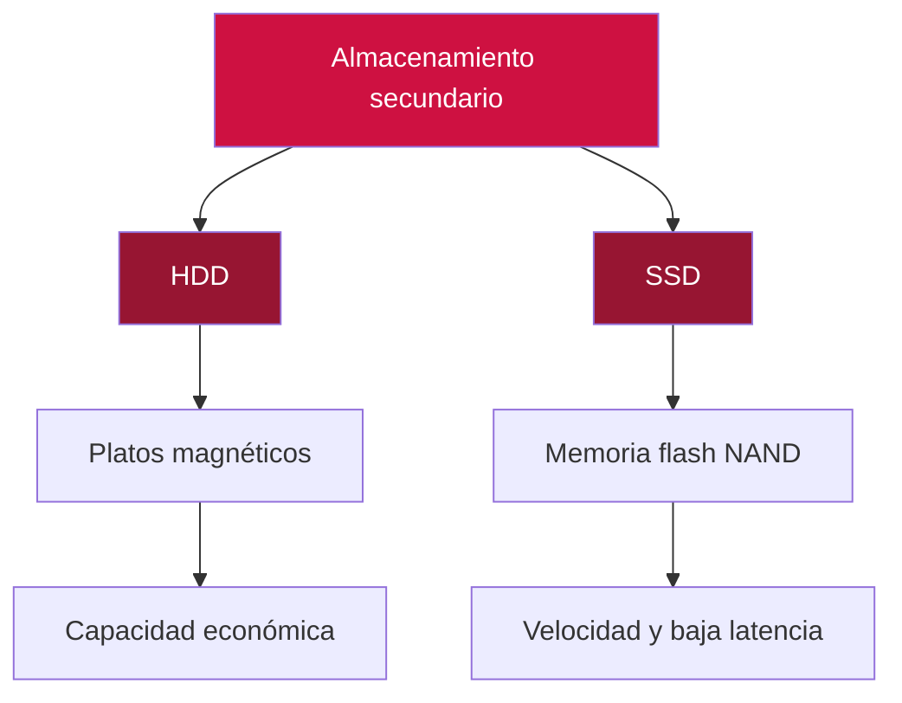
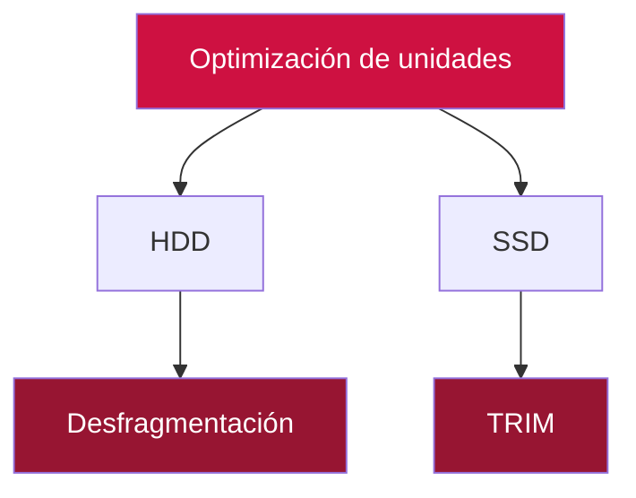
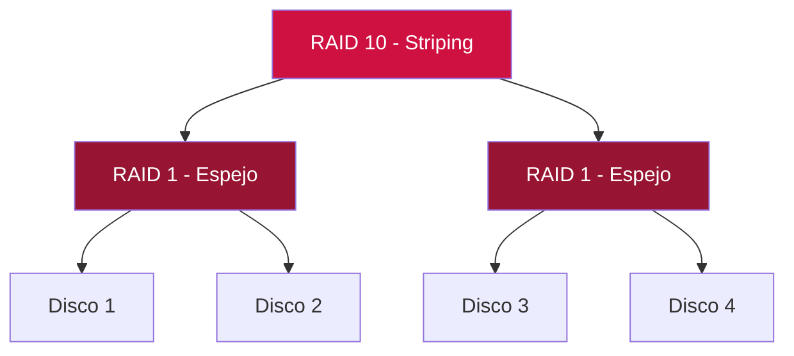
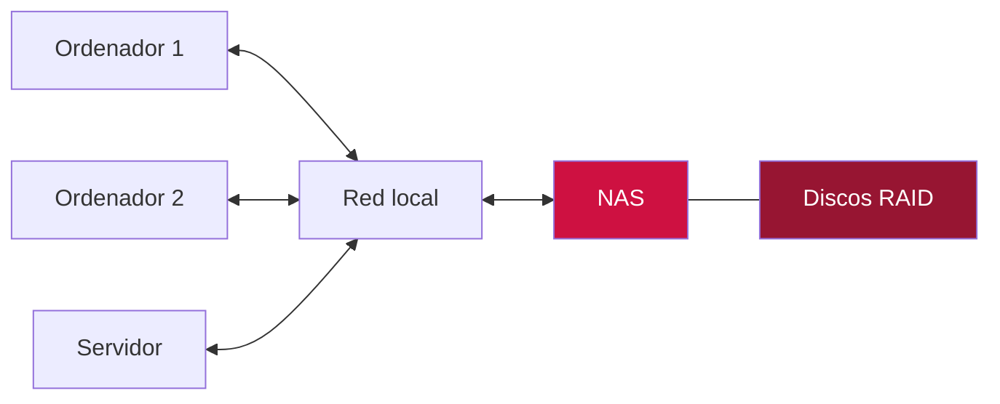
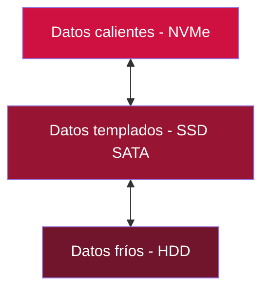

# Almacenamiento secundario

`Fundamentos de Hardware | ASIR`

---

[← Volver al temario](../README.md)

## Índice

1. [HDD y SSD](#1-hdd-y-ssd)
2. [Interfaces de almacenamiento y RAID](#2-interfaces-de-almacenamiento-y-raid)
3. [NAS y casos de uso](#3-nas-y-casos-de-uso)
4. [Ampliación y actualización](#4-ampliación-y-actualización)
5. [Conceptos clave](#5-conceptos-clave)
6. [Preguntas de repaso](#6-preguntas-de-repaso)
7. [Práctica](#7-práctica)

---

## 1. HDD y SSD

Referencia: PDF, páginas 4-8.

El almacenamiento secundario permite conservar
información de forma permanente.

A diferencia de la memoria RAM, no pierde
los datos cuando se apaga el ordenador.

Se utiliza para almacenar:

- Sistemas operativos.
- Programas.
- Documentos.
- Archivos multimedia.
- Bases de datos.
- Copias de seguridad.

### 1.1. Disco duro mecánico (HDD)

HDD significa Hard Disk Drive.

Almacena información magnéticamente sobre
platos giratorios.

Un cabezal se desplaza sobre los platos
para realizar operaciones de lectura y escritura.

### Componentes principales

| Componente | Función |
|---|---|
| Platos | Almacenan información magnéticamente. |
| Cabezal | Lee y escribe los datos. |
| Motor | Hace girar los platos. |
| Actuador | Desplaza el cabezal. |
| Caché | Almacena información temporalmente. |

### RPM

Revoluciones por minuto.

Indican cuántas vueltas realizan los platos
del disco durante un minuto.

Ejemplos habituales:

- 5.400 RPM.
- 7.200 RPM.

El rendimiento también depende de la caché,
los tiempos de acceso y otros factores.

### Ventajas e inconvenientes

| Ventajas | Inconvenientes |
|---|---|
| Gran capacidad. | Menor velocidad. |
| Bajo coste por GB. | Sensible a golpes. |
| Adecuado para archivos masivos. | Ruido y vibraciones. |
| Almacenamiento permanente. | Desgaste mecánico. |

### 1.2. Unidad de estado sólido (SSD)

SSD significa Solid State Drive.

Almacena información mediante memoria flash NAND.

No contiene platos giratorios ni cabezales,
por lo que no necesita realizar movimientos
mecánicos para acceder a los datos.

### Ventajas del SSD

- Mayor velocidad.
- Menor latencia.
- Arranque más rápido del sistema.
- Carga de aplicaciones más rápida.
- Ausencia de ruido mecánico.
- Mayor resistencia a golpes.
- Menor consumo en muchos escenarios.

### Inconvenientes

- Mayor coste por GB en términos generales.
- Resistencia de escritura finita.
- Posibles fallos electrónicos.

Los HDD también sufren desgaste y pueden fallar.

### Comparativa HDD y SSD

| Característica | HDD | SSD |
|---|---|---|
| Tecnología | Magnética | Flash NAND |
| Partes móviles | Sí | No |
| Acceso | Mecánico | Electrónico |
| Velocidad | Menor | Mayor |
| Latencia | Mayor | Menor |
| Coste por GB | Habitualmente bajo | Habitualmente superior |
| Resistencia a golpes | Menor | Mayor |
| Uso recomendado | Archivos y copias masivas | Sistema y programas |

### Configuración recomendada según el uso

Una configuración equilibrada puede combinar:

- SSD para el sistema operativo y los programas.
- HDD para archivos de gran tamaño y copias.

Esto permite aprovechar la velocidad del SSD
y el menor coste por GB del HDD.

---

### 1.3. Formatos de SSD

| Formato | Interfaz | Características |
|---|---|---|
| SSD 2,5 pulgadas | SATA | Conexión mediante cables. |
| M.2 SATA | SATA | Compacto, limitado por SATA. |
| M.2 NVMe | PCIe/NVMe | Elevado rendimiento. |
| Tarjeta PCIe | PCIe/NVMe | Se instala en una ranura de expansión. |
| U.2 y EDSFF | Según plataforma | Orientados a servidores. |

### Diferencia entre formato y protocolo

El formato determina la forma física
del dispositivo.

La interfaz y el protocolo determinan cómo
se comunica con el sistema.

> [!IMPORTANT]
> M.2 no significa necesariamente NVMe.
> Un SSD M.2 SATA y un SSD M.2 NVMe pueden
> tener una apariencia similar y velocidades
> muy diferentes.

---

### 1.4. Fragmentación, desfragmentación y optimización

### Fragmentación

Se produce cuando un archivo queda dividido
en diferentes bloques dispersos por la unidad.

En un HDD, el cabezal debe desplazarse
para acceder a los fragmentos.

Esto puede reducir el rendimiento.

### Desfragmentación

Proceso que reorganiza los fragmentos
para situarlos en bloques más próximos.

Su objetivo es reducir los desplazamientos
del cabezal de un disco mecánico.

### TRIM

Permite informar al SSD de qué bloques
ya no están siendo utilizados.

Esto facilita la gestión interna de la memoria
y ayuda a mantener su rendimiento.

### Diferencias de mantenimiento

| Operación | HDD | SSD |
|---|---|---|
| Desfragmentación tradicional | Cuando corresponde | No recomendada como mantenimiento periódico |
| TRIM | No corresponde | Sí, cuando es compatible |
| Monitorización | Sí | Sí |

### Optimización en Windows

Windows dispone de la herramienta
Optimizar unidades.

El sistema selecciona la operación adecuada
según el tipo de almacenamiento.

### Optimización en Linux

Linux dispone de la herramienta:

    fstrim

Permite informar a las unidades compatibles
de los bloques libres del sistema de archivos.

Según el temario, una ejecución semanal
suele ser suficiente para muchos equipos.

> [!WARNING]
> No se debe programar la desfragmentación
> tradicional periódica de un SSD.
> Genera escrituras innecesarias sin aportar
> el beneficio mecánico que ofrece en un HDD.

---

## 2. Interfaces de almacenamiento y RAID

Referencia: PDF, páginas 8-10.

### 2.1. Comparativa de interfaces

| Tecnología | Aplicación | Características |
|---|---|---|
| SATA | HDD y SSD convencionales | Económica y extendida. |
| SAS | Servidores | Prestaciones profesionales y mayor conectividad. |
| NVMe | SSD de alto rendimiento | Aprovecha el ancho de banda PCIe. |

### Ejemplos complementarios de velocidades

| Interfaz | Velocidad orientativa |
|---|---|
| SATA III | 6 Gb/s nominales |
| SSD SATA | Aproximadamente 500-550 MB/s secuenciales |
| PCIe 4.0 x4 | Hasta unos 7,88 GB/s de enlace por dirección |

El rendimiento real depende de la unidad,
el sistema y el tipo de operaciones.

---

### 2.2. RAID

RAID significa Redundant Array of Independent Disks.

Consiste en combinar varios discos en un
conjunto lógico.

Según el nivel utilizado, permite mejorar:

- Rendimiento.
- Capacidad de almacenamiento.
- Tolerancia a fallos.
- Disponibilidad de los datos.

### Técnicas utilizadas en RAID

| Técnica | Definición |
|---|---|
| Striping | Reparte bloques entre varios discos. |
| Mirroring | Duplica datos en varios discos. |
| Paridad | Información que permite reconstruir datos perdidos. |

### RAID 0

Utiliza striping.

Reparte los datos entre los discos
para aumentar el rendimiento y la capacidad.

    Disco 1     Disco 2
    -------     -------
       A           B
       C           D
       E           F

Características:

- Mínimo de dos discos.
- Aprovecha toda la capacidad.
- No ofrece redundancia.
- Si falla un disco, se pierde el conjunto.

### RAID 1

Utiliza mirroring o almacenamiento en espejo.

    Disco 1     Disco 2
    -------     -------
       A           A
       B           B
       C           C

Características:

- Mínimo de dos discos.
- Duplica la información.
- Tolera el fallo de un disco en una pareja.
- La capacidad útil de una pareja es la de un disco.

### RAID 5

Distribuye datos y paridad entre los discos.

    Disco 1     Disco 2     Disco 3
    -------     -------     -------
       A           B          P1
       C          P2           D
      P3           E           F

P representa la información de paridad.

Características:

- Mínimo de tres discos.
- Tolera el fallo de un disco.
- Ofrece un equilibrio entre capacidad y redundancia.
- La paridad puede penalizar la escritura.

### RAID 6

Utiliza doble paridad distribuida.

Características:

- Mínimo de cuatro discos.
- Tolera el fallo de dos discos.
- Mayor redundancia que RAID 5.
- Pierde el equivalente a dos discos de capacidad.
- Tiene un coste adicional de escritura.

### RAID 10

Combina RAID 1 y RAID 0.

Primero crea grupos de discos en espejo
y después reparte los datos entre ellos.

Características:

- Mínimo de cuatro discos, en número par.
- Buen rendimiento de lectura y escritura.
- Capacidad útil equivalente a la mitad del total.
- Tolera al menos el fallo de un disco.
- Puede tolerar varios fallos si no se pierden
  ambos discos de un mismo espejo.

### Comparativa de niveles RAID

| Nivel | Discos mínimos | Técnica | Fallos tolerados |
|---|---:|---|---|
| RAID 0 | 2 | Striping | 0 |
| RAID 1 | 2 | Mirroring | 1 por pareja |
| RAID 5 | 3 | Paridad | 1 |
| RAID 6 | 4 | Doble paridad | 2 |
| RAID 10 | 4 | Striping y mirroring | 1 garantizado; más según el espejo afectado |

### Fórmulas complementarias de capacidad

N = número de discos.

C = capacidad del disco más pequeño.

| Nivel | Capacidad útil teórica |
|---|---|
| RAID 0 | N x C |
| RAID 1 | C, para una pareja en espejo |
| RAID 5 | (N - 1) x C |
| RAID 6 | (N - 2) x C |
| RAID 10 | (N x C) / 2 |

Estas fórmulas no descuentan el espacio utilizado
por metadatos, formato o discos de reserva.

### Ejemplo de cálculo

Disponemos de cuatro discos de 4 TB.

| Nivel | Capacidad útil |
|---|---:|
| RAID 0 | 16 TB |
| RAID 5 | 12 TB |
| RAID 6 | 8 TB |
| RAID 10 | 8 TB |

Si utilizamos RAID 1 con dos de esos discos,
la capacidad útil será de 4 TB.

### RAID por hardware y por software

| Tipo | Funcionamiento |
|---|---|
| Hardware | Utiliza una controladora dedicada. |
| Software | El sistema operativo gestiona el conjunto. |

### Hot-swap

Permite sustituir una unidad sin apagar
el equipo, si el hardware y la configuración
admiten esta función.

### Reconstrucción RAID

Cuando falla un disco en un conjunto redundante,
la información puede reconstruirse utilizando
los discos supervivientes.

Durante la reconstrucción puede reducirse
el rendimiento del sistema.

> [!WARNING]
> RAID NO ES UNA COPIA DE SEGURIDAD.
>
> No protege por sí solo frente a borrados accidentales,
> ransomware, incendios, robos o pérdida completa
> del equipo.

---

## 3. NAS y casos de uso

Referencia: PDF, páginas 10-12.

### 3.1. NAS

NAS significa Network Attached Storage.

Es un dispositivo dedicado a proporcionar
almacenamiento accesible a través de una red.

Características habituales:

- Varias bahías para discos.
- Configuraciones RAID.
- Carpetas compartidas.
- Gestión de usuarios.
- Permisos de acceso.
- Servicios de copia de seguridad.
- Administración mediante red.

### Ventajas del NAS

- Centraliza los archivos.
- Facilita el acceso compartido.
- Permite gestionar permisos.
- Facilita la organización del almacenamiento.
- Puede utilizarse como destino de copias.

Un NAS también necesita medidas de seguridad
y copias independientes.

### 3.2. Caso de estudio: RAID 5 frente a RAID 10

| Característica | RAID 5 | RAID 10 |
|---|---|---|
| Capacidad útil | N - 1 discos | Mitad del total |
| Escritura | Penalización por paridad | Habitualmente mejor |
| Reconstrucción | Utiliza los discos restantes | Copia desde el espejo superviviente |
| Tolerancia | Un fallo | Depende de los espejos afectados |
| Uso habitual | Almacenamiento de archivos | Bases de datos y cargas intensivas |

### Ejemplo práctico

Para un servidor de archivos donde prima
la capacidad, puede resultar adecuado RAID 5.

Para una base de datos con muchas operaciones
de escritura, RAID 10 puede ofrecer ventajas.

La decisión depende de:

- Presupuesto.
- Capacidad necesaria.
- Rendimiento.
- Tolerancia a fallos.
- Sistema de copias de seguridad.

---

## 4. Ampliación y actualización

Referencia: PDF, páginas 13-14.

### SSD NVMe de alto rendimiento

Las unidades NVMe que utilizan PCIe 4.0 y 5.0
pueden ofrecer velocidades de varios GB/s.

Son especialmente útiles para:

- Edición de vídeo.
- Bases de datos.
- Virtualización.
- Procesamiento intensivo de información.

### Almacenamiento por capas (Tiering)

Consiste en distribuir los datos entre diferentes
tipos de almacenamiento según su frecuencia de uso.

| Capa | Tipo de datos | Tecnología habitual |
|---|---|---|
| Caliente | Uso frecuente | SSD NVMe |
| Templada | Uso intermedio | SSD SATA |
| Fría | Uso poco frecuente | HDD |

Permite equilibrar rendimiento y coste.

### SDS

Software Defined Storage.

Almacenamiento definido por software.

Permite gestionar recursos de almacenamiento
de forma flexible, independientemente de gran
parte del hardware físico utilizado.

Facilita:

- Escalabilidad.
- Gestión centralizada.
- Redundancia.
- Aprovechamiento de recursos.

### Almacenamiento en la nube

Permite contratar recursos de almacenamiento
como un servicio.

| Tipo | Aplicación |
|---|---|
| Objetos | Archivos y datos mediante servicios como S3. |
| Bloques | Discos virtuales. |
| Archivos | Sistemas de archivos compartidos. |

Una configuración híbrida puede combinar
almacenamiento local y almacenamiento cloud.

---

## 5. Conceptos clave

| Concepto | Definición rápida |
|---|---|
| HDD | Disco duro mecánico. |
| SSD | Unidad de estado sólido. |
| NAND | Memoria flash no volátil. |
| RPM | Revoluciones por minuto. |
| Fragmentación | Dispersión de bloques de un archivo. |
| Desfragmentación | Reorganización de fragmentos. |
| TRIM | Informa al SSD de bloques no utilizados. |
| RAID | Conjunto lógico de discos. |
| Striping | Reparto de datos. |
| Mirroring | Duplicación de datos. |
| Paridad | Información de reconstrucción. |
| RAID 0 | Rendimiento sin redundancia. |
| RAID 1 | Almacenamiento en espejo. |
| RAID 5 | Paridad distribuida. |
| RAID 6 | Doble paridad. |
| RAID 10 | Reparto entre espejos. |
| Hot-swap | Sustitución en funcionamiento compatible. |
| NAS | Almacenamiento conectado a la red. |
| Tiering | Almacenamiento por capas. |
| SDS | Almacenamiento definido por software. |

---

## 6. Preguntas de repaso

01. ¿Qué diferencia el almacenamiento secundario de la RAM?

Conserva los datos sin alimentación eléctrica.

02. ¿Cómo almacena los datos un HDD?

Magnéticamente sobre platos giratorios.

03. ¿Qué significan las RPM?

Revoluciones por minuto.

04. ¿Qué tecnología utiliza un SSD?

Memoria flash NAND.

05. ¿Qué dispositivo suele ofrecer mayor capacidad por euro?

El HDD.

06. ¿Qué unidad resulta recomendable para instalar el sistema operativo?

Un SSD, preferiblemente NVMe si existe compatibilidad.

07. ¿Todos los SSD M.2 utilizan NVMe?

No. También existen SSD M.2 SATA.

08. ¿Qué es la fragmentación?

La distribución dispersa de los bloques de un archivo.

09. ¿Qué finalidad tiene la desfragmentación?

Reducir los desplazamientos del cabezal de un HDD.

10. ¿Para qué sirve TRIM?

Para informar al SSD de los bloques que ya no se usan.

11. ¿Qué herramienta de Linux permite realizar TRIM?

fstrim.

12. ¿Qué interfaz se utiliza principalmente en almacenamiento profesional?

SAS.

13. ¿Qué significa RAID?

Redundant Array of Independent Disks.

14. ¿Qué caracteriza a RAID 0?

Reparte los datos sin ofrecer redundancia.

15. ¿Qué caracteriza a RAID 1?

Duplica la información en espejo.

16. ¿Cuántos discos necesita RAID 5 como mínimo?

Tres discos.

17. ¿Cuántos fallos tolera RAID 6?

Dos discos.

18. ¿Cuántos discos necesita RAID 10 como mínimo?

Cuatro discos.

19. ¿Qué ocurre si fallan ambos discos del mismo espejo RAID 10?

Se pierde el conjunto si no existe otra forma
de reconstruir la información de ese espejo.

20. ¿Cuánto espacio útil ofrece RAID 5 con cuatro discos de 4 TB?

12 TB teóricos.

21. ¿Cuánto espacio útil ofrece RAID 6 con cuatro discos de 4 TB?

8 TB teóricos.

22. ¿Cuánto espacio útil ofrece RAID 10 con cuatro discos de 4 TB?

8 TB teóricos.

23. ¿RAID sustituye a una copia de seguridad?

No. La redundancia y las copias de seguridad
son medidas diferentes y complementarias.

24. ¿Qué RAID suele ser más adecuado para escrituras intensivas?

RAID 10 frente a RAID 5, porque no necesita
calcular paridad.

25. ¿Qué es un NAS?

Un dispositivo dedicado a compartir almacenamiento
a través de una red.

26. ¿Qué es tiering?

Distribuir los datos entre diferentes capas
de almacenamiento según su frecuencia de uso.

27. ¿Qué significa SDS?

Software Defined Storage o almacenamiento
definido por software.

---

## 7. Práctica

### Identificación del almacenamiento

- [ ] Identificar las unidades del ordenador.
- [ ] Distinguir HDD y SSD.
- [ ] Identificar formatos e interfaces.
- [ ] Consultar la capacidad disponible.
- [ ] Comprobar el tipo de optimización adecuado.

### Configuración RAID

- [ ] Comparar RAID 0, 1, 5, 6 y 10.
- [ ] Calcular las capacidades útiles.
- [ ] Identificar la tolerancia a fallos.
- [ ] Configurar RAID 1 por software en un entorno de prueba.
- [ ] Justificar la elección de RAID 5 o RAID 10.

Utilizar discos virtuales o de prueba para evitar
la pérdida de información real.

### Diseño de un NAS

- [ ] Determinar la capacidad necesaria.
- [ ] Elegir un nivel RAID.
- [ ] Planificar usuarios y permisos.
- [ ] Diseñar carpetas compartidas.
- [ ] Planificar una copia de seguridad independiente.

Entregable: tabla comparativa RAID y evidencia
de una configuración RAID 1 por software.

---

## Resumen final

El almacenamiento secundario conserva
los datos de forma permanente.

El HDD ofrece capacidad económica.

El SSD ofrece mayor velocidad y menor latencia.

M.2 define un formato, no una velocidad.

El HDD se desfragmenta cuando corresponde.
El SSD se optimiza mediante TRIM.

RAID permite mejorar el rendimiento o la redundancia,
pero no sustituye a las copias de seguridad.

El NAS centraliza el almacenamiento en red.

Tiering, SDS y cloud permiten gestionar
el almacenamiento de manera más flexible.

---

Fuente: Fundamentos de Hardware, Unidad 6.
Prometeo - thePower. Apuntes personales.

Las fórmulas y ejemplos numéricos son
ampliaciones complementarias.

---

`UNIDAD 06 | FUNDAMENTOS DE HARDWARE`

[Volver al temario](../README.md)

