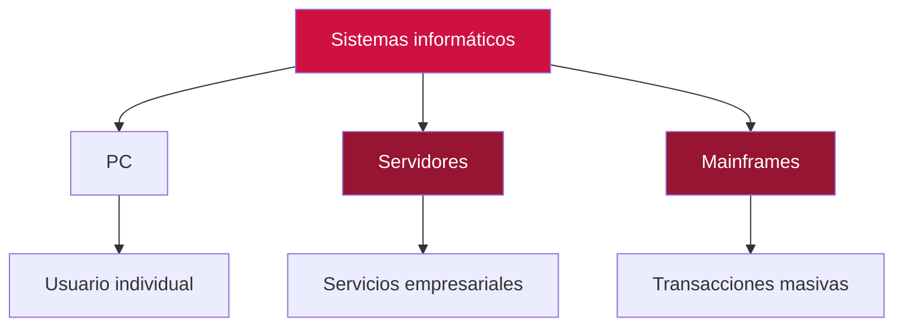
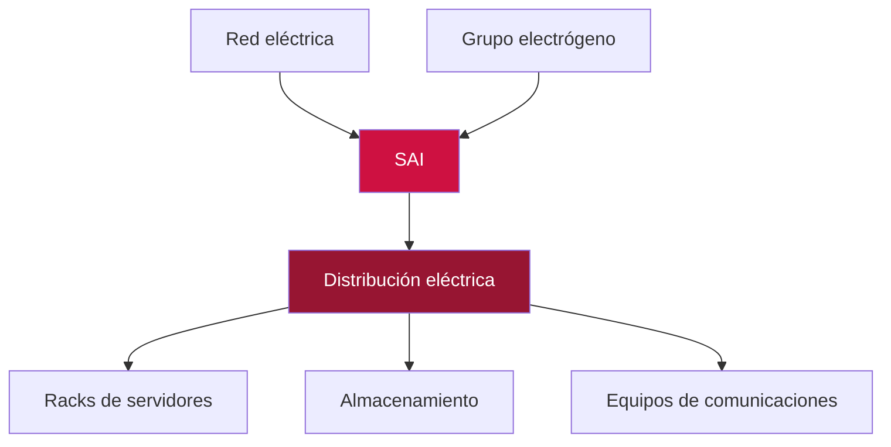
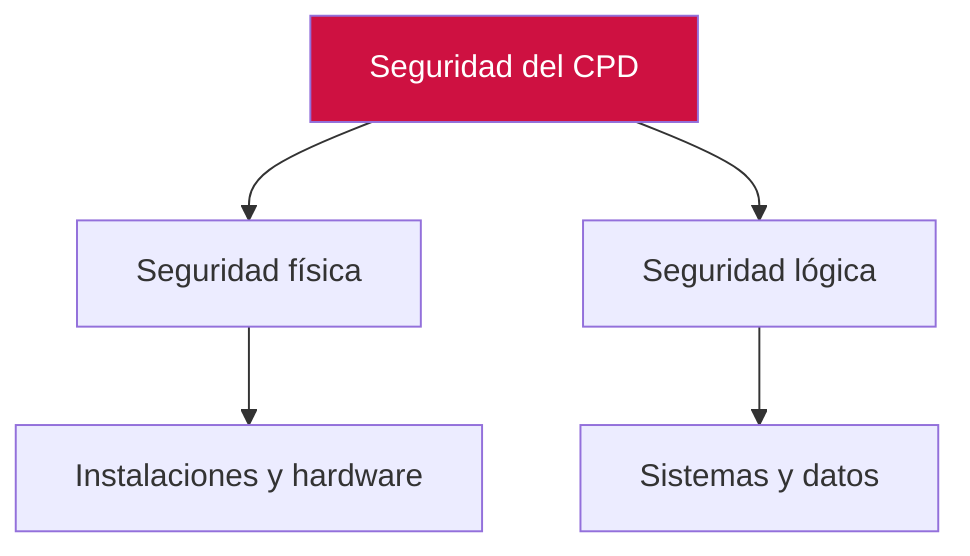
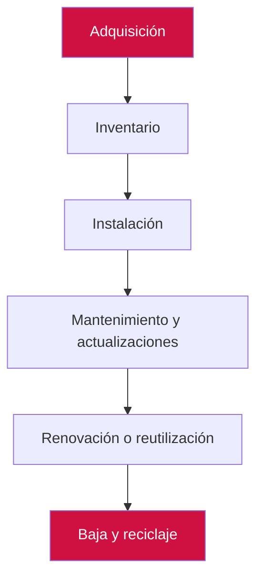
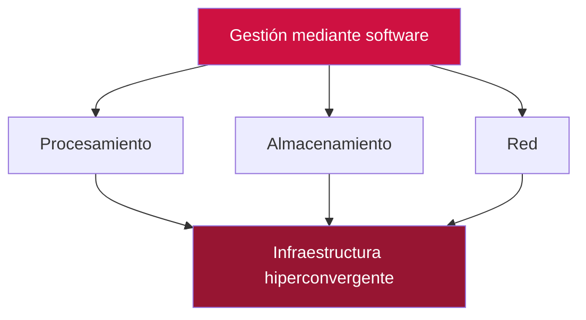

# Implantación de sistemas informáticos (CPD)

`Fundamentos de Hardware | ASIR`

---

[← Volver al temario](../README.md)

## Índice

1. [Arquitecturas de sistemas informáticos](#1-arquitecturas-de-sistemas-informáticos)
2. [El centro de procesamiento de datos (CPD)](#2-el-centro-de-procesamiento-de-datos-cpd)
3. [Refrigeración, seguridad y gestión de activos](#3-refrigeración-seguridad-y-gestión-de-activos)
4. [Ampliación y actualización](#4-ampliación-y-actualización)
5. [Conceptos clave](#5-conceptos-clave)
6. [Preguntas de repaso](#6-preguntas-de-repaso)
7. [Práctica](#7-práctica)

---

## 1. Arquitecturas de sistemas informáticos

Referencia: PDF, páginas 4-7.

Los sistemas informáticos se diseñan según
las necesidades de los usuarios, la carga
de trabajo y la disponibilidad necesaria.

### 1.1. Ordenador personal (PC)

PC significa Personal Computer.

Está diseñado principalmente para el uso individual
y la realización de tareas interactivas.

Aplicaciones habituales:

- Ofimática.
- Navegación.
- Diseño.
- Entretenimiento.
- Puestos de trabajo.

No está diseñado necesariamente para proporcionar
servicios críticos de forma ininterrumpida
a numerosos usuarios.

### 1.2. Sistemas departamentales

Son servidores destinados a proporcionar servicios
a departamentos u organizaciones.

Servicios habituales:

- Correo electrónico.
- Almacenamiento compartido.
- Bases de datos.
- Servicios web.
- Virtualización.

### Características de los servidores

- Procesadores de alto rendimiento.
- Elevada capacidad de memoria RAM.
- Compatibilidad habitual con memoria ECC.
- Almacenamiento RAID.
- Fuentes de alimentación redundantes.
- Posibilidad de sustitución de discos en caliente.
- Diseño orientado a la disponibilidad continua.

### Servidor en torre y servidor en rack

| Característica | Torre | Rack |
|---|---|---|
| Formato | Similar a un PC grande | Plano y estandarizado |
| Instalación | Independiente | Dentro de un armario |
| Espacio | Mayor por equipo | Permite apilar equipos |
| Uso habitual | Pequeñas empresas | Centros de datos |

### 1.3. Mainframes

Son grandes sistemas informáticos centrales
diseñados para procesar enormes cantidades
de transacciones con elevada fiabilidad.

Características:

- Alta disponibilidad.
- Elevada capacidad de entrada y salida.
- Procesamiento masivo de transacciones.
- Fiabilidad y seguridad.
- Capacidad para gestionar servicios críticos.

Usos habituales:

- Entidades bancarias.
- Aseguradoras.
- Administraciones públicas.
- Aerolíneas.

Los mainframes siguen siendo relevantes
en determinados entornos empresariales.

### Comparativa general

| Sistema | Escala | Uso |
|---|---|---|
| PC | Usuario individual | Tareas personales |
| Servidor en torre | Pequeña organización | Servicios compartidos |
| Servidor en rack | Organización o CPD | Servicios continuos |
| Mainframe | Grandes organizaciones | Transacciones masivas y críticas |

---

## 2. El centro de procesamiento de datos (CPD)

Referencia: PDF, páginas 7-9.

Un CPD es una instalación destinada a alojar
y proteger los recursos informáticos
y las comunicaciones de una organización.

Su objetivo es garantizar:

- Disponibilidad.
- Seguridad.
- Continuidad del servicio.
- Fiabilidad.
- Escalabilidad.
- Facilidad de mantenimiento.

### 2.1. Diseño físico del CPD

| Elemento | Función |
|---|---|
| Sala protegida | Reduce riesgos físicos y accesos no autorizados. |
| Suelo técnico | Permite canalizar cables y aire cuando se utiliza. |
| Alimentación redundante | Proporciona rutas eléctricas alternativas. |
| SAI | Mantiene temporalmente la alimentación. |
| Grupo electrógeno | Proporciona energía durante cortes prolongados. |
| Refrigeración | Mantiene temperaturas adecuadas. |
| Racks | Alojan los equipos informáticos. |
| Comunicaciones redundantes | Reducen interrupciones de conectividad. |
| Control de acceso | Restringe la entrada a personal autorizado. |

### Infraestructura eléctrica

Esquema simplificado de alimentación de un CPD.

La redundancia permite mantener el servicio
cuando falla alguno de los elementos,
siempre que exista una ruta alternativa operativa.

### 2.2. Racks de 19 pulgadas

Los racks son armarios estandarizados
que permiten instalar servidores, equipos
de comunicaciones y almacenamiento.

El estándar habitual de montaje es de 19 pulgadas.

### Unidades de rack (U)

La altura de los equipos se expresa en unidades U.

    1U = 44,45 mm

| Tamaño | Altura nominal |
|---|---:|
| 1U | 44,45 mm |
| 2U | 88,90 mm |
| 4U | 177,80 mm |
| 42U | 1.866,90 mm |

Un rack habitual de 42U dispone de 42 unidades
de espacio de montaje.

La altura exterior del armario puede ser superior.

### Elementos de un rack

| Elemento | Función |
|---|---|
| Guías | Sujetar y extraer los equipos. |
| PDU | Distribuir alimentación eléctrica. |
| Patch panel | Organizar las conexiones de red. |
| Organizadores | Ordenar y guiar los cables. |
| Paneles ciegos | Cubrir espacios y ayudar al flujo de aire. |

### PDU

Power Distribution Unit.

Distribuye energía eléctrica a los dispositivos
instalados en el rack.

### Ejemplo complementario de ocupación

Disponemos de un rack de 42U.

| Equipo | Cantidad | Espacio total |
|---|---:|---:|
| Servidores de 2U | 12 | 24U |
| Switches de 1U | 2 | 2U |
| Almacenamiento de 4U | 1 | 4U |
| Total | | 30U |

Espacio restante:

    42 - 30 = 12U

Porcentaje de ocupación:

    (30 / 42) x 100 = 71,43 %

Además del espacio, hay que comprobar el peso,
la profundidad, la potencia y la refrigeración.

### 2.3. Cableado estructurado

Consiste en organizar las conexiones
de comunicaciones mediante una infraestructura
planificada y documentada.

Elementos habituales:

- Cableado de cobre.
- Fibra óptica.
- Patch panels.
- Organizadores horizontales y verticales.
- Etiquetas de identificación.

### Buenas prácticas

- Etiquetar ambos extremos de cada cable.
- Documentar las conexiones.
- Organizar las rutas del cableado.
- Evitar obstrucciones al flujo de aire.
- Facilitar futuras ampliaciones.

Un cableado correctamente organizado reduce
el tiempo necesario para localizar averías
y realizar tareas de mantenimiento.

---

## 3. Refrigeración, seguridad y gestión de activos

Referencia: PDF, páginas 9-13.

### 3.1. Refrigeración del CPD

Los servidores generan calor continuamente.

Para evitar sobrecalentamientos, el CPD
necesita sistemas de refrigeración adecuados
a la carga térmica de los equipos.

### Pasillos fríos y calientes

Los racks se colocan de manera que los frontales
de los servidores reciban aire frío y las partes
traseras expulsen el aire caliente.

El objetivo es evitar la mezcla innecesaria
entre el aire frío y el caliente.

### Sistemas de refrigeración

- Climatización de precisión.
- Refrigeración por aire.
- Refrigeración líquida.
- Refrigeración por inmersión.

La elección depende de la densidad de equipos,
la carga térmica y las características del CPD.

### PUE

Power Usage Effectiveness.

Es un indicador de eficiencia energética
de los centros de datos.

Relaciona la energía total consumida por
la instalación con la utilizada directamente
por los equipos informáticos.

### Fórmula

    PUE = Energía total del CPD / Energía de TI

TI significa Tecnologías de la Información.

Ambos consumos deben corresponder
al mismo periodo de tiempo.

### Interpretación

| PUE | Significado |
|---|---|
| 1,0 | Valor ideal teórico. |
| 1,2-1,5 | Eficiente según la referencia del temario. |
| 2,0 | El consumo total duplica el consumo de TI. |
| Superior a 2 | Elevado consumo auxiliar respecto al consumo de TI. |

Cuanto más se aproxima el PUE a 1,
menor es la proporción de energía utilizada
por los sistemas auxiliares.

### Ejemplo práctico

Un CPD consume:

- Energía total: 150 kWh.
- Energía de equipos informáticos: 100 kWh.

Cálculo:

    PUE = 150 / 100 = 1,5

Consumo auxiliar:

    150 - 100 = 50 kWh

Los 50 kWh corresponden a sistemas auxiliares
como refrigeración y distribución eléctrica.

> [!NOTE]
> El PUE no mide directamente la huella de carbono
> ni la eficiencia de las aplicaciones informáticas.

---

### 3.2. Seguridad física y lógica

La protección de un CPD necesita medidas
tanto físicas como informáticas.

### Seguridad física

Protege las instalaciones y los equipos.

| Medida | Función |
|---|---|
| Control de acceso | Restringe la entrada. |
| Tarjetas y biometría | Identifican al personal autorizado. |
| Videovigilancia | Supervisa las instalaciones. |
| Detección de incendios | Identifica situaciones de riesgo. |
| Extinción de incendios | Limita los daños. |
| Protección ante inundaciones | Reduce daños físicos. |

### Seguridad lógica

Protege los sistemas, las redes y la información.

| Medida | Función |
|---|---|
| Permisos | Limitan el acceso a los recursos. |
| Autenticación | Verifica la identidad. |
| Cortafuegos | Controlan el tráfico de red. |
| Cifrado | Protege la información. |
| Copias de seguridad | Facilitan la recuperación. |
| Actualizaciones | Corrigen vulnerabilidades. |

Ambos tipos de seguridad son complementarios.

### ENS

Esquema Nacional de Seguridad.

El temario lo relaciona con las medidas
de protección y gestión de la seguridad
de los sistemas de información.

Su aplicación depende del ámbito
y las obligaciones de cada organización.

---

### 3.3. Inventario y gestión de activos

La gestión de activos permite conocer
los recursos disponibles y controlar
su mantenimiento durante toda su vida útil.

### Inventario de hardware

Debe recoger información como:

- Identificador del equipo.
- Fabricante y modelo.
- Número de serie.
- Ubicación física.
- Componentes instalados.
- Configuración.
- Versión de firmware.
- Garantía.
- Estado del equipo.

### Ejemplo de ficha de servidor

| Campo | Ejemplo ficticio |
|---|---|
| Identificador | SRV-01 |
| Ubicación | Rack 01 |
| Posición | U10-U11 |
| Formato | 2U |
| Procesador | 16 núcleos |
| Memoria | 128 GB ECC |
| Almacenamiento | RAID 10 |
| Alimentación | Fuentes redundantes |

### Ciclo de vida de los activos

### DCIM

Data Center Infrastructure Management.

Conjunto de herramientas destinadas
a supervisar y gestionar la infraestructura
de un centro de datos.

Permite controlar:

- Equipos.
- Ubicación y ocupación de racks.
- Consumo energético.
- Refrigeración.
- Activos e infraestructura.

### Actualizaciones

Las actualizaciones de software y firmware
deben gestionarse de forma planificada.

Buenas prácticas:

- Comprobar compatibilidad.
- Probar las actualizaciones previamente.
- Planificar ventanas de mantenimiento.
- Documentar los cambios.
- Preparar procedimientos de recuperación.

En sistemas críticos no se deben realizar
cambios importantes sin valorar el impacto
sobre la continuidad del servicio.

---

### 3.4. Inventario de software y licencias

Permite identificar los programas instalados
y comprobar que su utilización es adecuada.

### Información que debe registrarse

| Campo | Contenido |
|---|---|
| Programa | Nombre de la aplicación. |
| Versión | Versión instalada. |
| Equipo | Dispositivo donde se utiliza. |
| Fecha | Fecha de instalación. |
| Licencia | Tipo y condiciones de uso. |
| Renovación | Fecha de vencimiento, si corresponde. |
| Cantidad | Licencias contratadas y utilizadas. |

### Tipos de licencias

| Tipo | Características |
|---|---|
| Perpetua | Derecho de uso sin renovación periódica según condiciones. |
| Suscripción | Requiere pagos o renovaciones periódicas. |
| Por usuario | Asociada a un usuario. |
| Por dispositivo | Asociada a un equipo. |
| Ligada a la máquina | Su utilización depende del dispositivo autorizado. |

### Inventario en Windows

Se puede consultar mediante herramientas
de administración e inventario y mediante
la información de programas instalados
registrada en el sistema.

El temario advierte sobre el uso de:

    Win32_Product

Esta clase WMI puede activar comprobaciones
de instaladores y reducir el rendimiento.

### Inventario en Linux

Distribuciones basadas en Debian:

    dpkg -l

Sistemas que utilizan paquetes RPM:

    rpm -qa

Estos comandos permiten consultar
los paquetes instalados.

En organizaciones grandes pueden utilizarse
agentes de inventario que centralizan
la información de los diferentes equipos.

> [!WARNING]
> No se deben publicar claves de licencia,
> contraseñas ni datos sensibles de inventario
> en repositorios públicos.

---

## 4. Ampliación y actualización

Referencia: PDF, páginas 13-15.

### 4.1. Infraestructura hiperconvergente (HCI)

HCI significa Hyper-Converged Infrastructure.

Integra recursos de procesamiento, almacenamiento
y red en una infraestructura gestionada mediante
software.

Ventajas:

- Simplificación de la gestión.
- Escalabilidad mediante nuevos nodos.
- Integración de recursos.
- Aprovechamiento de la virtualización.

Es habitual en determinadas plataformas
de nube privada.

### 4.2. Edge computing

Consiste en acercar el procesamiento
al lugar donde se generan los datos.

Ejemplos:

- Fábricas.
- Tiendas.
- Sensores IoT.
- Antenas de comunicaciones.
- Pequeños centros de datos distribuidos.

Ventajas:

- Reducción de latencia.
- Menor tráfico hacia el CPD central.
- Procesamiento próximo al origen.
- Complemento de la infraestructura cloud.

### 4.3. Sostenibilidad de los CPD

El consumo eléctrico y la refrigeración
son factores importantes en el impacto
económico y ambiental de un centro de datos.

Medidas de mejora:

- Utilización de equipos eficientes.
- Virtualización y consolidación.
- Reducción de servidores infrautilizados.
- Refrigeración eficiente.
- Aprovechamiento de energías renovables.
- Reparación y reutilización de equipos.
- Gestión responsable de los RAEE.

### Free cooling

Consiste en aprovechar condiciones ambientales
exteriores favorables para reducir la energía
necesaria para refrigerar el CPD.

No elimina necesariamente la necesidad
de climatización adicional.

---

## 5. Conceptos clave

| Concepto | Definición rápida |
|---|---|
| PC | Ordenador personal. |
| Servidor | Sistema que presta servicios a otros equipos. |
| Mainframe | Sistema central para transacciones masivas. |
| CPD | Centro de procesamiento de datos. |
| Rack | Armario estandarizado para equipos. |
| U | Unidad de altura de rack. |
| PDU | Unidad de distribución eléctrica. |
| SAI | Sistema de alimentación ininterrumpida. |
| Patch panel | Panel de conexiones de red. |
| Pasillo frío | Zona de entrada de aire refrigerado. |
| Pasillo caliente | Zona de salida de aire caliente. |
| PUE | Relación entre energía total y energía de TI. |
| ENS | Esquema Nacional de Seguridad. |
| DCIM | Gestión de infraestructura del CPD. |
| Inventario | Registro de equipos y aplicaciones. |
| HCI | Infraestructura hiperconvergente. |
| Edge | Procesamiento cerca del origen del dato. |
| Free cooling | Refrigeración aprovechando condiciones exteriores. |
| RAEE | Residuos eléctricos y electrónicos. |

---

## 6. Preguntas de repaso

01. ¿Para qué está diseñado un PC?

Para realizar tareas interactivas de uso individual.

02. ¿Qué diferencia un servidor en torre de uno en rack?

El servidor en rack utiliza un formato normalizado
que permite instalarlo en un armario junto a otros equipos.

03. ¿Qué caracteriza a un mainframe?

Su fiabilidad y capacidad de procesar grandes
volúmenes de transacciones críticas.

04. ¿Qué ventajas ofrece un servidor profesional?

Redundancia, memoria ECC, RAID y disponibilidad
continua según la plataforma.

05. ¿Qué es un CPD?

Una instalación que aloja servidores,
almacenamiento y comunicaciones.

06. ¿Por qué debe protegerse físicamente un CPD?

Para evitar accesos no autorizados y reducir
riesgos como incendios e inundaciones.

07. ¿Qué aporta la alimentación redundante?

Rutas alternativas para mantener el suministro
ante determinados fallos.

08. ¿Qué diferencia hay entre un SAI y un grupo electrógeno?

El SAI mantiene temporalmente la alimentación.
El generador puede proporcionar energía durante
periodos más prolongados.

09. ¿Cuál es el ancho de montaje habitual de un rack?

19 pulgadas.

10. ¿Cuánto mide una unidad de rack?

44,45 mm de altura nominal.

11. ¿Cuántas unidades ocupa un servidor de 2U?

Dos unidades.

12. ¿Qué función tiene una PDU?

Distribuir alimentación eléctrica entre los equipos.

13. ¿Para qué sirve un patch panel?

Para organizar y terminar las conexiones de red.

14. ¿Por qué deben etiquetarse los cables?

Para facilitar su identificación, el mantenimiento
y las futuras ampliaciones.

15. ¿Qué objetivo tienen los pasillos fríos y calientes?

Separar los flujos de entrada y salida de aire.

16. ¿Cómo se calcula el PUE?

Dividiendo la energía total del CPD
entre la energía consumida por los equipos de TI.

17. ¿Cuál es el PUE si el CPD consume 150 kWh y TI consume 100 kWh?

1,5.

18. ¿Cuál es el PUE ideal teórico?

1,0.

19. ¿Qué medidas pertenecen a la seguridad física?

Control de accesos, videovigilancia
y protección contra incendios e inundaciones.

20. ¿Qué medidas pertenecen a la seguridad lógica?

Permisos, autenticación, cifrado, cortafuegos,
actualizaciones y copias de seguridad.

21. ¿Qué significa DCIM?

Data Center Infrastructure Management.

22. ¿Por qué deben probarse las actualizaciones?

Para reducir el riesgo de fallos e interrupciones.

23. ¿Qué recoge un inventario de software?

Programas, versiones, equipos, fechas
y licencias utilizadas.

24. ¿Qué es HCI?

Una infraestructura que integra procesamiento,
almacenamiento y red mediante software.

25. ¿Qué ventaja ofrece edge computing?

Reduce la latencia y el tráfico al procesar
los datos cerca de su origen.

26. ¿Qué es free cooling?

Aprovechar condiciones ambientales exteriores
para reducir las necesidades de refrigeración.

27. ¿Cómo contribuye la consolidación a la eficiencia?

Permite reducir la cantidad de equipos físicos
infrautilizados y su consumo energético.

---

## 7. Práctica

### Diseño de un CPD

- [ ] Dibujar el plano de un centro de datos.
- [ ] Distribuir los racks.
- [ ] Diseñar pasillos fríos y calientes.
- [ ] Planificar alimentación redundante.
- [ ] Organizar el cableado.
- [ ] Definir las medidas de seguridad.

### Dimensionamiento de un rack

- [ ] Identificar la capacidad total en U.
- [ ] Calcular el espacio ocupado.
- [ ] Calcular el espacio disponible.
- [ ] Planificar las futuras ampliaciones.

### Gestión energética y de activos

- [ ] Calcular el PUE.
- [ ] Proponer mejoras de eficiencia.
- [ ] Elaborar una ficha de servidor.
- [ ] Crear un inventario de software y licencias.
- [ ] Planificar las actualizaciones.

Entregable: plano del CPD, cálculo de PUE
y ficha de inventario de un servidor.

---

## Resumen final

Los PC están orientados al uso individual.

Los servidores proporcionan servicios compartidos.

Los mainframes procesan grandes cantidades
de transacciones críticas.

El CPD aloja y protege los recursos informáticos.

Los racks permiten organizar los equipos.

La alimentación redundante y la refrigeración
favorecen la continuidad del servicio.

El PUE mide la relación entre consumo total
y consumo de los equipos informáticos.

La seguridad física y lógica son complementarias.

Los inventarios permiten gestionar los equipos,
las aplicaciones y sus licencias.

La hiperconvergencia, el edge computing
y la sostenibilidad amplían el diseño tradicional
de los centros de datos.

---

Fuente: Fundamentos de Hardware, Unidad 7.
Prometeo - thePower. Apuntes personales.

Los ejemplos de cálculo y fichas de inventario
son material complementario de aprendizaje.

---

`UNIDAD 07 | FUNDAMENTOS DE HARDWARE`

[Volver al temario](../README.md)

