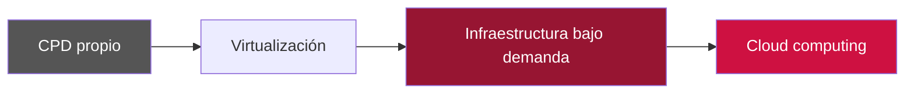
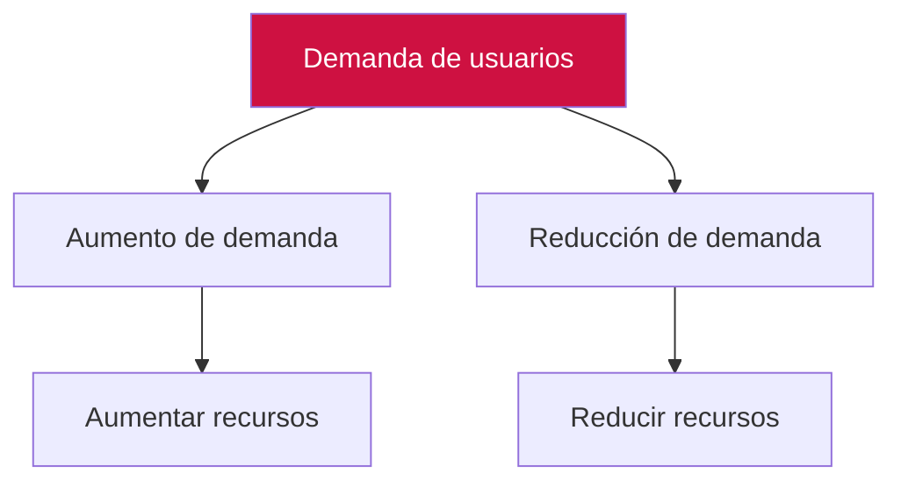
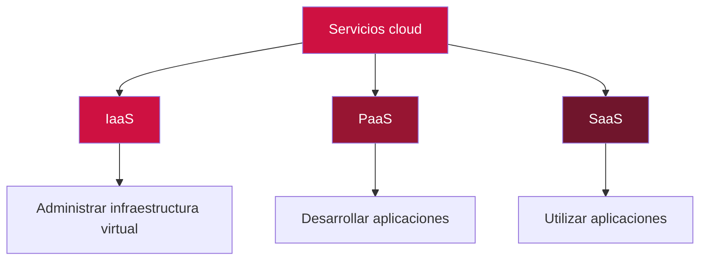
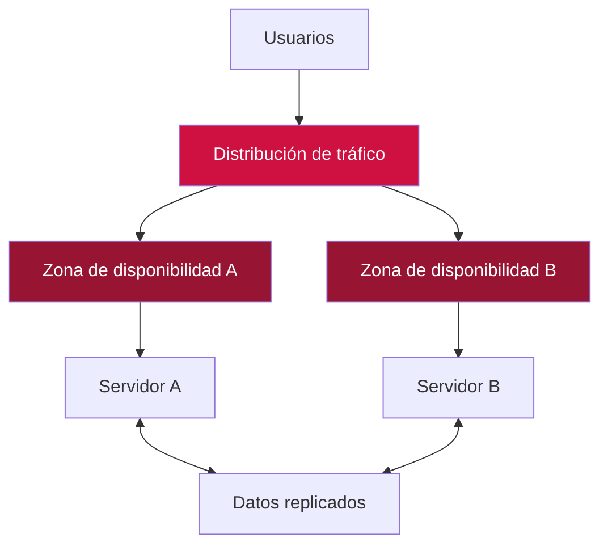
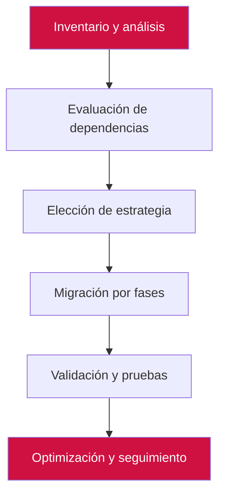
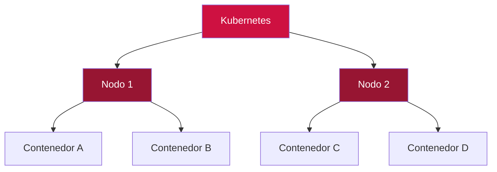

# Estándares y arquitectura en la computación en la nube

`Fundamentos de Hardware | ASIR`

---

[← Volver al temario](../README.md)

## Índice

1. [Fundamentos del cloud computing](#1-fundamentos-del-cloud-computing)
2. [Modelos de servicio y proveedores](#2-modelos-de-servicio-y-proveedores)
3. [Arquitectura cloud, migración y tendencias](#3-arquitectura-cloud-migración-y-tendencias)
4. [Ampliación y actualización](#4-ampliación-y-actualización)
5. [Conceptos clave](#5-conceptos-clave)
6. [Preguntas de repaso](#6-preguntas-de-repaso)
7. [Práctica](#7-práctica)

---

## 1. Fundamentos del cloud computing

Referencia: PDF, páginas 4-7.

### 1.1. Computación en la nube

Cloud computing consiste en utilizar recursos
informáticos como servicios accesibles mediante
una red, normalmente Internet.

Estos recursos pueden ser:

- Servidores.
- Almacenamiento.
- Redes.
- Bases de datos.
- Aplicaciones.
- Capacidad de procesamiento.

En lugar de comprar y mantener toda
la infraestructura física, una organización
puede contratar los recursos que necesita.

> [!IMPORTANT]
> La nube no elimina el hardware físico.
> Los servidores siguen existiendo en los centros
> de datos del proveedor.

### Evolución histórica

### On-premise

Infraestructura informática instalada
y gestionada por la propia organización.

La empresa debe encargarse de:

- Adquirir el hardware.
- Mantener los equipos.
- Gestionar la alimentación.
- Refrigerar las instalaciones.
- Administrar la infraestructura.
- Sustituir componentes averiados.

### Virtualización

Permite ejecutar varias máquinas virtuales
sobre un mismo equipo físico.

Facilita el aprovechamiento del hardware
y permite gestionar recursos de manera flexible.

### Cloud computing

Añade la posibilidad de utilizar recursos
bajo demanda mediante servicios gestionados
por un proveedor.

---

### 1.2. Ventajas de la nube

| Ventaja | Explicación |
|---|---|
| Pago por uso | Se factura según los servicios contratados y utilizados. |
| Menor inversión inicial | Reduce la necesidad de comprar infraestructura física. |
| Escalabilidad | Permite aumentar los recursos disponibles. |
| Elasticidad | Permite adaptar los recursos a la demanda. |
| Acceso global | Facilita el acceso a servicios desde diferentes lugares. |
| Agilidad | Permite desplegar recursos rápidamente. |
| Mantenimiento físico | El proveedor gestiona el hardware del servicio. |

### Escalabilidad

Capacidad de aumentar los recursos
para soportar una carga de trabajo mayor.

Por ejemplo, ampliar la capacidad de procesamiento
de una aplicación que recibe más usuarios.

### Elasticidad

Capacidad de aumentar o reducir los recursos
según las necesidades del momento.

### Ejemplo práctico

Una tienda online recibe muchas más visitas
durante una campaña comercial.

Puede aumentar sus recursos informáticos
durante ese periodo y reducirlos cuando
finalice la campaña.

De esta forma evita mantener permanentemente
una infraestructura sobredimensionada.

### Inconvenientes de la nube

- Dependencia de la conexión.
- Dependencia del proveedor.
- Posibles costes recurrentes elevados.
- Riesgos de seguridad.
- Requisitos de cumplimiento y protección de datos.
- Necesidad de controlar los recursos contratados.
- Complejidad de determinadas migraciones.

### Nube frente a infraestructura propia

| Característica | On-premise | Cloud |
|---|---|---|
| Hardware | Propio | Gestionado por el proveedor en la nube pública |
| Inversión inicial | Habitualmente elevada | Generalmente menor |
| Ampliación | Adquisición e instalación | Contratación de recursos |
| Mantenimiento físico | Organización | Proveedor en la nube pública |
| Control directo | Mayor | Depende del servicio |
| Costes | Compra y funcionamiento | Consumo y contratación |

> [!NOTE]
> La nube no siempre resulta más económica.
> Es necesario comparar el coste total
> durante el periodo de utilización.

---

## 2. Modelos de servicio y proveedores

Referencia: PDF, páginas 7-9.

### 2.1. Modelos de servicio

Los tres modelos fundamentales son:

- IaaS.
- PaaS.
- SaaS.

Se diferencian principalmente por las tareas
que administra el proveedor y las que
debe realizar el cliente.

### IaaS

Infrastructure as a Service.

Infraestructura como servicio.

El proveedor ofrece recursos como:

- Máquinas virtuales.
- Almacenamiento.
- Redes virtuales.
- Capacidad de procesamiento.

El cliente administra habitualmente:

- Sistema operativo.
- Aplicaciones.
- Configuración.
- Datos.
- Permisos y accesos.

Ejemplo complementario: Amazon EC2.

Es el modelo que ofrece mayor control
sobre el sistema operativo y las aplicaciones
de los tres modelos habituales.

### PaaS

Platform as a Service.

Plataforma como servicio.

El proveedor proporciona una plataforma
preparada para desarrollar, ejecutar
y desplegar aplicaciones.

Administra gran parte de la infraestructura,
el sistema operativo y el entorno de ejecución.

El cliente se centra principalmente
en el código, los datos y la configuración
de la aplicación.

Ejemplo complementario: Azure App Service.

### SaaS

Software as a Service.

Software como servicio.

El proveedor ofrece una aplicación
preparada para utilizarse.

El usuario no necesita instalar
ni mantener toda la infraestructura
que permite su funcionamiento.

Ejemplos:

- Correo electrónico web.
- Aplicaciones ofimáticas online.
- Plataformas de gestión empresarial.

El cliente sigue siendo responsable
del uso adecuado de sus cuentas,
permisos y datos.

### Comparativa IaaS, PaaS y SaaS

| Característica | IaaS | PaaS | SaaS |
|---|---|---|---|
| Qué proporciona | Infraestructura | Plataforma | Aplicación |
| Sistema operativo | Cliente | Proveedor | Proveedor |
| Aplicaciones | Cliente | Cliente | Proveedor |
| Infraestructura física | Proveedor | Proveedor | Proveedor |
| Control técnico | Mayor | Intermedio | Menor |
| Administración técnica del cliente | Mayor | Intermedia | Menor |

### Reparto de responsabilidades

| Capa | On-premise | IaaS | PaaS | SaaS |
|---|---|---|---|---|
| Hardware | Cliente | Proveedor | Proveedor | Proveedor |
| Red física | Cliente | Proveedor | Proveedor | Proveedor |
| Virtualización | Cliente | Proveedor | Proveedor | Proveedor |
| Sistema operativo | Cliente | Cliente | Proveedor | Proveedor |
| Entorno de ejecución | Cliente | Cliente | Proveedor | Proveedor |
| Aplicación | Cliente | Cliente | Cliente | Proveedor |
| Datos y accesos | Cliente | Cliente | Cliente | Responsabilidad compartida |

La tabla representa el reparto habitual.

Las responsabilidades concretas dependen
del servicio contratado.

---

### 2.2. Principales proveedores cloud

| Proveedor | Nombre completo | Características |
|---|---|---|
| AWS | Amazon Web Services | Amplia variedad de servicios e infraestructura. |
| Azure | Microsoft Azure | Integración con tecnologías empresariales de Microsoft. |
| GCP | Google Cloud Platform | Servicios de datos, análisis e inteligencia artificial. |

Estos proveedores ofrecen diferentes servicios
de procesamiento, redes, almacenamiento,
seguridad y bases de datos.

### Modelos de despliegue

No deben confundirse con los modelos
de servicio IaaS, PaaS y SaaS.

### Nube pública

Infraestructura administrada por un proveedor
que ofrece servicios a diferentes clientes.

Los recursos se comparten mediante mecanismos
de aislamiento y seguridad.

Ventajas:

- Flexibilidad.
- Escalabilidad.
- Menor necesidad de infraestructura propia.

### Nube privada

Infraestructura cloud dedicada
a una única organización.

Puede estar instalada en sus propias instalaciones
o gestionada por un proveedor externo.

Ventajas:

- Mayor control.
- Adaptación a necesidades específicas.
- Posibilidad de cumplir requisitos particulares.

### Nube híbrida

Combina infraestructura privada o local
con servicios de nube pública.

Permite mantener determinados datos y servicios
en local mientras se aprovechan las ventajas
de la nube pública.

### Multinube

Consiste en utilizar servicios
de varios proveedores cloud.

Por ejemplo, combinar servicios
de AWS y Microsoft Azure.

Puede reducir determinadas dependencias
y permitir elegir servicios especializados.

También puede aumentar la complejidad
de administración.

### Comparativa de despliegue

| Modelo | Característica principal |
|---|---|
| Pública | Servicios proporcionados a múltiples clientes. |
| Privada | Infraestructura dedicada a una organización. |
| Híbrida | Combinación de infraestructura privada y pública. |
| Multinube | Utilización de varios proveedores cloud. |

---

## 3. Arquitectura cloud, migración y tendencias

Referencia: PDF, páginas 9-12.

### 3.1. Arquitectura cloud

Los proveedores distribuyen sus recursos
informáticos en diferentes ubicaciones
geográficas.

### Región

Área geográfica en la que un proveedor
dispone de infraestructura informática.

La elección de una región puede depender de:

- Ubicación de los usuarios.
- Latencia.
- Coste.
- Servicios disponibles.
- Requisitos de residencia de datos.

### Zona de disponibilidad (AZ)

Availability Zone.

Ubicación o conjunto de centros de datos
dentro de una región, diseñado para ofrecer
aislamiento frente a determinados fallos.

Según el proveedor, dispone de infraestructura
eléctrica y comunicaciones independientes.

### Alta disponibilidad

Consiste en diseñar un sistema
para reducir las interrupciones del servicio.

Distribuir recursos entre diferentes
zonas de disponibilidad puede reducir
el impacto del fallo de una zona.

La distribución entre zonas debe acompañarse
de una configuración adecuada de aplicaciones,
redes y almacenamiento.

### Componentes habituales de la nube

| Componente | Función |
|---|---|
| Instancia virtual | Proporciona capacidad de procesamiento. |
| Almacenamiento de bloques | Proporciona discos virtuales. |
| Almacenamiento de objetos | Almacena información mediante objetos. |
| Redes virtuales | Organizan y aíslan comunicaciones. |
| Bases de datos gestionadas | Facilitan la administración de bases de datos. |
| Contenedores | Ejecutan aplicaciones empaquetadas. |
| Balanceador de carga | Distribuye tráfico entre recursos. |

### VPC

Virtual Private Cloud.

Red virtual aislada dentro
de una infraestructura cloud.

Permite organizar recursos y configurar
determinadas comunicaciones y accesos.

---

### 3.2. Estrategias de migración

La migración a la nube consiste en trasladar
sistemas, datos y aplicaciones desde
una infraestructura de origen a servicios cloud.

No todas las aplicaciones necesitan
la misma estrategia.

### Rehost

También conocido como Lift and Shift.

Consiste en trasladar una aplicación
a la nube con pocos cambios.

Ventajas:

- Migración relativamente rápida.
- Menor necesidad de rediseño.

Inconveniente:

- Puede no aprovechar todas las ventajas
  de la arquitectura cloud.

### Replatform

Consiste en realizar determinados ajustes
para aprovechar servicios gestionados
sin rediseñar completamente la aplicación.

Por ejemplo, sustituir una base de datos
administrada manualmente por un servicio gestionado.

### Refactor

Consiste en rediseñar una aplicación
para adaptarla mejor a la nube.

Puede utilizar:

- Contenedores.
- Servicios gestionados.
- Arquitecturas distribuidas.
- Funciones serverless.

Requiere mayor esfuerzo, pero puede
ofrecer ventajas a largo plazo.

### Otras estrategias

| Estrategia | Características |
|---|---|
| Repurchase | Sustituir la aplicación por un servicio equivalente, normalmente SaaS. |
| Retire | Eliminar aplicaciones que ya no resultan necesarias. |

### Comparativa

| Estrategia | Cambios | Esfuerzo habitual |
|---|---|---|
| Rehost | Mínimos | Bajo |
| Replatform | Moderados | Intermedio |
| Refactor | Importantes | Alto |
| Repurchase | Sustitución | Variable |
| Retire | Retirada | Variable |

### Proceso de migración

Buenas prácticas:

- Identificar aplicaciones y dependencias.
- Valorar qué servicios son críticos.
- Comenzar por sistemas de menor riesgo.
- Realizar copias de seguridad.
- Comprobar el funcionamiento de los sistemas.
- Controlar los costes.
- Preparar un procedimiento de retorno.

No se debe retirar el sistema original
sin comprobar que la migración ha sido correcta.

---

### 3.3. Tendencias emergentes

### Edge computing

Procesamiento de datos cerca
del lugar donde se generan.

En lugar de enviar toda la información
a un centro de datos distante, parte
del procesamiento se realiza localmente.

Ejemplos:

- Sensores IoT.
- Cámaras.
- Fábricas.
- Vehículos.
- Infraestructura de comunicaciones 5G.

Ventajas:

- Menor latencia.
- Menor tráfico hacia la nube.
- Procesamiento próximo al origen.
- Respuesta más rápida en determinadas tareas.

### Serverless

Modelo que permite ejecutar código
sin administrar directamente
los servidores que lo ejecutan.

El proveedor gestiona la infraestructura
y asigna recursos según la carga.

Aplicaciones habituales:

- Automatización.
- Procesamiento de eventos.
- APIs.
- Funciones bajo demanda.

Ejemplo complementario: AWS Lambda.

> [!IMPORTANT]
> Serverless no significa que no existan servidores.
> Significa que el usuario no necesita
> administrarlos directamente.

Los costes dependen del servicio,
las ejecuciones, el tiempo de funcionamiento
y los recursos empleados.

---

## 4. Ampliación y actualización

Referencia: PDF, páginas 12-14.

### 4.1. Contenedores

Un contenedor empaqueta una aplicación
junto con las dependencias necesarias
para ejecutarla en entornos compatibles.

Permite desplegar aplicaciones
de forma más reproducible y flexible.

### Máquinas virtuales y contenedores

| Máquina virtual | Contenedor |
|---|---|
| Incluye un sistema operativo invitado. | Comparte un núcleo compatible del anfitrión. |
| Utiliza virtualización mediante hipervisor. | Utiliza aislamiento a nivel de sistema operativo. |
| Habitualmente necesita más recursos. | Habitualmente necesita menos recursos. |
| Suele tardar más en arrancar. | Suele arrancar rápidamente. |

### Docker

Tecnología utilizada para crear, distribuir
y ejecutar aplicaciones mediante contenedores.

### Kubernetes

Sistema de orquestación de contenedores.

Permite:

- Desplegar aplicaciones.
- Distribuir cargas entre nodos.
- Escalar recursos.
- Supervisar contenedores.
- Reiniciar componentes cuando corresponde.

### Cloud-native

Enfoque de diseño de aplicaciones
orientado a aprovechar las características
de los entornos cloud.

Puede utilizar contenedores, automatización,
servicios distribuidos y escalado dinámico.

---

### 4.2. Comparación de costes

Ejemplo complementario de cálculo.

Una instancia virtual tiene un precio ficticio
de 0,10 euros por hora y funciona 200 horas.

    Coste = Precio por hora x Horas

    Coste = 0,10 x 200 = 20 euros

Este resultado corresponde únicamente
al coste de procesamiento del ejemplo.

También pueden existir costes de:

- Almacenamiento.
- Transferencias de datos.
- Copias de seguridad.
- Bases de datos.
- Otros servicios contratados.

### Modelos de contratación

| Modelo | Características |
|---|---|
| Bajo demanda | Pago según utilización. |
| Reserva o compromiso | Puede reducir costes a cambio de un compromiso. |
| Infraestructura propia | Compra y mantenimiento del equipamiento. |

Para comparar la nube con un CPD propio
hay que considerar:

- Adquisición de equipos.
- Amortización.
- Electricidad.
- Refrigeración.
- Mantenimiento.
- Personal técnico.
- Renovación de hardware.

Los precios del ejemplo son ficticios
y no representan tarifas reales de proveedores.

---

## 5. Conceptos clave

| Concepto | Definición rápida |
|---|---|
| Cloud computing | Recursos informáticos como servicios. |
| On-premise | Infraestructura propia y local. |
| Escalabilidad | Capacidad de soportar mayor carga. |
| Elasticidad | Adaptación de recursos a la demanda. |
| IaaS | Infraestructura como servicio. |
| PaaS | Plataforma como servicio. |
| SaaS | Software como servicio. |
| AWS | Amazon Web Services. |
| Azure | Plataforma cloud de Microsoft. |
| GCP | Google Cloud Platform. |
| Nube pública | Servicios cloud para múltiples clientes. |
| Nube privada | Infraestructura dedicada a una organización. |
| Nube híbrida | Combinación de nube privada y pública. |
| Multinube | Utilización de varios proveedores. |
| Región | Área geográfica de infraestructura cloud. |
| AZ | Zona de disponibilidad. |
| VPC | Red virtual privada. |
| Rehost | Migración con pocos cambios. |
| Replatform | Migración con ajustes moderados. |
| Refactor | Rediseño de una aplicación. |
| Edge | Procesamiento próximo al origen del dato. |
| Serverless | Ejecución sin administrar servidores directamente. |
| Docker | Tecnología de contenedores. |
| Kubernetes | Orquestación de contenedores. |

---

## 6. Preguntas de repaso

01. ¿Qué es cloud computing?

Utilizar recursos informáticos como servicios
accesibles mediante una red.

02. ¿Existen servidores físicos en la nube?

Sí. Se encuentran en la infraestructura
de los proveedores.

03. ¿Cómo ha evolucionado la infraestructura tradicional hacia la nube?

Mediante la virtualización y la contratación
de recursos informáticos bajo demanda.

04. ¿Qué diferencia existe entre escalabilidad y elasticidad?

La escalabilidad permite soportar cargas mayores.
La elasticidad adapta los recursos a la demanda,
aumentándolos o reduciéndolos.

05. ¿La nube siempre es más económica?

No. Depende de la utilización y del coste total.

06. ¿Qué significa IaaS?

Infrastructure as a Service.

07. ¿Quién administra habitualmente el sistema operativo en IaaS?

El cliente.

08. ¿Qué significa PaaS?

Platform as a Service.

09. ¿Qué significa SaaS?

Software as a Service.

10. ¿Cuáles son los tres proveedores principales estudiados?

Amazon Web Services, Microsoft Azure y Google Cloud.

11. ¿Qué caracteriza a una nube pública?

Ofrece recursos gestionados por un proveedor
a múltiples clientes con mecanismos de aislamiento.

12. ¿Qué es una nube privada?

Infraestructura cloud dedicada a una organización.

13. ¿Qué es una nube híbrida?

Combina infraestructura privada o local
con servicios de nube pública.

14. ¿Qué es multinube?

Utilizar servicios de varios proveedores cloud.

15. ¿Qué es una región cloud?

Un área geográfica en la que el proveedor
dispone de infraestructura informática.

16. ¿Qué es una zona de disponibilidad?

Una ubicación o conjunto de centros de datos
dentro de una región diseñado para aislar fallos.

17. ¿Por qué se utilizan varias zonas de disponibilidad?

Para reducir el impacto de determinados fallos
y favorecer la continuidad del servicio.

18. ¿Qué significa rehost?

Migrar una aplicación con pocos cambios.

19. ¿Qué significa replatform?

Migrar realizando ajustes para aprovechar
determinados servicios de la nube.

20. ¿Qué significa refactor?

Rediseñar una aplicación para adaptarla
a una arquitectura cloud.

21. ¿Qué significa repurchase?

Sustituir una aplicación por un servicio equivalente.

22. ¿Qué significa retire?

Retirar aplicaciones que ya no se necesitan.

23. ¿Qué es edge computing?

Procesar datos cerca del lugar donde se generan.

24. ¿Qué es serverless?

Ejecutar código sin administrar directamente
los servidores que lo ejecutan.

25. ¿Qué diferencia una máquina virtual de un contenedor?

Una máquina virtual incluye un sistema operativo
invitado. Un contenedor comparte un núcleo
compatible del anfitrión.

26. ¿Para qué sirve Kubernetes?

Para desplegar, organizar, supervisar
y escalar contenedores.

27. ¿Cuánto cuesta una instancia ficticia de 0,10 euros por hora utilizada durante 200 horas?

20 euros, sin incluir otros servicios.

    0,10 x 200 = 20

---

## 7. Práctica

### Modelos cloud

- [ ] Identificar ejemplos de IaaS.
- [ ] Identificar ejemplos de PaaS.
- [ ] Identificar ejemplos de SaaS.
- [ ] Comparar el reparto de responsabilidades.
- [ ] Comparar AWS, Azure y Google Cloud.
- [ ] Justificar la elección de un modelo de despliegue.

### Diseño de infraestructura

- [ ] Seleccionar una región.
- [ ] Diseñar una arquitectura con dos zonas de disponibilidad.
- [ ] Identificar las necesidades de almacenamiento.
- [ ] Identificar los recursos de procesamiento.
- [ ] Justificar las medidas de alta disponibilidad.

### Migración y costes

- [ ] Elaborar un inventario de aplicaciones.
- [ ] Elegir una estrategia de migración.
- [ ] Planificar una migración por fases.
- [ ] Calcular el coste estimado de una instancia.
- [ ] Comparar los costes con infraestructura propia.

### Laboratorio cloud

- [ ] Crear una instancia en un entorno autorizado.
- [ ] Identificar sus características.
- [ ] Comprobar su funcionamiento.
- [ ] Documentar los resultados.
- [ ] Eliminar los recursos innecesarios al finalizar.

Comprobar siempre los precios y los límites
de utilización antes de crear recursos.

Entregable: evidencia de una instancia en ejecución,
análisis de zonas de disponibilidad y comparativa
de costes.

---

## Resumen final

La computación en la nube permite utilizar
recursos informáticos como servicios.

IaaS proporciona infraestructura.

PaaS proporciona una plataforma.

SaaS proporciona aplicaciones.

Las nubes públicas, privadas e híbridas
representan diferentes modelos de despliegue.

Las regiones y zonas de disponibilidad permiten
diseñar infraestructuras distribuidas.

Rehost, replatform y refactor son estrategias
de migración con diferentes niveles de adaptación.

Edge computing acerca el procesamiento a los datos.

Serverless abstrae la administración de servidores.

Docker y Kubernetes facilitan el despliegue
y la gestión de aplicaciones mediante contenedores.

---

Fuente: Fundamentos de Hardware, Unidad 8.
Prometeo - thePower. Apuntes personales.

Los ejemplos de servicios y cálculos de costes
identificados como complementarios son material
de apoyo para el aprendizaje.

---

`UNIDAD 08 | FUNDAMENTOS DE HARDWARE`

[Volver al temario](../README.md)

