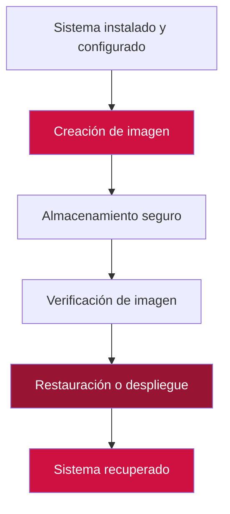
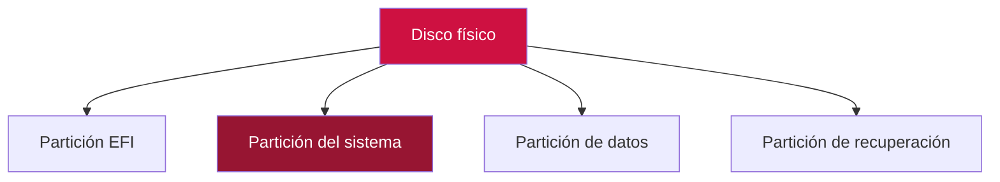
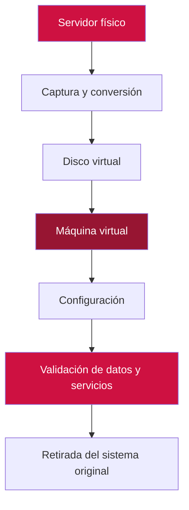
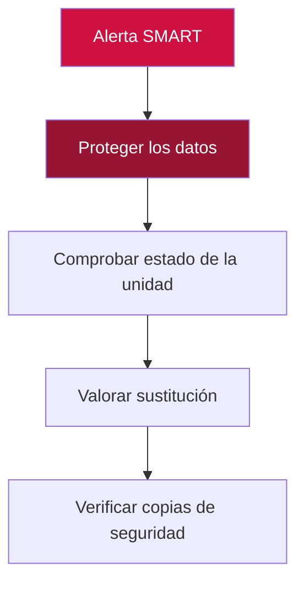
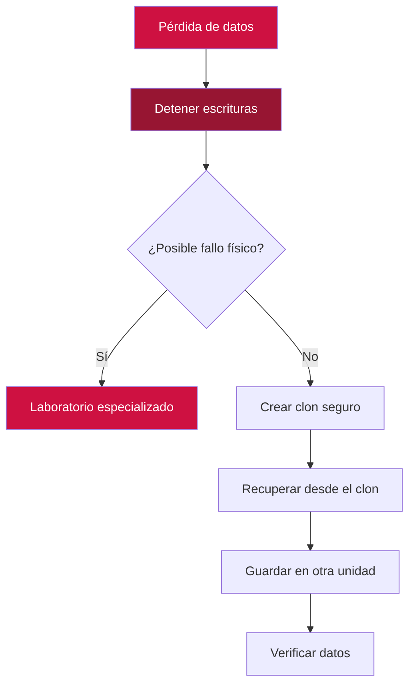
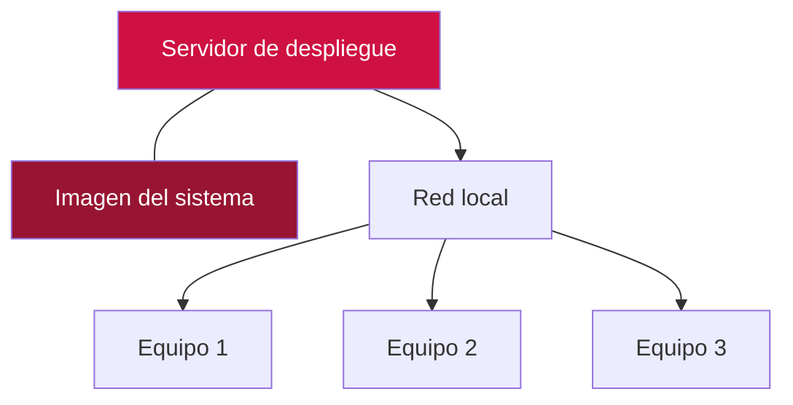
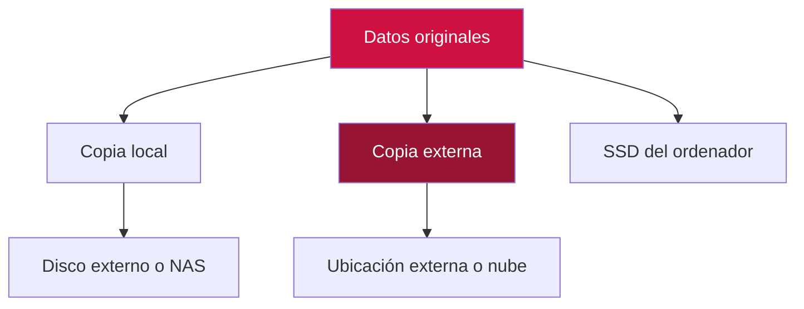

# Imágenes de respaldo de sistemas

`Fundamentos de Hardware | ASIR`

---

[← Volver al temario](../README.md)

## Índice

1. [Imágenes de respaldo](#1-imágenes-de-respaldo)
2. [Migración de sistemas](#2-migración-de-sistemas)
3. [Mantenimiento y benchmarking](#3-mantenimiento-y-benchmarking)
4. [Ampliación y actualización](#4-ampliación-y-actualización)
5. [Conceptos clave](#5-conceptos-clave)
6. [Preguntas de repaso](#6-preguntas-de-repaso)
7. [Práctica](#7-práctica)

---

## 1. Imágenes de respaldo

Referencia: PDF, páginas 4-8.

### 1.1. Imagen de sistema

Una imagen de sistema es una copia del contenido
de un disco o partición que permite recuperar
el sistema en un estado determinado.

Puede incluir:

- Sistema operativo.
- Aplicaciones instaladas.
- Configuración.
- Controladores.
- Particiones.
- Datos almacenados.

Su objetivo es permitir la restauración
del sistema sin tener que reinstalar
y configurar todos los programas desde cero.

### Imagen de sistema frente a copia de archivos

| Imagen de sistema | Copia de archivos |
|---|---|
| Captura el contenido de un disco o partición. | Copia archivos seleccionados. |
| Permite recuperar el entorno del sistema. | Permite recuperar documentos y archivos. |
| Puede incluir el sistema operativo. | Normalmente no incluye todo el sistema. |
| Facilita el despliegue de equipos. | Facilita la recuperación de información concreta. |

### Tipos de imágenes

| Tipo | Características |
|---|---|
| Imagen completa | Captura el contenido completo del disco. |
| Imagen base | Contiene el sistema y los programas preparados para desplegarse. |
| Sector a sector | Copia todos los sectores, incluidos los que no se utilizan. |
| Imagen inteligente | Copia los bloques utilizados en sistemas compatibles. |

### Imagen completa

Permite recuperar el sistema con sus datos
y configuración en el estado capturado.

### Imagen base

Contiene un sistema operativo preparado,
con sus aplicaciones y configuraciones.

Es especialmente útil cuando hay que instalar
varios ordenadores con características similares.

Ejemplos:

- Aulas de informática.
- Oficinas.
- Centros educativos.
- Puestos de trabajo empresariales.

### Copia sector a sector

Copia todos los sectores del dispositivo,
incluidos los espacios que no contienen
información utilizada por el sistema de archivos.

Puede ocupar más espacio y necesitar más tiempo.

### Imagen inteligente

Copia únicamente los bloques utilizados,
cuando el sistema de archivos es compatible.

Permite reducir el tamaño de la imagen
y el tiempo necesario para crearla.

### Proceso general

### Diferencia entre imagen y clonación

| Imagen | Clonación |
|---|---|
| Se guarda en uno o varios archivos de imagen. | Puede realizarse directamente de disco a disco. |
| Puede almacenarse para utilizarse posteriormente. | Replica el contenido en otro dispositivo. |
| Permite realizar restauraciones posteriores. | Facilita la sustitución o duplicación de unidades. |

---

### 1.2. Particionado de discos

Particionar consiste en dividir lógicamente
una unidad de almacenamiento en diferentes
secciones denominadas particiones.

Cada partición puede utilizarse para
una finalidad diferente.

### Usos del particionado

- Separar el sistema operativo de los datos.
- Instalar varios sistemas operativos.
- Crear particiones de recuperación.
- Organizar el almacenamiento.
- Facilitar la creación de imágenes.

### Tipos de particiones

| Partición | Función |
|---|---|
| Sistema | Contiene el sistema operativo. |
| Datos | Almacena archivos personales o empresariales. |
| EFI | Contiene elementos necesarios para el arranque UEFI. |
| Recuperación | Contiene herramientas de recuperación. |
| Swap | Espacio de intercambio utilizado en Linux. |

### Ejemplo de distribución

### MBR

Master Boot Record.

Es un esquema tradicional de particionado.

Características:

- Asociado habitualmente a la BIOS clásica.
- Admite hasta cuatro particiones primarias.
- Una partición primaria puede utilizarse
  como partición extendida.
- Limitación habitual de unos 2 TB
  con sectores lógicos de 512 bytes.

### GPT

GUID Partition Table.

Es un esquema moderno de particionado.

Características:

- Asociado habitualmente a UEFI.
- Admite discos de gran capacidad.
- Permite crear numerosas particiones.
- Mejora las posibilidades de organización.

### Comparativa MBR y GPT

| Característica | MBR | GPT |
|---|---|---|
| Tecnología | Tradicional | Moderna |
| Firmware asociado | BIOS clásica | UEFI |
| Capacidad habitual | Hasta unos 2 TB con sectores de 512 bytes | Admite discos de mayor capacidad |
| Particiones | Cuatro primarias | Numerosas particiones |
| Uso | Equipos antiguos | Equipos modernos |

> [!IMPORTANT]
> Separar el sistema operativo de los datos facilita
> determinadas restauraciones, pero no sustituye
> a una copia de seguridad independiente.
>
> Si falla físicamente el disco, pueden perderse
> todas sus particiones.

Para recuperar un sistema UEFI pueden ser necesarias
varias particiones, incluida la de arranque EFI.

---

### 1.3. Herramientas de creación de imágenes

| Herramienta | Características |
|---|---|
| Clonezilla | Software libre de clonación y restauración. |
| Copias de seguridad de Windows | Herramientas de respaldo según la versión del sistema. |
| dd | Herramienta de Linux para realizar copias de bloques. |
| Acronis | Solución comercial de respaldo y recuperación. |
| Macrium | Solución de creación y restauración de imágenes. |

### Clonezilla

Herramienta libre y gratuita utilizada
para crear, clonar y restaurar imágenes
de discos y particiones.

Permite:

- Crear imágenes de sistemas.
- Restaurar imágenes.
- Clonar discos.
- Clonar particiones.
- Desplegar sistemas mediante la red.
- Preparar varios equipos similares.

### Creación de una imagen con Clonezilla

1. Preparar un medio de arranque con Clonezilla.
2. Arrancar el ordenador desde ese medio.
3. Seleccionar la opción de creación de imagen.
4. Identificar el disco o partición de origen.
5. Seleccionar un destino con espacio suficiente.
6. Crear y almacenar la imagen.
7. Verificar su integridad.

### Restauración de una imagen

1. Arrancar desde Clonezilla.
2. Seleccionar la opción de restauración.
3. Identificar la imagen correspondiente.
4. Seleccionar el disco de destino.
5. Comprobar cuidadosamente origen y destino.
6. Ejecutar la restauración.
7. Verificar el arranque y los datos recuperados.

> [!WARNING]
> Restaurar una imagen puede sobrescribir
> completamente el disco de destino.
>
> Hay que comprobar siempre qué unidad
> se está utilizando antes de confirmar.

### Ejemplo práctico

Un aula dispone de 20 ordenadores similares.

En lugar de instalar y configurar
el sistema operativo en cada ordenador:

- Se prepara un equipo de referencia.
- Se instalan los programas necesarios.
- Se crea una imagen base.
- Se despliega la imagen en los demás equipos.
- Se comprueba la identidad y configuración
  de cada ordenador.

Esto permite reducir considerablemente
el tiempo de instalación.

---

## 2. Migración de sistemas

Referencia: PDF, páginas 8-10.

Migrar un sistema consiste en trasladarlo
desde un entorno informático a otro.

El objetivo es conservar los datos,
programas y configuraciones necesarios
sin tener que empezar desde cero.

### 2.1. Tipos de migración

| Tipo | Significado | Origen | Destino |
|---|---|---|---|
| P2P | Physical to Physical | Físico | Físico |
| P2V | Physical to Virtual | Físico | Virtual |
| V2P | Virtual to Physical | Virtual | Físico |
| V2V | Virtual to Virtual | Virtual | Virtual |

### P2P

Migración de un equipo físico
a otro equipo físico.

Ejemplo:

Trasladar el sistema de un ordenador antiguo
a un nuevo ordenador.

### P2V

Migración de un sistema físico
a una máquina virtual.

Ejemplo:

Convertir un servidor físico
en una máquina virtual alojada
en una infraestructura de virtualización.

Ventajas:

- Consolidación de servidores.
- Mejor aprovechamiento del hardware.
- Mayor facilidad de administración.
- Posibilidad de trasladar máquinas virtuales.
- Facilidad para realizar determinadas copias.

### V2P

Migración de una máquina virtual
a un equipo físico.

Puede utilizarse cuando una aplicación
necesita recursos físicos dedicados.

### V2V

Migración de una máquina virtual
a otra infraestructura virtualizada.

Ejemplo:

Trasladar una máquina virtual
entre diferentes plataformas de virtualización.

---

### 2.2. Proceso de migración P2V

La migración P2V permite convertir
un sistema físico en una máquina virtual.

### Herramientas

| Herramienta | Función |
|---|---|
| VMware vCenter Converter | Conversión de sistemas a entornos virtualizados compatibles. |
| Disk2vhd | Conversión de unidades físicas en archivos de disco virtual. |
| Herramientas del hipervisor | Importación y conversión según la plataforma. |

Hay que comprobar la compatibilidad
y disponibilidad de las herramientas
antes de utilizarlas.

### Fases de migración

1. Analizar el equipo físico.
2. Identificar los discos y servicios necesarios.
3. Crear una copia de seguridad.
4. Capturar y convertir los discos.
5. Crear la máquina virtual.
6. Configurar el hardware virtual.
7. Adaptar los controladores necesarios.
8. Comprobar el arranque.
9. Verificar los datos y servicios.
10. Retirar el sistema físico cuando corresponda.

### Consolidación de servidores

Consiste en trasladar diferentes sistemas
a una infraestructura física compartida
mediante virtualización.

Permite reducir:

- Cantidad de servidores físicos.
- Espacio ocupado.
- Consumo energético.
- Necesidades de mantenimiento.

### Snapshots

Capturas del estado de una máquina virtual
que permiten regresar a determinados estados.

> [!IMPORTANT]
> Un snapshot no equivale necesariamente
> a una copia de seguridad independiente.

Antes de retirar el sistema original
hay que comprobar que todos los servicios
y datos funcionan correctamente.

---

## 3. Mantenimiento y benchmarking

Referencia: PDF, páginas 10-14.

### 3.1. Tipos de mantenimiento

El mantenimiento informático busca
conservar los equipos en buen estado
y garantizar su funcionamiento.

### Mantenimiento preventivo

Se realiza antes de que aparezca una avería.

Su objetivo es reducir la probabilidad
de fallos y prolongar la vida útil
de los componentes.

Ejemplos:

- Limpieza del equipo.
- Comprobación de temperaturas.
- Revisión de ventiladores.
- Actualización de software.
- Revisión del estado de los discos.
- Comprobación de las copias de seguridad.
- Revisión del cableado.

### Mantenimiento correctivo

Se realiza después de producirse una avería.

Su objetivo es recuperar el funcionamiento
del equipo o servicio.

Ejemplos:

- Sustitución de un disco averiado.
- Cambio de una fuente de alimentación.
- Reparación de componentes.
- Reinstalación de software.
- Restauración de una imagen.
- Corrección de errores de configuración.

### Comparativa

| Característica | Preventivo | Correctivo |
|---|---|---|
| Cuándo se realiza | Antes de la avería | Después de la avería |
| Objetivo | Evitar problemas | Solucionar problemas |
| Planificación | Habitualmente programada | Según la incidencia |
| Ejemplo | Limpieza periódica | Sustitución de un ventilador averiado |

Un buen administrador combina ambos tipos
de mantenimiento.

---

### 3.2. Monitorización SMART

SMART significa:

Self-Monitoring, Analysis and Reporting Technology.

Es un sistema de monitorización y autodiagnóstico
incorporado en unidades de almacenamiento.

Permite consultar determinados parámetros
relacionados con el estado de los discos.

### Parámetros SMART

| Parámetro | Qué indica |
|---|---|
| Sectores reasignados | Sectores defectuosos sustituidos por otros de reserva. |
| Errores de lectura | Problemas durante el acceso a la información. |
| Horas de funcionamiento | Tiempo de utilización de la unidad. |
| Temperatura | Estado térmico del dispositivo. |
| Desgaste del SSD | Estimación de desgaste según la unidad. |

Los atributos y sus valores pueden variar
entre fabricantes y modelos.

### Herramientas de monitorización

| Herramienta | Función |
|---|---|
| CrystalDiskInfo | Consultar el estado SMART de las unidades. |
| smartctl | Consultar información SMART desde terminal. |

### Procedimiento ante una alerta SMART

Si una unidad muestra indicios de deterioro,
debe priorizarse la protección de los datos.

> [!WARNING]
> SMART puede ayudar a detectar problemas,
> pero no predice todos los fallos.
>
> Un disco con estado SMART correcto también
> puede averiarse inesperadamente.

---

### 3.3. Diagnóstico y benchmarking

### Diagnóstico

Consiste en realizar comprobaciones
para identificar errores, averías
o comportamientos anormales.

Ejemplos:

- Comprobar errores en la RAM.
- Revisar las temperaturas.
- Identificar problemas en el almacenamiento.
- Comprobar la estabilidad del sistema.
- Detectar fallos de alimentación.

### Benchmarking

Consiste en medir y comparar
el rendimiento de un sistema o componente
mediante pruebas específicas.

Permite:

- Comparar diferentes equipos.
- Evaluar componentes.
- Medir mejoras de rendimiento.
- Identificar posibles cuellos de botella.
- Comprobar si un componente rinde
  de acuerdo con lo esperado.

### Diferencias

| Diagnóstico | Benchmarking |
|---|---|
| Busca errores y averías. | Mide el rendimiento. |
| Identifica problemas. | Permite realizar comparaciones. |
| Se utiliza para solucionar incidencias. | Se utiliza para evaluar prestaciones. |

### Herramientas habituales

| Herramienta | Uso |
|---|---|
| CrystalDiskInfo | Estado y monitorización de discos. |
| CrystalDiskMark | Rendimiento del almacenamiento. |
| Cinebench | Rendimiento del procesador en las pruebas correspondientes. |
| 3DMark | Rendimiento gráfico. |
| MemTest | Detección de errores de memoria RAM. |
| smartctl | Monitorización SMART. |

### Ejemplo complementario de benchmarking

Comparamos dos unidades de almacenamiento.

| Unidad | Velocidad de lectura |
|---|---:|
| HDD | 100 MB/s |
| SSD | 500 MB/s |

Relación de rendimiento:

    500 / 100 = 5

Aumento porcentual:

    ((500 - 100) / 100) x 100 = 400 %

La velocidad de lectura medida
es cinco veces superior.

Esto no significa que todas las operaciones
del ordenador vayan a ser cinco veces más rápidas.

### Buenas prácticas

Para realizar comparaciones fiables:

- Utilizar la misma herramienta.
- Utilizar condiciones similares.
- Mantener configuraciones comparables.
- Comprobar las temperaturas.
- Considerar las aplicaciones en segundo plano.
- Documentar los resultados.

---

### 3.4. Recuperación de datos

La recuperación de datos busca rescatar
información perdida cuando no existe
una copia de seguridad disponible.

### Eliminación de archivos

En determinados sistemas de archivos,
al eliminar un archivo, su espacio
puede quedar marcado como disponible.

Mientras no se sobrescriba, existe
la posibilidad de recuperar parte
o toda la información.

### Recuperación en SSD

La recuperación puede resultar más complicada
debido a tecnologías como TRIM.

TRIM informa a la unidad de los bloques
que han dejado de utilizarse.

Esto puede reducir considerablemente
las posibilidades de recuperar archivos borrados.

### Procedimiento ante una pérdida de datos

1. Detener las escrituras en la unidad afectada.
2. Evitar instalar programas en esa unidad.
3. Identificar el tipo de problema.
4. Valorar si existe un fallo físico.
5. Crear una copia o clon seguro cuando sea apropiado.
6. Trabajar sobre la copia.
7. Guardar los archivos recuperados en otra unidad.
8. Verificar la información recuperada.

Las herramientas de recuperación pueden:

- Recuperar archivos eliminados.
- Buscar archivos mediante sus firmas.
- Reconstruir determinadas particiones.
- Recuperar información de sectores accesibles.
- Crear copias de unidades con errores.

### Fallos físicos

Si un disco presenta ruidos mecánicos anormales,
daños electrónicos o signos de avería grave,
no se deben realizar pruebas repetitivas
que puedan empeorar su estado.

Cuando los datos son importantes,
debe recurrirse a profesionales especializados.

> [!IMPORTANT]
> La recuperación de datos no está garantizada.
> La mejor protección es disponer de copias
> de seguridad verificadas.

---

## 4. Ampliación y actualización

Referencia: PDF, páginas 14-17.

### 4.1. PXE y despliegue mediante red

PXE significa Preboot Execution Environment.

Permite arrancar un ordenador mediante
una conexión de red.

Se utiliza para cargar entornos de instalación
o desplegar sistemas operativos e imágenes.

### Funcionamiento simplificado

Ventajas:

- Instalación de varios equipos.
- Administración centralizada.
- Reducción de tareas repetitivas.
- Menor necesidad de medios USB individuales.
- Despliegue de configuraciones homogéneas.

Aplicaciones habituales:

- Centros educativos.
- Oficinas.
- Centros de datos.
- Organizaciones con numerosos equipos.

### Plantillas e imágenes en la nube

En entornos virtualizados y cloud
pueden utilizarse imágenes maestras
para crear máquinas virtuales
con configuraciones preparadas.

Permiten:

- Despliegues rápidos.
- Configuraciones reproducibles.
- Automatización de instalaciones.
- Creación de nuevos entornos.

### Infraestructura como código

Permite definir y automatizar
determinadas configuraciones de infraestructura
mediante archivos de código.

Facilita realizar despliegues repetibles
y mantener un control de los cambios.

---

### 4.2. Ransomware y protección de copias

El ransomware es un tipo de malware
que puede cifrar, bloquear o secuestrar
datos y sistemas.

En determinados ataques también se intenta
eliminar o modificar las copias de seguridad.

Por este motivo, las copias deben protegerse
frente a accesos y modificaciones no autorizadas.

### Copias inmutables

Son copias protegidas frente a modificaciones
o eliminaciones durante un periodo determinado,
según los mecanismos y políticas configurados.

### WORM

Write Once, Read Many.

Escribir una vez y leer muchas veces.

Es un mecanismo que permite proteger
determinada información frente a modificaciones
posteriores durante su periodo de retención.

### Air gap

Consiste en mantener una copia aislada
de los sistemas principales o desconectada
de la red para reducir su exposición.

### Regla 3-2-1

Es una estrategia de copias de seguridad.

| Número | Significado |
|---|---|
| 3 | Tres copias de los datos, incluido el original. |
| 2 | Dos tipos de soportes o sistemas de almacenamiento. |
| 1 | Una copia fuera de la ubicación principal. |

### Ejemplo de estrategia 3-2-1

Las medidas de protección pueden combinar:

- Copias locales.
- Copias externas.
- Copias inmutables.
- Copias aisladas.
- Control de acceso.
- Verificación de integridad.
- Pruebas periódicas de restauración.

> [!IMPORTANT]
> Una copia de seguridad debe poder restaurarse.
> No basta con comprobar que existe un archivo
> de respaldo.

---

### 4.3. Cálculo complementario del tiempo de respaldo

El tiempo necesario para realizar una copia
depende del volumen de información
y de la velocidad efectiva de transferencia.

### Fórmula

    Tiempo (s) = Tamaño (MB) / Velocidad (MB/s)

### Ejemplo práctico

Debemos realizar una copia de 100 GB
a una velocidad efectiva de 100 MB/s.

Utilizando unidades decimales:

    100 GB = 100.000 MB

    Tiempo = 100.000 / 100

    Tiempo = 1.000 segundos

Resultado:

    16 minutos y 40 segundos

### Factores que afectan al tiempo real

- Velocidad del almacenamiento.
- Velocidad de la red.
- Cantidad y tamaño de los archivos.
- Compresión.
- Procesamiento del sistema.
- Verificación de la copia.
- Carga de trabajo simultánea.

El resultado de la fórmula es una estimación
ideal, no una duración garantizada.

---

## 5. Conceptos clave

| Concepto | Definición rápida |
|---|---|
| Imagen de sistema | Copia restaurable de un disco o partición. |
| Imagen base | Sistema preparado para su despliegue. |
| Clonación | Duplicación del contenido de una unidad. |
| Partición | División lógica de un disco. |
| MBR | Esquema tradicional de particionado. |
| GPT | Esquema moderno de particionado. |
| EFI | Partición utilizada para el arranque UEFI. |
| Clonezilla | Herramienta libre de imágenes y clonación. |
| P2P | Migración de físico a físico. |
| P2V | Migración de físico a virtual. |
| V2P | Migración de virtual a físico. |
| V2V | Migración de virtual a virtual. |
| Snapshot | Captura de un estado de una máquina virtual. |
| Mantenimiento preventivo | Actuación anterior al fallo. |
| Mantenimiento correctivo | Actuación posterior al fallo. |
| SMART | Monitorización de unidades de almacenamiento. |
| Diagnóstico | Identificación de fallos. |
| Benchmark | Prueba de rendimiento. |
| TRIM | Información al SSD sobre bloques no utilizados. |
| PXE | Arranque mediante red. |
| Ransomware | Malware que secuestra o bloquea información. |
| WORM | Escritura única y lectura múltiple. |
| Air gap | Aislamiento de una copia. |
| Regla 3-2-1 | Estrategia de copias de seguridad. |
| Inmutabilidad | Protección frente a modificaciones y eliminaciones. |

---

## 6. Preguntas de repaso

Intenta responder antes de desplegar la solución.

01. ¿Qué es una imagen de sistema?

Una copia del contenido de un disco o partición
que permite restaurarlo posteriormente.

02. ¿Qué diferencia hay entre una imagen de sistema y una copia de archivos?

La imagen puede incluir todo el entorno del sistema,
mientras que una copia de archivos protege
información seleccionada.

03. ¿Qué es una imagen base?

Un sistema operativo preparado y configurado
para desplegarlo en otros equipos.

04. ¿Qué diferencia una copia sector a sector de una inteligente?

La copia sector a sector incluye todos los sectores.
La inteligente copia los bloques utilizados
cuando el sistema de archivos lo permite.

05. ¿Qué significa particionar un disco?

Dividirlo lógicamente en diferentes secciones.

06. ¿Cuántas particiones primarias permite MBR?

Cuatro.

07. ¿Qué esquema de particionado se asocia habitualmente a UEFI?

GPT.

08. ¿Separar el sistema y los datos en particiones sustituye a un backup?

No. Un fallo físico puede afectar
a todas las particiones del disco.

09. ¿Qué es Clonezilla?

Una herramienta libre y gratuita
para crear, clonar y restaurar imágenes.

10. ¿Qué debemos comprobar antes de restaurar una imagen?

La imagen seleccionada, el disco de destino
y la existencia de copias de seguridad.

11. ¿Qué significa P2P?

Physical to Physical.
Migración de físico a físico.

12. ¿Qué significa P2V?

Physical to Virtual.
Migración de físico a virtual.

13. ¿Qué significa V2P?

Virtual to Physical.
Migración de virtual a físico.

14. ¿Qué significa V2V?

Virtual to Virtual.
Migración de virtual a virtual.

15. ¿Qué debemos comprobar antes de retirar un servidor físico migrado?

Que la máquina virtual arranca correctamente
y que funcionan sus servicios y datos.

16. ¿Qué diferencia el mantenimiento preventivo del correctivo?

El preventivo busca evitar averías.
El correctivo busca solucionar averías existentes.

17. ¿Qué significa SMART?

Self-Monitoring, Analysis and Reporting Technology.

18. ¿Qué parámetros permite consultar SMART?

Temperatura, horas de funcionamiento,
sectores reasignados, errores y desgaste,
según la unidad.

19. ¿Qué debemos hacer ante una alerta SMART?

Proteger los datos y valorar el estado
y la sustitución de la unidad.

20. ¿SMART puede predecir todos los fallos?

No. Una unidad puede fallar inesperadamente.

21. ¿Qué diferencia el diagnóstico del benchmarking?

El diagnóstico identifica fallos.
El benchmarking mide y compara rendimiento.

22. ¿Qué mide CrystalDiskMark?

El rendimiento del almacenamiento.

23. ¿Para qué se utiliza Cinebench?

Para evaluar el rendimiento del procesador
en las pruebas correspondientes.

24. ¿Qué herramienta permite detectar errores de RAM?

MemTest.

25. ¿Qué debemos hacer primero ante una pérdida de datos?

Evitar nuevas escrituras en el dispositivo afectado.

26. ¿Por qué se recomienda trabajar sobre un clon?

Para evitar modificar el dispositivo original
y empeorar la pérdida de información.

27. ¿Cómo afecta TRIM a la recuperación de datos?

Puede reducir considerablemente las posibilidades
de recuperar archivos eliminados de un SSD.

28. ¿Qué significa PXE?

Preboot Execution Environment.
Permite arrancar equipos mediante la red.

29. ¿Qué significa WORM?

Write Once, Read Many.
Escribir una vez y leer muchas veces.

30. ¿Qué establece la regla 3-2-1?

Tres copias de los datos, dos tipos de soportes
o sistemas de almacenamiento y una copia
fuera de la ubicación principal.

31. ¿Qué es air gap?

Mantener una copia aislada de la red
o desconectada de los sistemas principales.

32. ¿Cuánto tarda idealmente una copia de 100 GB a 100 MB/s?

1.000 segundos.

16 minutos y 40 segundos.

---

## 7. Práctica

### Creación de imágenes

- [ ] Preparar una máquina virtual de prueba.
- [ ] Identificar las particiones del sistema.
- [ ] Preparar Clonezilla.
- [ ] Crear una imagen del sistema.
- [ ] Guardar la imagen en otro dispositivo.
- [ ] Verificar su integridad.
- [ ] Restaurarla en un destino de prueba.
- [ ] Comprobar el arranque.

### Migración de sistemas

- [ ] Diferenciar P2P, P2V, V2P y V2V.
- [ ] Planificar una migración P2V.
- [ ] Identificar discos y servicios.
- [ ] Comprobar la configuración virtual.
- [ ] Elaborar un procedimiento de validación.

### Mantenimiento

- [ ] Elaborar un plan de mantenimiento preventivo.
- [ ] Consultar temperaturas.
- [ ] Comprobar el estado SMART de los discos.
- [ ] Identificar posibles señales de deterioro.
- [ ] Planificar actuaciones correctivas.

### Benchmarking

- [ ] Medir el rendimiento del almacenamiento.
- [ ] Identificar las características del procesador.
- [ ] Comparar resultados en condiciones similares.
- [ ] Documentar las diferencias.

### Copias de seguridad

- [ ] Diseñar una estrategia 3-2-1.
- [ ] Planificar una copia externa.
- [ ] Identificar opciones de almacenamiento inmutable.
- [ ] Planificar una copia aislada.
- [ ] Realizar una prueba de restauración.
- [ ] Estimar el tiempo necesario para realizar una copia.

Entregable: evidencia de una imagen de sistema,
análisis SMART y comparación de resultados
de benchmarking.

Realizar las operaciones de restauración
y particionado utilizando entornos de prueba
sin información importante.

---

## Resumen final

Las imágenes de sistema permiten recuperar
y desplegar equipos sin reinstalar todo desde cero.

Clonezilla es una herramienta libre
para crear y restaurar imágenes.

MBR y GPT permiten organizar las particiones.

P2P, P2V, V2P y V2V representan diferentes
tipos de migración de sistemas.

El mantenimiento preventivo reduce
la probabilidad de averías.

El mantenimiento correctivo recupera
el funcionamiento después de un fallo.

SMART permite monitorizar determinados
indicadores de salud de los discos.

El benchmarking permite medir
y comparar el rendimiento.

Ante una pérdida de datos es fundamental
evitar nuevas escrituras en el dispositivo.

PXE facilita el despliegue mediante red.

Las copias inmutables, el aislamiento
y la regla 3-2-1 mejoran las posibilidades
de recuperación ante incidentes.

---

Fuente: Fundamentos de Hardware, Unidad 9.
Prometeo - thePower. Apuntes personales.

Los ejemplos numéricos y determinados matices
técnicos son ampliaciones complementarias
para facilitar el aprendizaje.

---

`UNIDAD 09 | FUNDAMENTOS DE HARDWARE`

[Volver al temario](../README.md)

